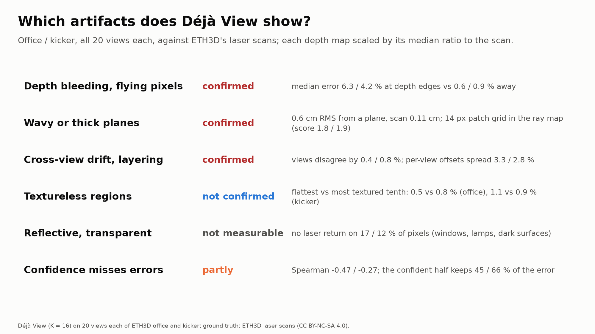
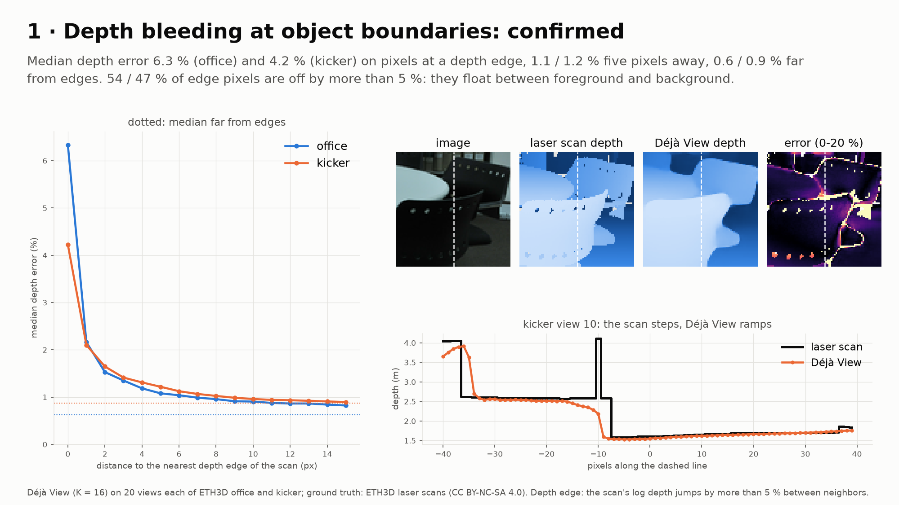
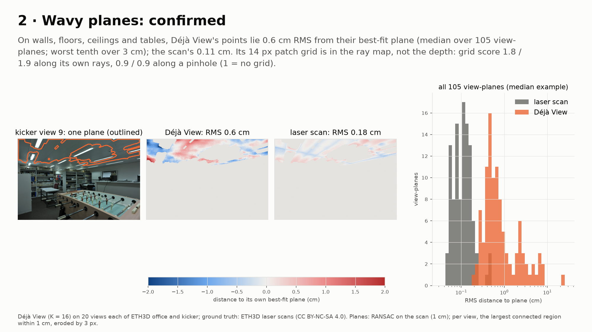
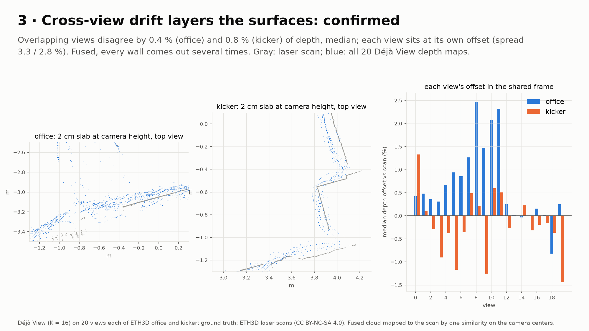
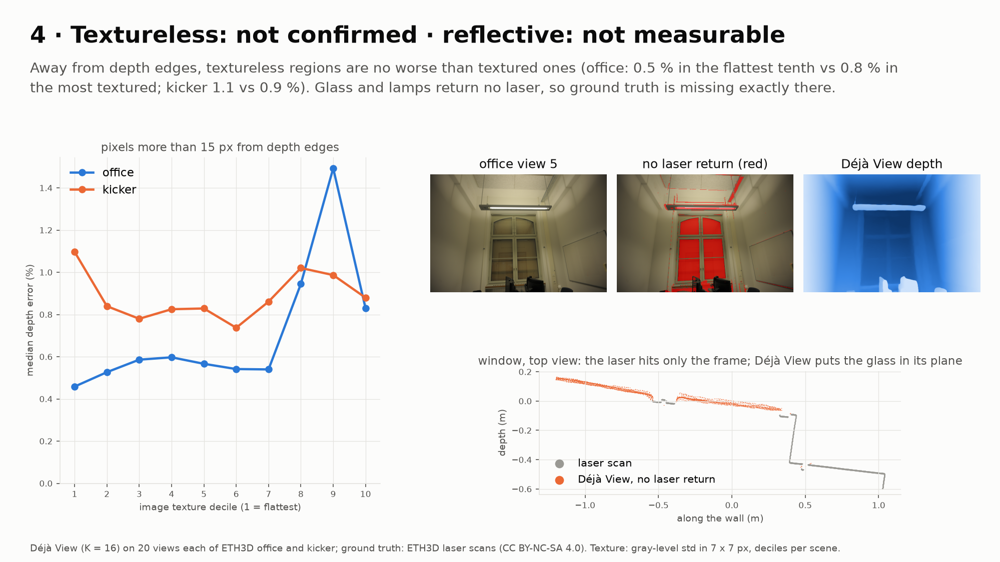
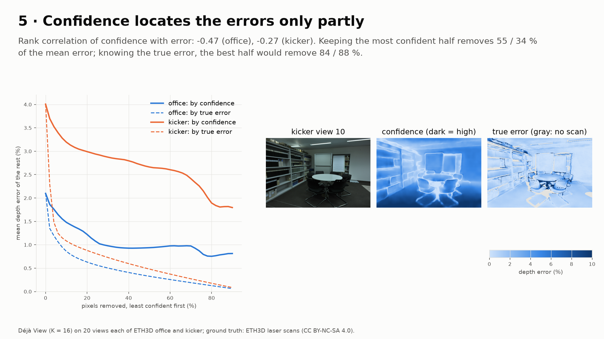

# artifacts_eth3d-20261027-170035

git `fab013a7f948a4f093a11cd39974e63dfcf5a5a6`

Does Déjà View (K = 16) show the artifacts our proposal (§1, §4) names? All 20 views each of ETH3D office and
kicker, against the laser scans. Each depth map is scaled by its median ratio to the scan's depth and compared per
pixel as log(s D / D_gt); layering uses the fused cloud of all views, mapped to the scan by one similarity on the
camera centers. Thresholds were fixed in `configs/artifacts_eth3d.yaml` before looking at the outcome; the close-ups
are chosen by rule (the median view-plane, the crop with the most strong depth edges, office view 5's window).
Images and laser scans: ETH3D (Schöps et al., CVPR 2017), CC BY-NC-SA 4.0; the slides that show them are adapted
from it under the same licence. The data itself is not in this repository.

| artifact | office | kicker | verdict |
|---|---|---|---|
| bleeding: median error at a depth edge / 5 px away / far | 6.3 / 1.1 / 0.6 % | 4.2 / 1.2 / 0.9 % | confirmed |
| bleeding: edge pixels off by > 5 % (far from edges) | 54 % (7 %) | 47 % (1 %) | confirmed |
| planes: RMS to own best-fit plane, Déjà View / scan (median) | 0.57 / 0.07 cm | 0.82 / 0.14 cm | confirmed |
| planes: worst tenth of view-planes, Déjà View | > 1.4 cm | > 5.1 cm | |
| 14 px patch grid: score along predicted rays / pinhole / scan | 1.8 / 0.9 / 0.9 | 1.9 / 0.9 / 0.9 | in the ray map only |
| layering: median disagreement of overlapping views | 0.44 % | 0.81 % | confirmed |
| layering: spread of per-view offsets in the shared frame | 3.3 % | 2.8 % | confirmed |
| textureless: error in flattest / most textured tenth, away from edges | 0.46 / 0.83 % | 1.10 / 0.88 % | not confirmed |
| reflective / transparent: pixels without laser return | 17 % | 12 % | not measurable |
| confidence: Spearman with error | -0.47 | -0.27 | partly |
| confidence: mean error kept by the confident half / the oracle half | 45 / 16 % | 66 / 12 % | partly |

## findings

- **Depth bleeding is the largest per-pixel error.** On the pixel at a depth edge the median error is 5-10x the
  error away from edges, and about half of all edge pixels are off by more than 5 %: Déjà View ramps across an
  occlusion over 2-5 px where the scan steps (`1_bleeding`), so those points float in free space between foreground
  and background. Thin structures (a chair back, 3 px wide) can vanish into the ramp altogether.
- **Planes are wavy, at the centimeter scale.** Déjà View's points on one wall or floor lie 0.6-0.8 cm RMS from
  their own best-fit plane (median), 5-8x the scan's; the worst tenth exceeds 1.4 cm (office) and 5 cm (kicker).
  The waves are low-frequency, tens of pixels across (`2_planes`). The 14 px patch grid seen on ScanNet++ is in the
  predicted ray map, not in the depth: lifted along a fitted pinhole the grid score is 0.9, like the scan's.
- **Cross-view drift is real and layers every surface.** Overlapping views disagree by 0.4-0.8 % of depth (about
  1-2 cm at 2.5 m) and each view sits at its own offset, spread over ~3 % (`3_layering`); in the fused cloud a wall
  comes out as several parallel copies. Office's ceiling views (8-11) sit 1.5-2.5 % too far.
- **Textureless regions are not where it fails.** Away from depth edges, the flattest tenth of image patches has
  no higher error than the most textured (office: lower). Textureless areas here are mostly walls, which are easy
  geometry; the textured tenth holds clutter. The claim may still hold for textureless surfaces that are not planar.
- **Reflective and transparent surfaces cannot be tested with a laser scan.** Glass and lamps return no laser, so
  ground truth is missing exactly there (with dark surfaces: 17 % / 12 % of pixels). Office's window shows what
  Déjà View does: it puts the glass in the plane of the frame the laser did hit (`4_surfaces`), which is plausible,
  but unverifiable here. Testing this needs a dataset with depth on glass (synthetic, e.g. Hypersim).
- **Confidence carries signal but misses most of the error.** Confidence and error rank-correlate at -0.47 / -0.27;
  keeping the most confident half still keeps 45 % / 66 % of the mean error, where the true best half keeps 12-16 %
  (`5_confidence`). Low confidence marks the edges; it misses offsets that cover a whole surface, such as drift.
- For the refinement this ranks the targets: bleeding (boundary-aware smoothing, segment cuts) and drift (E_mv)
  first, plane waviness (planarity on structural classes) next; confidence alone cannot gate the data term, which
  supports the consistency-gated weight u_i(p) of the proposal.
- Limits: two indoor scenes, one backbone setting (K = 16, 20 views at 504 x 336), errors after a per-view median
  scale; the scan's own z-buffer can show background through gaps at edges, which counts against every pixel the
  same way.

Slides (16:9, also as `slides.pdf`):

