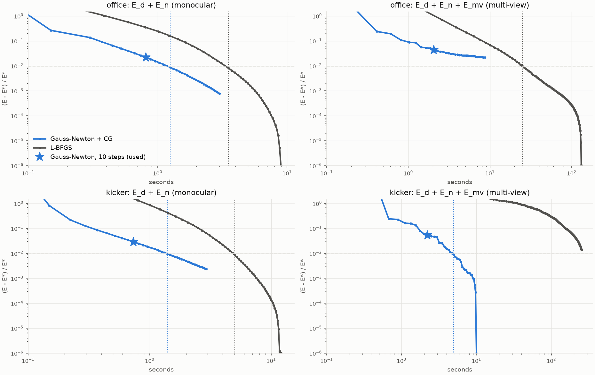

# benchmark_solvers-20261029-143531

git `08c703bd4f301034cf0b56c82b053b9b136d6696-dirty`

Images and laser scans: ETH3D (Schöps et al., CVPR 2017), CC BY-NC-SA 4.0; the figure is derived from it under the same licence. The data itself is not in this repository.

Both solvers minimize the same energy on the same problem from δ = 0 (see `benchmark.py`). Iterations: Gauss-Newton steps / CG iterations (one J^T J product each); L-BFGS iterations / energy-and-gradient evaluations. Converged: E within 1 % of E*, the lowest energy either solver reached. Accuracy: fused cloud of all 20 views, distance of each sampled pixel's point to its nearest scan point.

| scene | setup | solver | iterations to converge | seconds to converge | seconds run | final E / E* | mean dist (cm) | median (cm) | ≤ 1 cm | thickness (mm) |
|---|---|---|---|---|---|---|---|---|---|---|
| office | E_d + E_n (monocular) | Gauss-Newton + CG | 16 steps / 320 CG | 1.25 | 3.01 | 1.0008 | 3.769 | 1.676 | 30.4% | 3.55 |
| office | E_d + E_n (monocular) | L-BFGS | 340 it / 364 evals | 3.53 | 9.00 | 1.0000 | 3.790 | 1.678 | 30.5% | 3.53 |
| office | E_d + E_n (monocular) | Gauss-Newton + CG, 10 steps (used) | | | 0.81 | 1.0219 | 3.715 | 1.664 | 30.4% | 3.57 |
| office | E_d + E_n (monocular) | L-BFGS, same wall time | | | 1.01 | 1.2412 | 3.612 | 1.611 | 32.6% | 3.63 |
| office | E_d + E_n + E_mv (multi-view) | Gauss-Newton + CG | - steps / - CG | - | 8.66 | 1.0220 | 3.530 | 1.611 | 29.5% | 1.65 |
| office | E_d + E_n + E_mv (multi-view) | L-BFGS | 400 it / 423 evals | 25.00 | 132.52 | 1.0000 | 3.510 | 1.601 | 29.6% | 1.64 |
| office | E_d + E_n + E_mv (multi-view) | Gauss-Newton + CG, 10 steps (used) | | | 2.06 | 1.0431 | 3.535 | 1.597 | 30.6% | 1.65 |
| office | E_d + E_n + E_mv (multi-view) | L-BFGS, same wall time | | | 2.60 | 1.6992 | 3.488 | 1.470 | 34.5% | 3.32 |
| kicker | E_d + E_n (monocular) | Gauss-Newton + CG | 19 steps / 380 CG | 1.40 | 2.94 | 1.0024 | 3.208 | 1.821 | 32.1% | 4.64 |
| kicker | E_d + E_n (monocular) | L-BFGS | 480 it / 519 evals | 5.02 | 12.09 | 1.0000 | 3.277 | 1.830 | 31.9% | 4.62 |
| kicker | E_d + E_n (monocular) | Gauss-Newton + CG, 10 steps (used) | | | 0.74 | 1.0290 | 2.984 | 1.783 | 32.4% | 4.67 |
| kicker | E_d + E_n (monocular) | L-BFGS, same wall time | | | 0.80 | 2.3275 | 2.704 | 1.653 | 34.3% | 4.63 |
| kicker | E_d + E_n + E_mv (multi-view) | Gauss-Newton + CG | 21 steps / 420 CG | 4.96 | 10.00 | 1.0000 | 2.801 | 1.637 | 35.1% | 2.71 |
| kicker | E_d + E_n + E_mv (multi-view) | L-BFGS | - it / - evals | - | 253.79 | 1.0135 | 2.660 | 1.551 | 36.4% | 2.88 |
| kicker | E_d + E_n + E_mv (multi-view) | Gauss-Newton + CG, 10 steps (used) | | | 2.22 | 1.0537 | 2.677 | 1.587 | 36.0% | 2.72 |
| kicker | E_d + E_n + E_mv (multi-view) | L-BFGS, same wall time | | | 3.05 | 5.7251 | 2.487 | 1.548 | 35.8% | 4.53 |

## convergence

