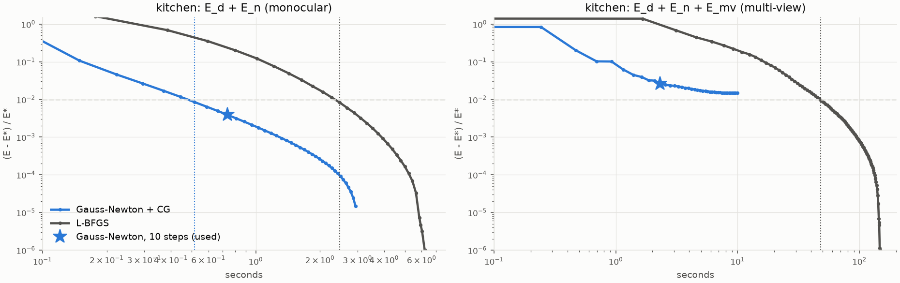

# benchmark_solvers_scannetpp-20261029-163353

git `08c703bd4f301034cf0b56c82b053b9b136d6696-dirty`

Images and laser scans: ScanNet++ (Yeshwanth et al., ICCV 2023), used under its terms of use. The data itself is not in this repository.

Both solvers minimize the same energy on the same problem from δ = 0 (see `benchmark.py`). Iterations: Gauss-Newton steps / CG iterations (one J^T J product each); L-BFGS iterations / energy-and-gradient evaluations. Converged: E within 1 % of E*, the lowest energy either solver reached. Accuracy: fused cloud of all 20 views, distance of each sampled pixel's point to its nearest scan point.

| scene | setup | solver | iterations to converge | seconds to converge | seconds run | final E / E* | mean dist (cm) | median (cm) | ≤ 1 cm | thickness (mm) |
|---|---|---|---|---|---|---|---|---|---|---|
| kitchen | E_d + E_n (monocular) | Gauss-Newton + CG | 7 steps / 140 CG | 0.52 | 2.94 | 1.0000 | 1.433 | 1.155 | 44.1% | 3.52 |
| kitchen | E_d + E_n (monocular) | L-BFGS | 240 it / 257 evals | 2.48 | 6.23 | 1.0000 | 1.433 | 1.154 | 44.1% | 3.52 |
| kitchen | E_d + E_n (monocular) | Gauss-Newton + CG, 10 steps (used) | | | 0.74 | 1.0039 | 1.423 | 1.150 | 44.2% | 3.53 |
| kitchen | E_d + E_n (monocular) | L-BFGS, same wall time | | | 0.80 | 1.2011 | 1.385 | 1.121 | 45.2% | 3.46 |
| kitchen | E_d + E_n + E_mv (multi-view) | Gauss-Newton + CG | - steps / - CG | - | 9.92 | 1.0148 | 1.269 | 1.012 | 49.5% | 1.26 |
| kitchen | E_d + E_n + E_mv (multi-view) | L-BFGS | 619 it / 698 evals | 48.21 | 147.63 | 1.0000 | 1.270 | 1.012 | 49.5% | 1.27 |
| kitchen | E_d + E_n + E_mv (multi-view) | Gauss-Newton + CG, 10 steps (used) | | | 2.31 | 1.0264 | 1.264 | 1.008 | 49.7% | 1.27 |
| kitchen | E_d + E_n + E_mv (multi-view) | L-BFGS, same wall time | | | 3.12 | 1.6848 | 1.273 | 1.051 | 47.9% | 2.68 |

## convergence

