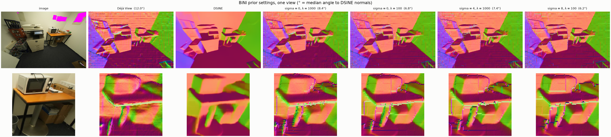
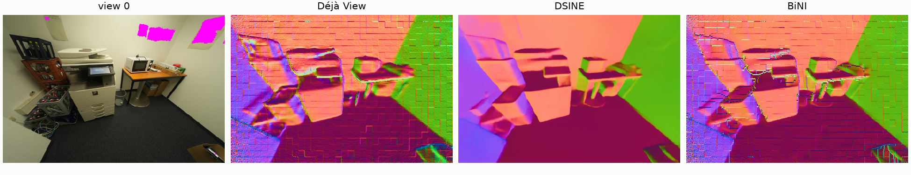
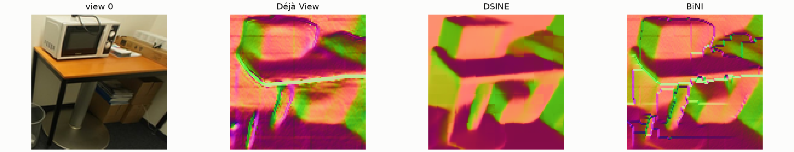

# bini_blur_kitchen-20261026-151901

git `45ec80bfe588c09b0441fa6f925dc71e8475eb51`

| metric | value |
|---|---|
| views | 1 |
| normals_seconds | 0.1307 |
| refine_seconds | 6.957 |
| scale_to_m | 1.048 |
| camera_ate_m | 0.007364 |
| mean_point_shift_mm | 8.86 |
| angle_to_normals_deg_input | 11.99 |
| angle_to_normals_deg_refined | 7.357 |

## Findings (looked at every figure)

- Single view (kitchen view 13), ~7 s per setting. Every setting pulls the normals toward
  DSINE's (see the angles in compare.png), and walls take DSINE's orientation.
- The 14 px patch grid survives every setting, blurred prior included. BiNI starts from Déjà View's depth, whose
  patch seams are small depth steps; its discontinuity weights read them as edges and keep the surface broken
  there. No prior setting can remove that: the weights would have to start from DSINE's normals instead.
- Staircase artifacts at occlusion edges (monitors, table legs) appear in every setting and get slightly worse
  with sigma > 0, where Déjà View and DSINE disagree on where the edge is.
- Blurring the prior buys no visible detail over plain BiNI with a lower lambda (sigma = 0, lambda = 100), matching the
  office trade-off (figures/bini_blur_prior_tradeoff_office).
- The 20-view kitchen run at sigma = 4, lambda = 1000 (runs/bini_blur_kitchen-20261026-151558, finished before the
  stop) shows the same trade-off: angle to DSINE 12.1° → 7.9°, cross-view median 1.046% → 1.053% (slightly worse).

## compare

One view under several BiNI prior settings (sigma = blur of the depth prior in px, λ = its weight); bottom row zoomed where DSINE has the most detail. In brackets: median angle to DSINE's normals.

## normal_sources

Normals per view: Déjà View's depth, DSINE's prediction (rotated into the same frame), and the depth after BiNI integrates DSINE's normals against Déjà View's depth.

## detail_crops

The same three, zoomed where DSINE's normals carry the most detail.

