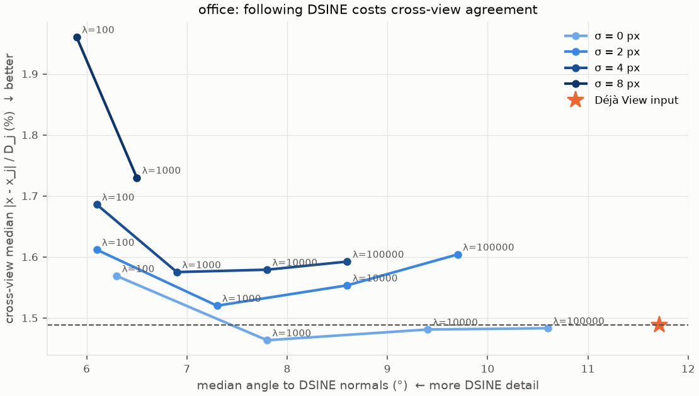

# bini_blur_prior_tradeoff_office

BiNI with DSINE normals on office (7b6477cb95), 20 views, varying the depth prior's blur σ and weight λ (k = 2).
Probe stopped after σ = 8, λ = 1000 (runtime); σ = 16 not run. Git `6cf285a` (CG stop fix included).

| σ (px) | λ | cross-view median | within 1% | angle to DSINE (°) |
|---|---|---|---|---|
| input | – | 1.489% | 0.392 | 11.7 |
| 0 | 100 | 1.569% | 0.375 | 6.3 |
| 0 | 1000 | 1.464% | 0.398 | 7.8 |
| 0 | 10000 | 1.481% | 0.395 | 9.4 |
| 0 | 100000 | 1.483% | 0.393 | 10.6 |
| 2 | 100 | 1.612% | 0.376 | 6.1 |
| 2 | 1000 | 1.520% | 0.395 | 7.3 |
| 2 | 10000 | 1.554% | 0.389 | 8.6 |
| 2 | 100000 | 1.604% | 0.383 | 9.7 |
| 4 | 100 | 1.686% | 0.367 | 6.1 |
| 4 | 1000 | 1.575% | 0.390 | 6.9 |
| 4 | 10000 | 1.579% | 0.389 | 7.8 |
| 4 | 100000 | 1.592% | 0.385 | 8.6 |
| 8 | 100 | 1.960% | 0.348 | 5.9 |
| 8 | 1000 | 1.730% | 0.377 | 6.5 |

## Findings

- Blurring the prior lets the result follow DSINE more closely (angle 11.7° → 5.9° at σ = 8, λ = 100), but
  it's a worse trade than plain BiNI: at every level of DSINE agreement, the σ = 0 curve has the lowest
  cross-view error. Lowering λ is a cheaper way to follow DSINE than blurring.
- Every step toward DSINE costs cross-view agreement; only σ = 0, λ = 1e3 beats the input (1.464% vs 1.489%).
- Every setting hit the 150-iteration cap, so these are not fully converged.
- Without GT depth we can't tell whether DSINE's detail is real geometry that the views simply disagree on at this
  resolution, or detail DSINE invents. A GT mesh (ScanNet++ token) would settle it.
