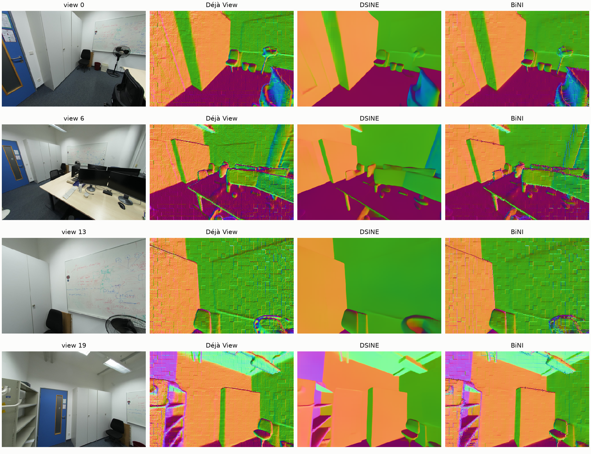
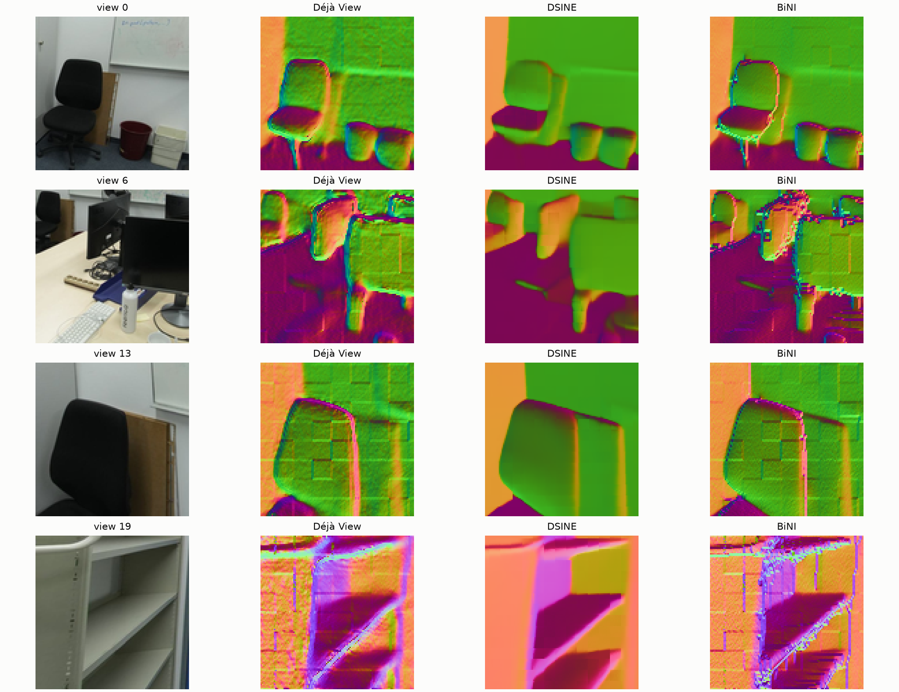
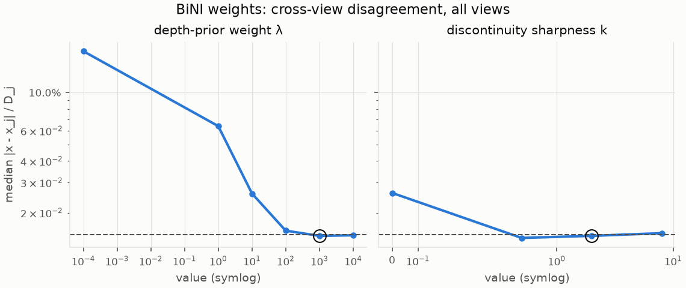
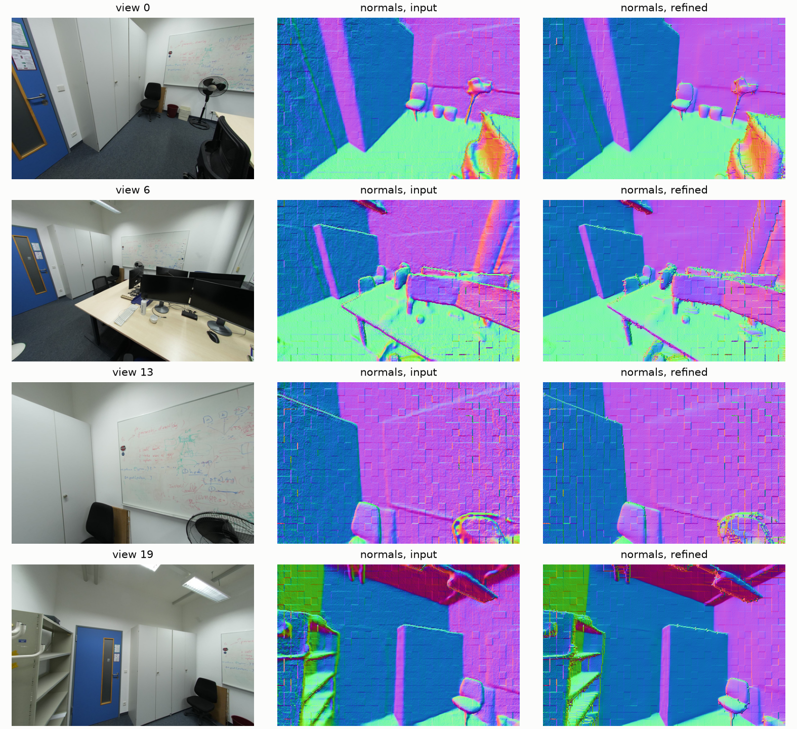
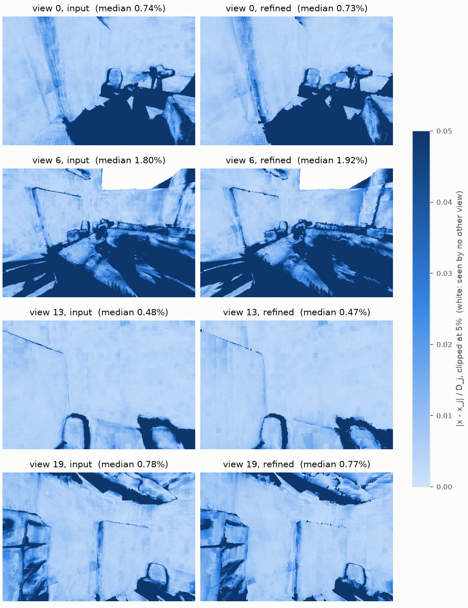
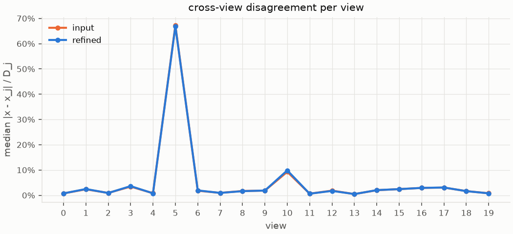

# bini_dsine_office-20261026-141343

git `24a5f76963becc2042b188e3e4e397a197231b03`

| metric | value |
|---|---|
| views | 20 |
| normals_seconds | 0.1422 |
| refine_seconds | 13.52 |
| scale_to_m | 1.76 |
| camera_ate_m | 0.008577 |
| mean_point_shift_mm | 9.109 |
| mv_median_input | 0.01489 |
| mv_median_refined | 0.01467 |
| mv_inlier_1pct_input | 0.3915 |
| mv_inlier_1pct_refined | 0.3977 |

## Findings (looked at every figure)

- DSINE (hugoycj/DSINE-hub, given Déjà View's intrinsics) gives clean normals: no 14 px patch grid, crisp
  object edges. Its normals sit a median 11.7° from Déjà View's (office); a per-view rotation explains only
  2-6° of that, so the disagreement is local.
- BiNI's default depth weight (λ = 1e-4) lets integration drift: cross-view median 17% (office), 0.4 m
  mean point shift. The surface only stays near the input from λ ≈ 100 up (bini_sweep).
- At λ = 1000 (picked on these two scenes, so optimistic) cross-view agreement improves slightly:
  median 1.489% → 1.467%, within 1% 39.2% → 39.8%, mean point shift 9.1 mm.
- But the detail doesn't transfer. At that λ the BiNI normals look like Déjà View's: the patch grid stays,
  DSINE's smooth surfaces don't come through, and occlusion edges get staircase artifacts where the two
  disagree on where the edge is (detail_crops). A uniform depth prior can't take high frequencies from the
  normals and low frequencies from the depth at once: weak anchors drift, strong anchors ignore the normals.
- Next: anchor only the low frequencies (prior on blurred log depth), so the normals set the detail.

## normal_sources

Normals per view: Déjà View's depth, DSINE's prediction (rotated into the same frame), and the depth after BiNI integrates DSINE's normals against Déjà View's depth.

## detail_crops

The same three, zoomed where DSINE's normals carry the most detail.

## bini_sweep

Cross-view disagreement over all views versus the depth-prior weight λ and the discontinuity sharpness k, one at a time (circle: this run). Dashed: Déjà View input.

## normals

Surface normals from the point maps (world frame as RGB): noise and edges show here first.

## multiview_maps

Cross-view disagreement per pixel: median over the other views of |x - x_j| / D_j under the frozen predicted cameras. A GT-free proxy; occlusions put a floor under it.

## multiview_per_view

Median cross-view disagreement per view, before and after.

