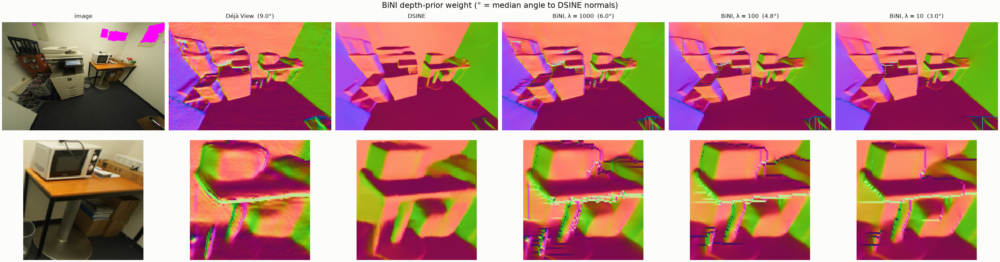
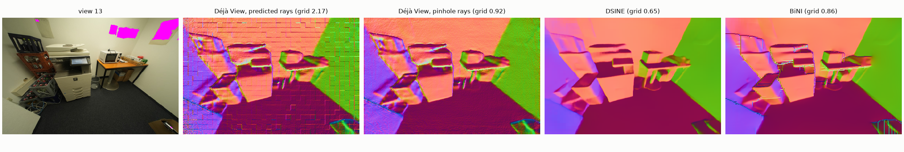
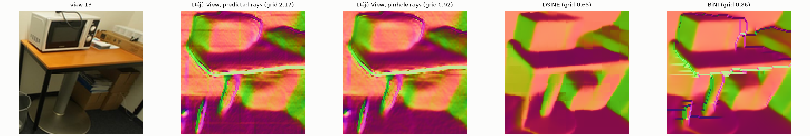

# bini_kitchen-20261026-213400

git `e874cf6741e6ffcbb5cad3087c50bd1ad7085c09`

| metric | value |
|---|---|
| normals_seconds | 0.1102 |
| refine_seconds | 2.592 |
| grid_score_dsine | 0.6532 |
| angle_to_normals_deg_input | 9.003 |
| angle_to_normals_deg_refined | 4.83 |
| grid_score_input | 0.9162 |
| grid_score_refined | 0.8567 |
| drift_pct_input | 0 |
| drift_pct_refined | 0.1762 |

## Findings (looked at every figure)

- The 14 px patch grid comes from Déjà View's ray map, not its depth. Lifting its depth through its predicted rays
  scores 2.17; through a pinhole fit of the same camera, 0.92 (no grid). The rays deviate from that pinhole by
  0.6-0.9 px (median) in patch-sized steps. `rays: pinhole` keeps the camera's center, rotation and focal length.
- BiNI now starts its discontinuity weights at 0.5, as the reference does; taking them from Déjà View's depth had
  kept its seams. With both fixes the result follows DSINE's normals (angle 9.0° → 4.8°) with no grid
  (0.86), its blurred depth stays within 0.18% of Déjà View's, and it converges in about 2.5 s.
- Walls, table tops and the monitor backs take DSINE's smooth surfaces.
- What remains sits on occlusion edges: 1-2 px staircases and short horizontal streaks (monitor outlines, table
  edge, shelf), where Déjà View's depth jump and DSINE's normal edge don't line up and the discontinuity weights
  flip. Every λ shows them; λ = 10 adds a few long streaks.
- λ = 100 was chosen on these two views (sweep of λ 10-1000 and a blurred prior with sigma 0-8, which added
  nothing and diverged at λ = 10). No GT depth, so detail is judged against DSINE, not against the scene.

## compare

The view under several depth-prior weights λ (lower lets DSINE's normals set more of the shape); bottom row zoomed where DSINE has the most detail. In brackets: median angle to DSINE's normals.

## normal_sources

Normals of the view: Déjà View's depth lifted through its predicted rays and through a pinhole fit of them, DSINE's prediction (rotated into the same frame), and the depth after BiNI integrates DSINE's normals against Déjà View's depth. Grid: patch-grid score, about 1 without a 14 px grid.

## detail_crops

The same panels, zoomed where DSINE's normals carry the most detail.

