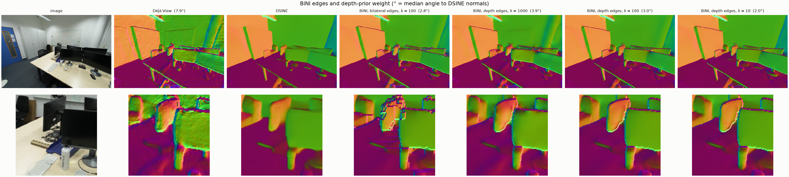
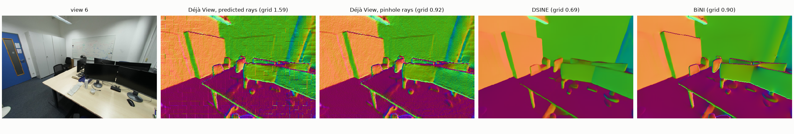
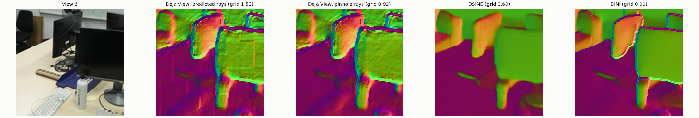

# bini_office-20261027-065548

git `1c5e3e32dd9d0c3d0de11bcd44adcfaf337e9570`

| metric | value |
|---|---|
| normals_seconds | 0.1083 |
| refine_seconds | 0.2494 |
| grid_score_dsine | 0.6893 |
| angle_to_normals_deg_input | 7.948 |
| angle_to_normals_deg_refined | 2.951 |
| grid_score_input | 0.9211 |
| grid_score_refined | 0.9 |
| drift_pct_input | 0 |
| drift_pct_refined | 0.1582 |

## Findings (looked at every figure)

- The 14 px patch grid comes from Déjà View's ray map, not its depth: lifted through its predicted rays it scores
  1.59, through a pinhole fit of the same camera 0.92. Runs use `rays: pinhole`.
- BiNI's own bilateral weights left staircases and streaks on occlusion edges: Déjà View draws them as 2-4 px
  ramps, DSINE's normals carry no edge there, and the weights put the jump on a different pixel of the ramp in
  every row. Cutting on the prior's occlusion contours (`edges: depth`: a closed level set of the local
  mid-depth, where the step disagrees with the normals by > 2%) leaves one clean contour per edge
  (compare.png). On a synthetic slanted edge: 0 jumps off the true edge instead of 30.
- That level set holds two layers. Where three meet (a monitor in front of another in front of the wall), the
  middle one changes side, its contour stops short, and depth leaks around the open end as a dark swirl in the
  normals. Each open end is now extended along the prior's edge to the nearest other contour, at most 7 px
  away. On a synthetic T: 5 pixels > 5% off GT instead of 138, all on the true edge.
- Open contour ends: 168 → 58. Pixels > 30° off DSINE away from the cuts: 4456 → 1310; the swirls on the
  monitor tops and the whiteboard edge are gone (normal_sources.png).
- Result: angle to DSINE 7.9° → 3.0° (3.5° before closing; bilateral: 2.8°, which also glues surfaces across
  edges), no grid (0.90), blurred depth within 0.16% of Déjà View's, 0.25 s per view.
- Left: a 1 px outline on every edge (central-difference normals straddle any real jump).
- λ = 100 and edge_tol = 0.02 were chosen on these two views; λ = 10 drifts by about 1%. No GT depth, so
  detail is judged against DSINE, not against the scene.

## compare

BiNI's own bilateral edges, then cuts on the prior's occlusion contours under several depth-prior weights λ (lower lets DSINE's normals set more of the shape); bottom row zoomed where DSINE has the most detail. In brackets: median angle to DSINE's normals.

## normal_sources

Normals of the view: Déjà View's depth lifted through its predicted rays and through a pinhole fit of them, DSINE's prediction (rotated into the same frame), and the depth after BiNI integrates DSINE's normals against Déjà View's depth. Grid: patch-grid score, about 1 without a 14 px grid.

## detail_crops

The same panels, zoomed where DSINE's normals carry the most detail.

