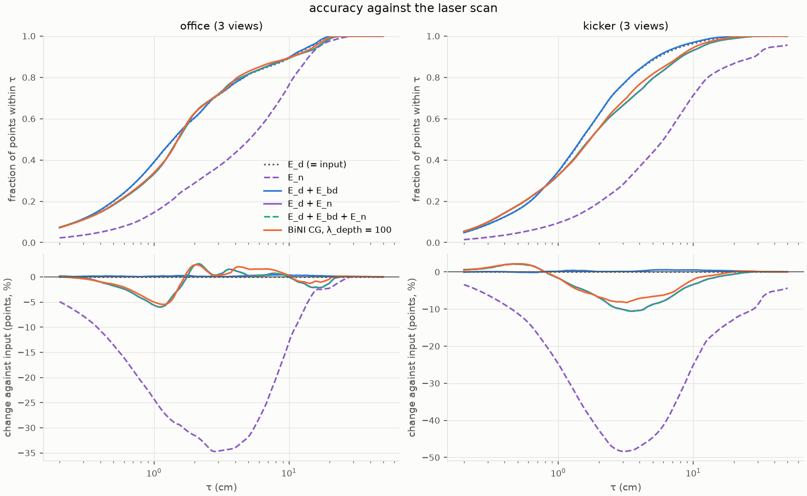
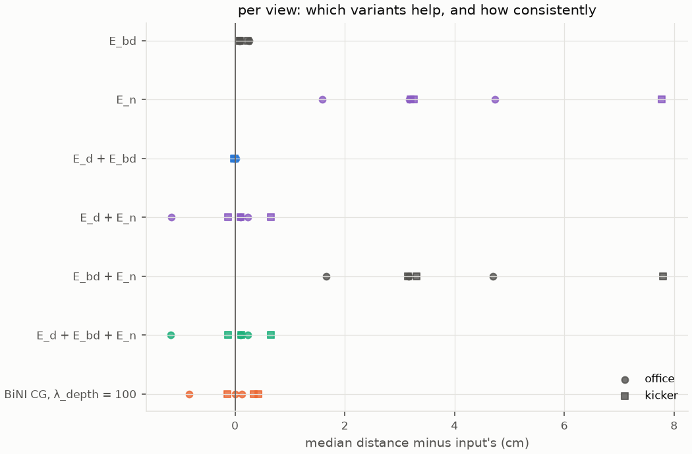
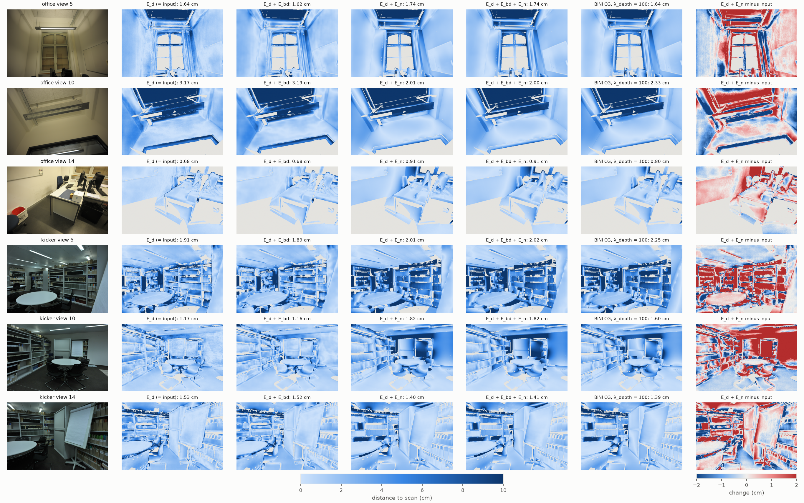
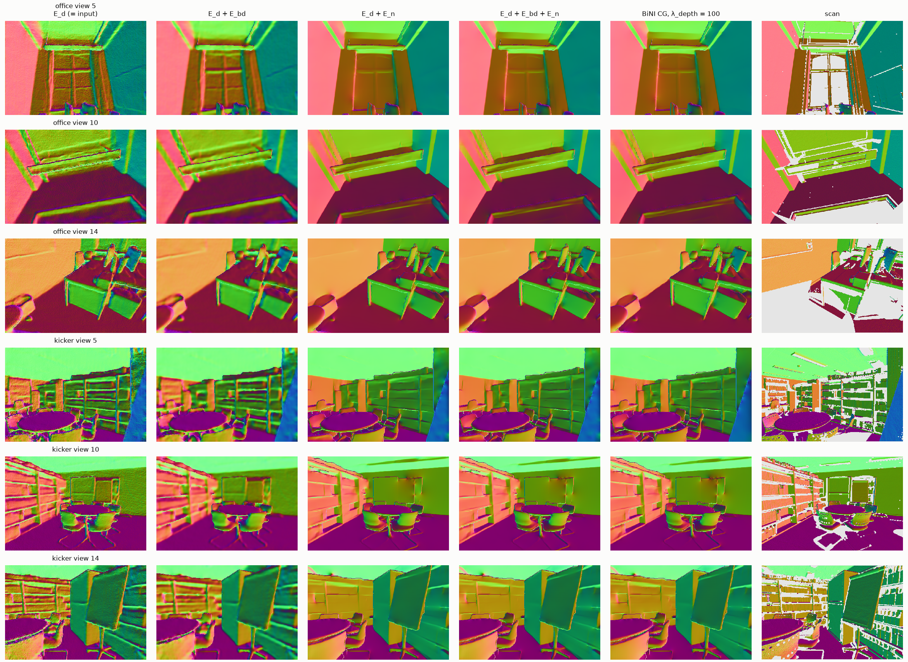

# eval_eth3d-20261027-133306

git `6bc1e1643e3f37acdf0f5fda6fcfb24b11e1df7d`

## accuracy, mean over all views

| variant | median (cm) | mean (cm) | ≤ 1 cm | ≤ 2 cm | ≤ 5 cm | ≤ 10 cm | ≤ 20 cm | median vs input | angle to DSINE (°) | drift (%) | seconds |
|---|---|---|---|---|---|---|---|---|---|---|---|
| E_d (= input) | 1.68 | 2.79 | 38.3% | 62.7% | 85.5% | 93.3% | 99.6% | +0.0% | 12.25 | 0.00 | 0.09 |
| E_bd | 1.82 | 2.89 | 35.5% | 59.4% | 84.0% | 93.4% | 99.8% | +8.1% | 10.55 | 0.03 | 4.16 |
| E_n | 5.64 | 8.56 | 12.1% | 24.1% | 46.4% | 74.3% | 92.3% | +234.9% | 1.80 | 3.70 | 16.15 |
| E_d + E_bd | 1.68 | 2.70 | 38.5% | 62.8% | 85.9% | 93.8% | 99.8% | -0.4% | 10.23 | 0.01 | 2.43 |
| E_d + E_n | 1.65 | 3.26 | 34.0% | 59.9% | 81.1% | 91.6% | 98.8% | -2.1% | 4.38 | 0.33 | 2.97 |
| E_bd + E_n | 5.65 | 8.48 | 11.8% | 24.1% | 46.5% | 74.5% | 92.3% | +235.2% | 1.81 | 3.63 | 14.61 |
| E_d + E_bd + E_n | 1.65 | 3.27 | 34.0% | 59.9% | 81.0% | 91.6% | 98.8% | -2.1% | 4.39 | 0.34 | 2.99 |
| BiNI CG, λ_depth = 100 | 1.67 | 3.07 | 34.5% | 60.2% | 82.9% | 92.4% | 99.5% | -0.9% | 4.69 | 0.31 | 0.26 |

## median distance per view (cm)

| variant | office 5 | office 10 | office 14 | kicker 5 | kicker 10 | kicker 14 |
|---|---|---|---|---|---|---|
| E_d (= input) | 1.64 | 3.17 | 0.68 | 1.91 | 1.17 | 1.53 |
| E_bd | 1.71 | 3.43 | 0.78 | 1.99 | 1.41 | 1.61 |
| E_n | 3.23 | 6.35 | 5.41 | 5.11 | 8.95 | 4.79 |
| E_d + E_bd | 1.62 | 3.19 | 0.68 | 1.89 | 1.16 | 1.52 |
| E_d + E_n | 1.74 | 2.01 | 0.91 | 2.01 | 1.82 | 1.40 |
| E_bd + E_n | 3.30 | 6.33 | 5.38 | 5.06 | 8.97 | 4.83 |
| E_d + E_bd + E_n | 1.74 | 2.00 | 0.91 | 2.02 | 1.82 | 1.41 |
| BiNI CG, λ_depth = 100 | 1.64 | 2.33 | 0.80 | 2.25 | 1.60 | 1.39 |

## views

| view | image | scan coverage | Déjà View focal / ETH3D | scale |
|---|---|---|---|---|
| office 5 | DSC_0230.JPG | 87% | 1.007 | 1.488 |
| office 10 | DSC_0239.JPG | 83% | 0.990 | 1.434 |
| office 14 | DSC_0248.JPG | 57% | 1.007 | 1.495 |
| kicker 5 | DSC_6496.JPG | 88% | 1.006 | 2.176 |
| kicker 10 | DSC_6506.JPG | 92% | 1.002 | 2.141 |
| kicker 14 | DSC_6512.JPG | 89% | 0.996 | 2.145 |

## accuracy_curves

Fraction of each variant's points within τ of the laser scan, pooled over a scene's three views (top), and its change against Déjà View's input (bottom). Each depth map is aligned by one median scale.

## per_view

Change of each variant's median distance against the input, one dot per view; left of zero is better.

## error_maps

Distance of each pixel's point to the nearest scan point, after median scaling (gray: the scan saw nothing there). Last column: E_d + E_n minus the input, blue where refinement moved points closer.

## eval_normals

Normals of each depth map lifted through the calibrated camera; last column the scan's own, z-buffered into the view (gray: no scan point).

## findings

Setup: ETH3D office and kicker (laser scans, calibrated DSLR), Déjà View K = 16 on 20 views per scene, three
views per scene fixed before any run (quartiles of capture order). The refinement sees only Déjà View's depth and
rays and DSINE's normals; its weights were chosen on ScanNet++ office view 6 and kitchen view 13 and not tuned here.
Each depth map is aligned by one median scale and lifted through the calibrated camera; accuracy only.

1. **Déjà View is already accurate at this scale**: 1.68 cm median distance to the scan (0.68-3.17 cm per view),
   62.7% of points within 2 cm. The evaluation floor (the scan's own z-buffered depth, re-lifted) is 0.3 cm.
2. **The normal term does not improve accuracy.** E_d + E_n lowers the mean-over-views median by 2%, but only
   through office view 10 (3.17 -> 2.01 cm, the ceiling); it is worse on 4 of 6 views (up to +0.65 cm on kicker
   10), the mean distance rises from 2.79 to 3.26 cm, and points within 1 cm fall from 38.3% to 34.0%.
3. **Why: right orientations, wrong offsets.** In `eval_normals.png` the normal-term results look far closer to
   the scan's normals than the input does (flat walls, sharp creases, no texture noise), and in `accuracy_curves.png`
   they gain about 2 points below 0.8 cm on kicker. But `error_maps.png` shows whole planes moved by 1-2 cm, e.g.
   kicker 10's back wall: a bias of a degree or two in DSINE's normals, integrated across a 3 m wall, becomes
   centimeters, and the data term at λ_n = 0.005 does not hold the low frequencies. That weight was chosen by the
   angle to DSINE's normals, which rewards following DSINE; against ground truth that has a cost.
4. **Bending is harmless and nearly inert**: E_d + E_bd matches the input (median -0.4%, mean 2.79 -> 2.70 cm).
5. **No anchor, no accuracy**: E_n alone is 3.4x worse (5.64 cm median) even after median scaling; E_bd + E_n
   equally so. BiNI's CG lands close to E_d + E_n (1.67 cm median, mean 3.07 cm) in 0.26 s instead of 3.0 s.

Limits: six views of two scenes; the z-buffer can put a background scan point behind a surface the scanner missed,
which counts against every variant alike; accuracy only, since three views see part of the scan. Tuning λ_n on
these views would be tuning on the test scenes; a fair sweep needs other ETH3D rooms (pipes, terrains,
delivery_area) as validation.
