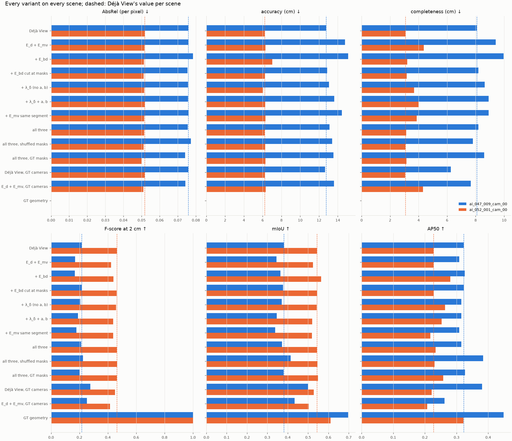
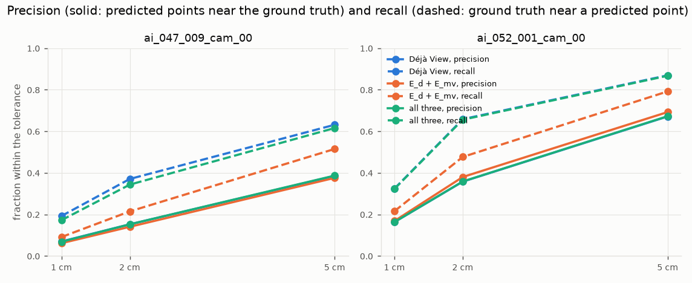
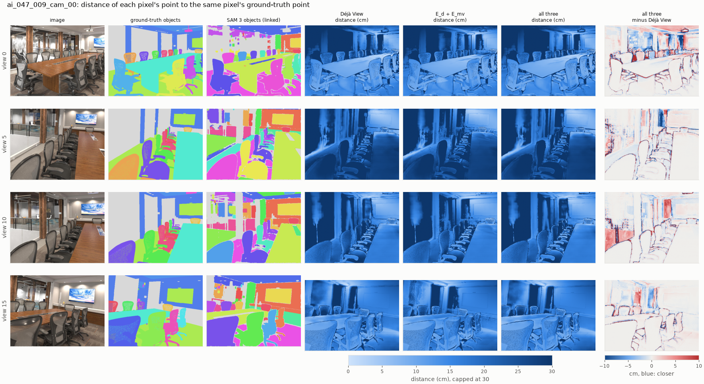
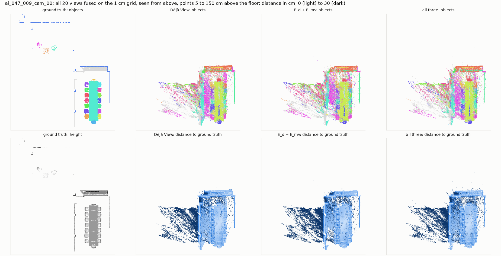
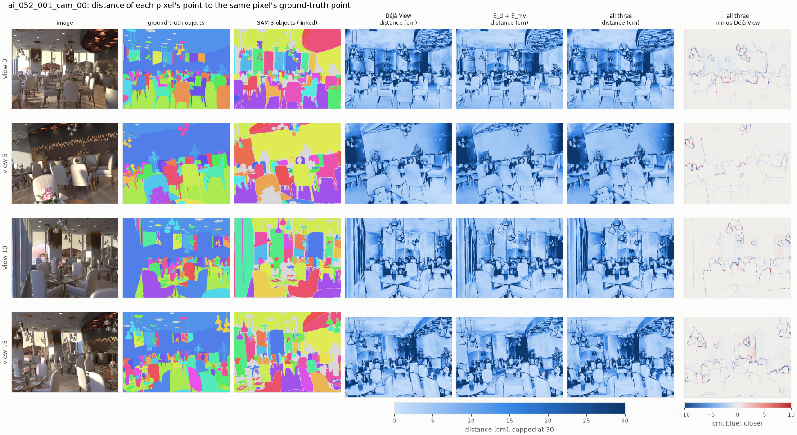
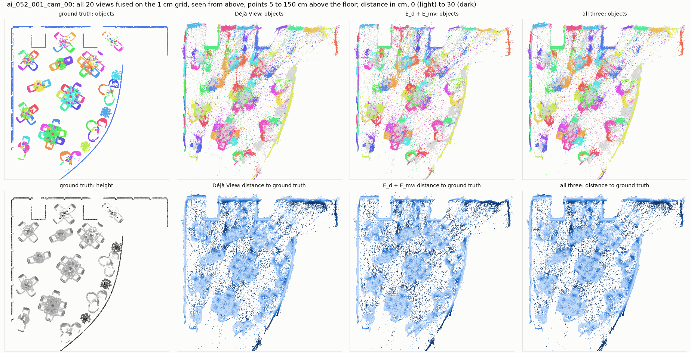
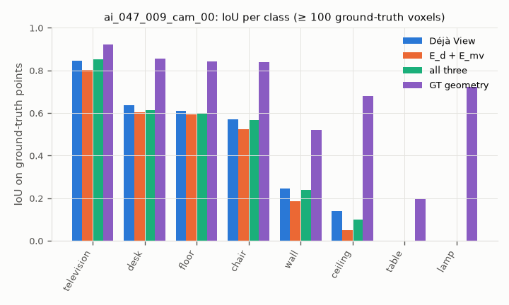
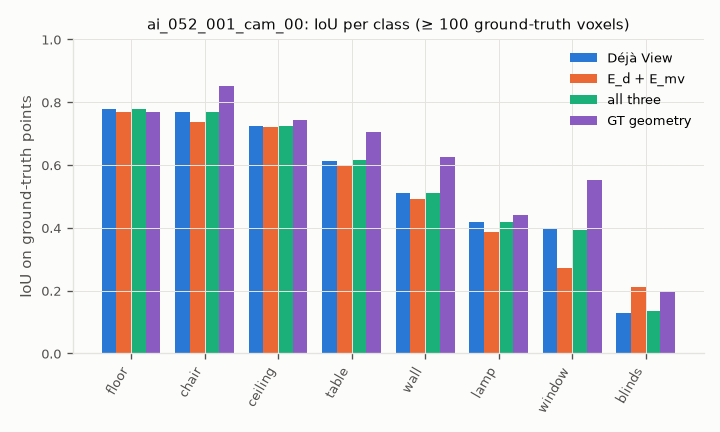

# Week 3 protocol: pipeline variants on Hypersim validation scenes

Run `runs/eval_hypersim-20261102-232027` (`configs/eval_hypersim.yaml`, git `73945cb`, tree
dirty only in figure code). Reproduce:

```bash
uv run python -m src.analysis.scene_eval --cfg configs/eval_hypersim.yaml
uv run python -m src.analysis.scene_figures --run runs/eval_hypersim-<time>
```

## Setup

- **Scenes:** Hypersim validation split, 20 views each, uniform over the trajectory, 504 × 378.
  - `ai_047_009` (conference room): weights tuned here, see `eval_hypersim_tuning-*`.
  - `ai_052_001` (restaurant): held out.
  - The kitchen `ai_015_001` is configured, but Apple's server sent its archive at 30–60 KB/s
    and kept dropping the connection, so it is not in this run.
  - The test split is never used.
- **Pipeline** (`run-pipeline` stages):
  1. Déjà View, K = 16: about 10 s per scene.
  2. SAM 3 in image mode with one prompt per concrete NYU40 class (`configs/prompts/nyu40.txt`),
     threshold 0.3: about 30 s per scene. Linked with the working association: about 11 s.
  3. The joint refiner on Déjà View's cameras: 1–4 s per variant (times in the tables).
- **Ground truth:** Hypersim's per-pixel depth, NYU40 classes and instances (Mircea's loader, E29),
  lifted through the true cameras and reduced to a 1 cm grid.
- **Alignment:** one similarity, fitted on 200k pixel correspondences of the Déjà View points and
  shared by every variant. Scale 3.67 (conference) and 4.31 (restaurant).
- **Scores** (`src/evaluation/labeled.py`):
  - AbsRel: per-pixel depth error after the alignment's scale.
  - Accuracy, completeness, precision, recall and F-score: of the fused 1 cm clouds; distances
    capped at 1 m.
  - mIoU and AP: labels transferred to the ground-truth points from predictions within 5 cm.
- **Labels:** always the linked SAM 3 masks, so label scores change only through geometry.

## Variants

| variant | what changes against `configs/refine.yaml` (E_d + E_mv, λ_mv 1, 10 × 20 Gauss-Newton/CG) |
|---|---|
| Déjà View | no refinement |
| E_d + E_mv | the pipeline's current refiner |
| + E_bd | thin-plate bending on inverse depth, λ_bd 100, everywhere |
| + E_bd cut at masks | the same, but no stencil across a change of instance id |
| + λ_δ (no a, b) | λ_δ 10 on the dense residual: same budget as the next row without segments |
| + λ_δ + a, b | per (view, segment) scale and shift of inverse depth, λ_δ 10 |
| + E_mv same segment | cross-view matches only between pixels of one instance id |
| all three | cut E_bd + a, b + same-segment E_mv |
| all three, shuffled masks | each view gets the next view's masks (control: same statistics, wrong places) |
| all three, GT masks | Hypersim's instances instead of SAM 3's (oracle, issue #8) |
| Déjà View, GT cameras | Déjà View's depth (scaled) on the true cameras: the depth without the pose error |
| E_d + E_mv, GT cameras | the refiner on the true cameras |
| GT geometry | true depth and cameras with SAM 3 labels: the ceiling of the label scores |

## Figures



*Every score of every variant; dashed: Déjà View per scene.*



*Precision (solid) and recall (dashed) against the tolerance. In the restaurant, Déjà View's
lines lie under those of "all three".*



*Conference room, 4 of 20 views.*
- Columns 4–6: each pixel's distance to its ground-truth point, in cm.
- Last column: "all three" minus Déjà View; blue means closer.
- The largest errors are behind the glass wall (views 5 and 10) and on the far wall. The
  refinement changes them at object edges, in both directions.







*Restaurant from above: furniture between 5 cm and 1.5 m above the floor.* Déjà View's room is
bent as a whole: the curved glass wall and the right end do not overlay the ground truth. No
variant changes that.

 

## Results

Conference room `ai_047_009` (tuning scene):

| variant | AbsRel | accuracy (cm) | completeness (cm) | precision 2 cm | recall 2 cm | F-score 2 cm | disagreement (%) | mIoU | AP50 | AP | time (s) |
|---|---|---|---|---|---|---|---|---|---|---|---|
| Déjà View | 0.0758 | 12.75 | 8.09 | 0.152 | 0.371 | 0.216 | 0.96 | 0.381 | 0.322 | 0.144 | 0.0 |
| E_d + E_mv | 0.0757 | 14.76 | 9.41 | 0.141 | 0.215 | 0.170 | 0.05 | 0.345 | 0.308 | 0.131 | 2.4 |
| + E_bd | 0.0784 | 15.11 | 9.96 | 0.128 | 0.247 | 0.168 | 0.13 | 0.364 | 0.326 | 0.154 | 3.0 |
| + E_bd cut at masks | 0.0754 | 12.87 | 8.19 | 0.155 | 0.353 | 0.215 | 0.70 | 0.377 | 0.322 | 0.144 | 0.8 |
| + λ_δ (no a, b) | 0.0756 | 13.07 | 8.64 | 0.154 | 0.317 | 0.207 | 0.39 | 0.371 | 0.315 | 0.142 | 1.9 |
| + λ_δ + a, b | 0.0756 | 13.61 | 8.91 | 0.146 | 0.273 | 0.190 | 0.28 | 0.346 | 0.315 | 0.143 | 3.3 |
| + E_mv same segment | 0.0759 | 14.45 | 8.92 | 0.137 | 0.254 | 0.178 | 0.10 | 0.338 | 0.308 | 0.111 | 2.0 |
| all three | 0.0754 | 13.11 | 8.20 | 0.152 | 0.344 | 0.211 | 0.60 | 0.371 | 0.315 | 0.142 | 2.6 |
| all three, shuffled masks | 0.0772 | 13.41 | 7.80 | 0.156 | 0.400 | 0.225 | 0.94 | 0.414 | 0.384 | 0.171 | 2.3 |
| all three, GT masks | 0.0740 | 13.53 | 8.60 | 0.148 | 0.308 | 0.200 | 0.37 | 0.379 | 0.326 | 0.134 | 4.0 |
| Déjà View, GT cameras | 0.0758 | 12.64 | 6.26 | 0.191 | 0.501 | 0.277 | 1.10 | 0.499 | 0.381 | 0.193 | 0.0 |
| E_d + E_mv, GT cameras | 0.0742 | 13.59 | 7.67 | 0.204 | 0.330 | 0.253 | 0.05 | 0.433 | 0.262 | 0.158 | 2.3 |
| GT geometry | 0 | 0 | 0 | 1 | 1 | 1 | – | 0.697 | 0.448 | 0.304 | 0.0 |

Restaurant `ai_052_001` (held out):

| variant | AbsRel | accuracy (cm) | completeness (cm) | precision 2 cm | recall 2 cm | F-score 2 cm | disagreement (%) | mIoU | AP50 | AP | time (s) |
|---|---|---|---|---|---|---|---|---|---|---|---|
| Déjà View | 0.0518 | 6.21 | 3.07 | 0.358 | 0.659 | 0.464 | 0.64 | 0.543 | 0.227 | 0.086 | 0.0 |
| E_d + E_mv | 0.0516 | 6.29 | 4.37 | 0.380 | 0.477 | 0.423 | 0.05 | 0.524 | 0.227 | 0.089 | 2.3 |
| + E_bd | 0.0513 | 7.04 | 3.20 | 0.338 | 0.629 | 0.440 | 0.55 | 0.565 | 0.280 | 0.102 | 1.6 |
| + E_bd cut at masks | 0.0512 | 6.24 | 3.16 | 0.358 | 0.653 | 0.463 | 0.61 | 0.544 | 0.227 | 0.086 | 1.3 |
| + λ_δ (no a, b) | 0.0514 | 6.06 | 3.68 | 0.375 | 0.587 | 0.458 | 0.25 | 0.541 | 0.263 | 0.098 | 1.8 |
| + λ_δ + a, b | 0.0517 | 6.27 | 4.01 | 0.366 | 0.545 | 0.438 | 0.18 | 0.520 | 0.253 | 0.086 | 3.1 |
| + E_mv same segment | 0.0514 | 6.29 | 3.86 | 0.381 | 0.515 | 0.438 | 0.06 | 0.519 | 0.218 | 0.082 | 2.1 |
| all three | 0.0514 | 6.22 | 3.14 | 0.359 | 0.656 | 0.464 | 0.62 | 0.544 | 0.234 | 0.087 | 1.5 |
| all three, shuffled masks | 0.0511 | 6.27 | 3.07 | 0.359 | 0.661 | 0.465 | 0.64 | 0.547 | 0.230 | 0.090 | 1.0 |
| all three, GT masks | 0.0500 | 6.29 | 3.15 | 0.361 | 0.649 | 0.464 | 0.57 | 0.549 | 0.258 | 0.092 | 2.4 |
| Déjà View, GT cameras | 0.0518 | 6.24 | 3.05 | 0.349 | 0.632 | 0.450 | 0.62 | 0.528 | 0.221 | 0.079 | 0.0 |
| E_d + E_mv, GT cameras | 0.0510 | 6.34 | 4.30 | 0.363 | 0.486 | 0.416 | 0.07 | 0.504 | 0.207 | 0.078 | 2.4 |
| GT geometry | 0 | 0 | 0 | 1 | 1 | 1 | – | 0.610 | 0.322 | 0.153 | 0.0 |

## Findings

Two scenes, one of them used for tuning. Differences of a few thousandths are within what a
different seed or view set would move, so only the patterns below are claimed.

1. **The pipeline runs end to end on Hypersim:** unposed RGB in; a labeled cloud with SAM 3
   objects and NYU40 classes out.
   - Déjà View's fused cloud is 6–13 cm from the ground truth on average.
   - With true geometry, the SAM 3 labels reach mIoU 0.61–0.70 and AP50 0.32–0.45. With Déjà
     View's geometry they reach mIoU 0.38–0.54 and AP50 0.23–0.32, so geometry costs a third of
     the label quality.
2. **Agreement alone (E_d + E_mv) lowers the cloud scores on both scenes.**
   - F-score at 2 cm: 0.216 → 0.170 (conference), 0.464 → 0.423 (restaurant).
   - Precision barely changes: −0.011 and +0.022. Recall falls: −0.156 and −0.182.
   - The views now agree to 0.05 %, against 0.6–1 %, and AbsRel is unchanged. The cloud becomes
     one surface that is no closer to the truth, while the input's slightly different layers had
     straddled it.
   - This repeats the ScanNet++ result: agreement removes what the views disagree on, not the
     error they share. Here it also costs recall.
3. **The pose error is not why agreement hurts.** On the true cameras, E_mv still costs recall:
   F 0.277 → 0.253 and 0.450 → 0.416.
   - The true cameras do matter for the conference room: F 0.216 → 0.277, mIoU 0.381 → 0.499.
     Déjà View's camera centers there are 21 cm from the true ones after alignment, against 4 cm
     in the restaurant.
4. **Cutting E_bd at mask boundaries is what keeps smoothing from hurting.**
   - Uncut: AbsRel 0.0784 and accuracy 15.1 cm on the conference room.
   - Cut: 0.0754 and 12.9 cm. In the restaurant, accuracy goes from 7.04 cm uncut to 6.24 cm cut.
5. **Per-segment a, b do not help** against the same λ_δ without them: F 0.190 vs 0.207, and
   0.438 vs 0.458.
6. **The semantic signal is small and shows only in AbsRel.**
   - With all three terms, AbsRel follows the quality of the masks on both scenes: GT masks
     0.0740 / 0.0500, SAM 3 0.0754 / 0.0514, against Déjà View's 0.0758 / 0.0518. GT masks
     remove 2–3.5 % of the per-pixel error.
   - Shuffled masks score as well or better on the cloud scores: conference F 0.225, mIoU 0.414,
     the best non-oracle row. So on those scores the masks are not what helps; random cuts that
     stop the solver from moving help as much.
   - By Claude.md's step 5 this does not yet show a semantic effect.
7. **Next:** the refinement can only redistribute error between views; it has no information
   about the shared error. Candidates:
   - a prior that knows the shape: planarity for walls and tables, E_pr in the method;
   - better cameras: on the true cameras, Déjà View's own cloud gains the most here.

   Both should be measured with AbsRel and precision as well as F-score, since recall rewards a
   cloud for being thick.
