# Week 3 protocol: pipeline variants on three Hypersim validation scenes

Run `runs/eval_hypersim-20261102-235032` (`configs/eval_hypersim.yaml`, git `031eec2`, tree
dirty only in the normals figure of `scene_figures.py`). Reproduce:

```bash
uv run python -m src.analysis.scene_eval --cfg configs/eval_hypersim.yaml
uv run python -m src.analysis.scene_figures --run runs/eval_hypersim-<time>
```

It replaces the two-scene run `eval_hypersim-20261102-232027`, whose numbers it repeats. Up to
0.05 cm differs between the two runs, from the GPU's non-deterministic sums: that is the noise
floor of a rerun.

## Setup

- **Scenes:** Hypersim validation split, 20 views each, uniform over the trajectory, 504 × 378.
  - `ai_015_001` (kitchen): held out.
  - `ai_047_009` (conference room): weights tuned here, see `eval_hypersim_tuning-*`.
  - `ai_052_001` (restaurant): held out.
  - The test split is never used.
- **Pipeline** (`run-pipeline` stages):
  1. Déjà View, K = 16: about 10 s per scene.
  2. SAM 3 in image mode with one prompt per concrete NYU40 class (`configs/prompts/nyu40.txt`),
     threshold 0.3: about 30 s. Linked with the working association: about 11 s.
  3. The joint refiner on Déjà View's cameras: 1–4 s per variant (times in the tables).
- **Ground truth:** Hypersim's per-pixel depth, NYU40 classes and instances (Mircea's loader, E29),
  lifted through the true cameras and reduced to a 1 cm grid.
- **Alignment:** one similarity, fitted on 200k pixel correspondences of the Déjà View points and
  shared by all variants.
  - Scales: 2.72 (kitchen), 3.67 (conference), 4.31 (restaurant).
  - After the alignment, Déjà View's camera centers are 2.4, 20.6 and 4.3 cm from the true ones.
- **Scores** (`src/evaluation/labeled.py`):
  - AbsRel: per-pixel depth error after the alignment's scale.
  - Accuracy, completeness, precision, recall and F-score: of the fused 1 cm clouds; distances
    capped at 1 m.
  - mIoU and AP: labels transferred to the ground-truth points from predictions within 5 cm.
- **Labels:** always the linked SAM 3 masks, so label scores change only through geometry.

## Variants

| variant | what changes against `configs/refine.yaml` (E_d + E_mv, λ_mv 1, 10 × 20 Gauss-Newton/CG) |
|---|---|
| Déjà View | no refinement |
| E_d + E_mv | the pipeline's current refiner |
| + E_bd | thin-plate bending on inverse depth, λ_bd 100, everywhere |
| + E_bd cut at masks | the same, but no stencil across a change of instance id |
| + λ_δ (no a, b) | λ_δ 10 on the dense residual: same budget as the next row without segments |
| + λ_δ + a, b | per (view, segment) scale and shift of inverse depth, λ_δ 10 |
| + E_mv same segment | cross-view matches only between pixels of one instance id |
| all three | cut E_bd + a, b + same-segment E_mv (`configs/refine_semantic.yaml`) |
| all three, shuffled masks | each view gets the next view's masks (control: same statistics, wrong places) |
| all three, GT masks | Hypersim's instances instead of SAM 3's (oracle, issue #8) |
| Déjà View, GT cameras | Déjà View's depth (scaled) on the true cameras: the depth without the pose error |
| E_d + E_mv, GT cameras | the refiner on the true cameras |
| GT geometry | true depth and cameras with SAM 3 labels: the ceiling of the label scores |

## Figures

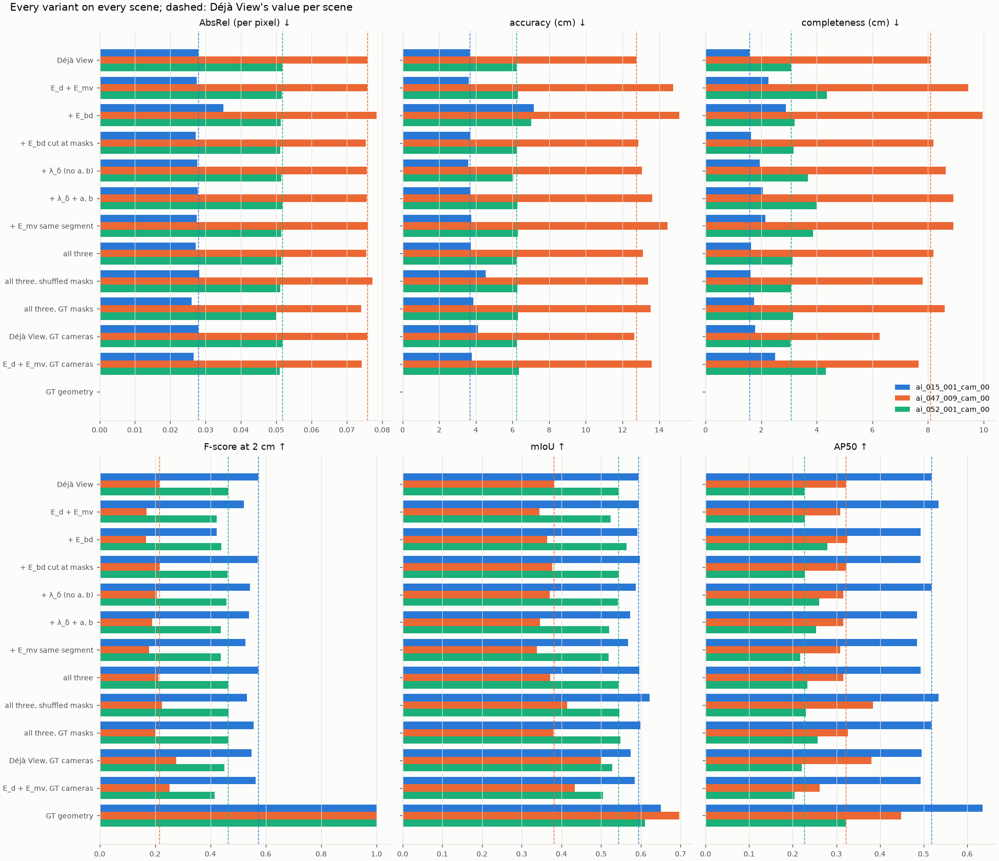

*Every score of every variant; dashed: Déjà View per scene.*

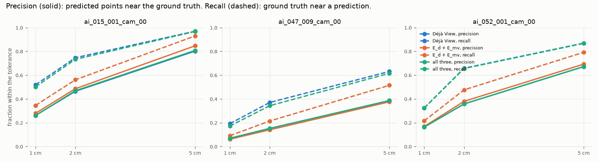

*Precision (solid) and recall (dashed) against the tolerance; where Déjà View's lines are
missing, they lie under those of "all three".*

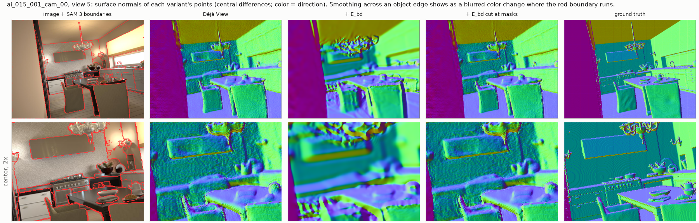

*Kitchen, view 5: surface normals. Uncut bending (+ E_bd) melts the cupboards, chandelier and
table into each other. Cut at the SAM 3 boundaries (red), it keeps Déjà View's edges.*

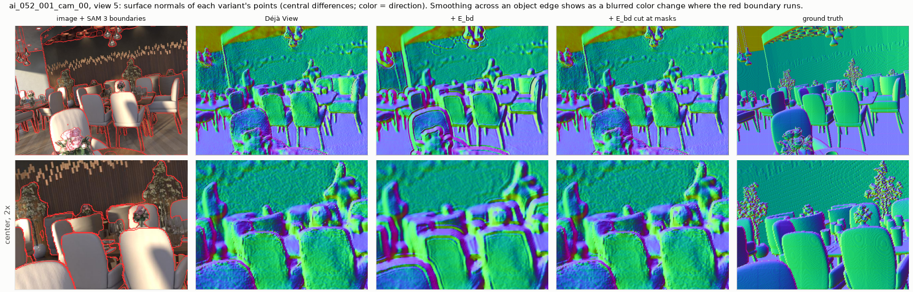 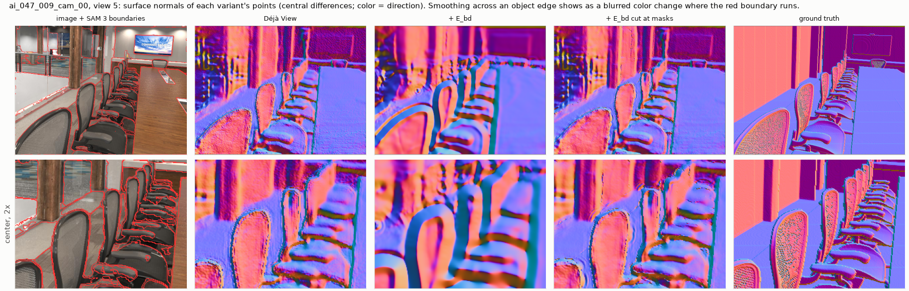

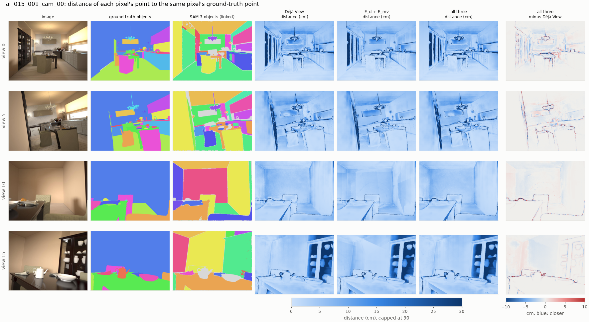

*Kitchen, 4 of 20 views.*
- Columns 4–6: each pixel's distance to its ground-truth point, in cm.
- Last column: "all three" minus Déjà View; blue means closer.

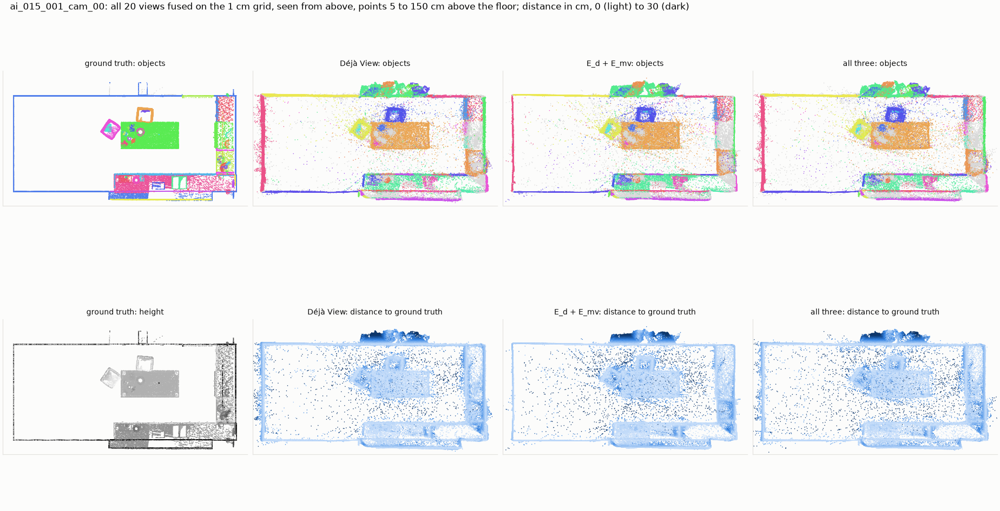

*Kitchen from above: furniture between 5 cm and 1.5 m above the floor. E_d + E_mv leaves more
stray points in the free space between table and walls (dark dots) than Déjà View or "all
three".*

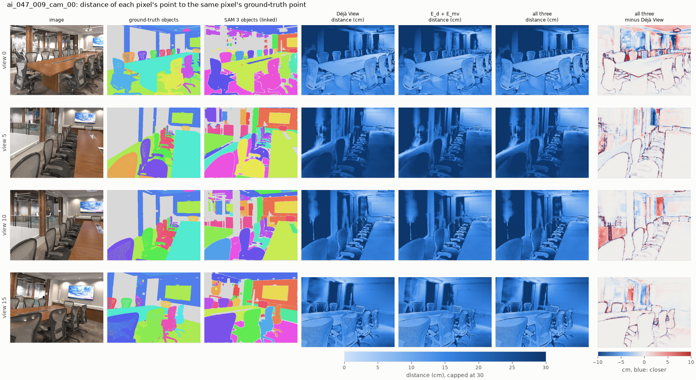

*Conference room. The largest errors are behind the glass wall (views 5 and 10) and on the far
wall.*

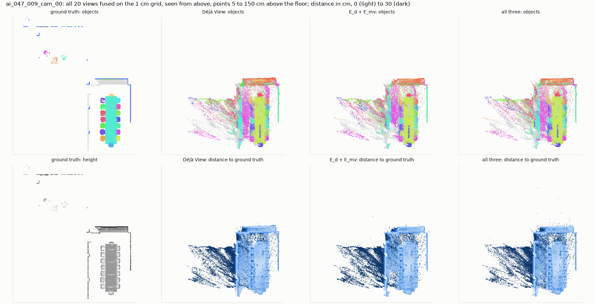

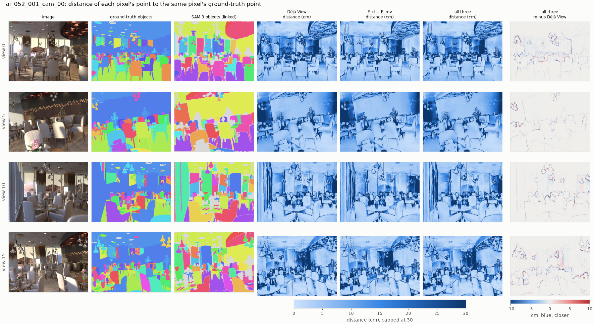

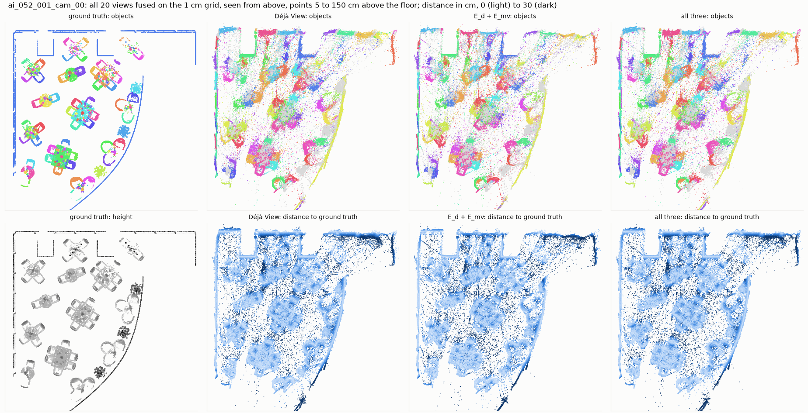

*Restaurant: Déjà View's room is bent as a whole; the curved glass wall and the right end do
not overlay the ground truth. No variant changes that.*

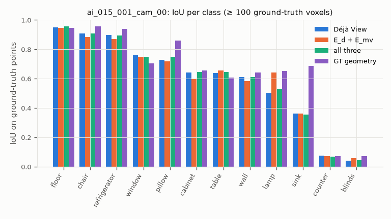
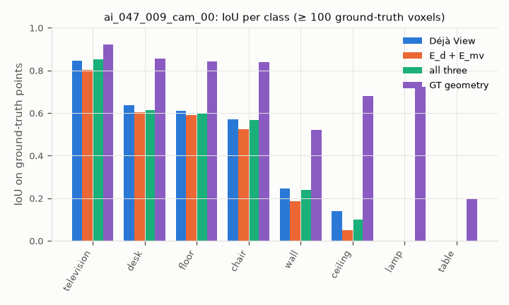
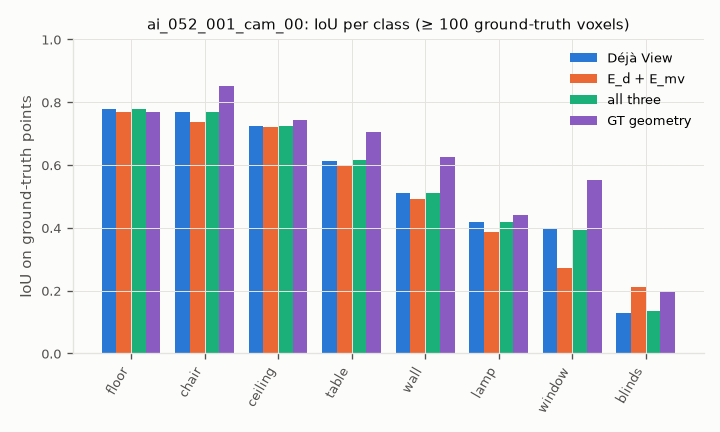

## Results

Kitchen `ai_015_001` (held out):

| variant | AbsRel | accuracy (cm) | completeness (cm) | precision 2 cm | recall 2 cm | F-score 2 cm | disagreement (%) | mIoU | AP50 | AP | time (s) |
|---|---|---|---|---|---|---|---|---|---|---|---|
| Déjà View | 0.0279 | 3.65 | 1.58 | 0.465 | 0.747 | 0.573 | 0.50 | 0.593 | 0.518 | 0.371 | 0.0 |
| E_d + E_mv | 0.0274 | 3.61 | 2.26 | 0.486 | 0.561 | 0.521 | 0.04 | 0.595 | 0.535 | 0.346 | 2.4 |
| + E_bd | 0.0350 | 7.17 | 2.89 | 0.347 | 0.541 | 0.423 | 0.12 | 0.591 | 0.493 | 0.344 | 2.9 |
| + E_bd cut at masks | 0.0273 | 3.70 | 1.64 | 0.469 | 0.732 | 0.571 | 0.44 | 0.597 | 0.493 | 0.359 | 1.6 |
| + λ_δ (no a, b) | 0.0276 | 3.59 | 1.95 | 0.472 | 0.641 | 0.544 | 0.18 | 0.587 | 0.518 | 0.360 | 1.7 |
| + λ_δ + a, b | 0.0278 | 3.71 | 2.06 | 0.479 | 0.617 | 0.539 | 0.12 | 0.573 | 0.485 | 0.338 | 3.4 |
| + E_mv same segment | 0.0275 | 3.75 | 2.14 | 0.481 | 0.579 | 0.526 | 0.03 | 0.567 | 0.485 | 0.315 | 2.1 |
| all three | 0.0272 | 3.71 | 1.63 | 0.469 | 0.733 | 0.572 | 0.43 | 0.596 | 0.493 | 0.359 | 1.4 |
| all three, shuffled masks | 0.0283 | 4.54 | 1.62 | 0.419 | 0.729 | 0.532 | 0.54 | 0.622 | 0.535 | 0.400 | 1.7 |
| all three, GT masks | 0.0260 | 3.86 | 1.75 | 0.460 | 0.701 | 0.556 | 0.32 | 0.599 | 0.518 | 0.372 | 2.2 |
| Déjà View, GT cameras | 0.0279 | 4.12 | 1.78 | 0.440 | 0.732 | 0.549 | 0.54 | 0.574 | 0.496 | 0.352 | 0.0 |
| E_d + E_mv, GT cameras | 0.0267 | 3.78 | 2.50 | 0.529 | 0.601 | 0.563 | 0.03 | 0.585 | 0.493 | 0.342 | 2.3 |
| GT geometry | 0 | 0 | 0 | 1 | 1 | 1 | – | 0.650 | 0.635 | 0.441 | 0.0 |

Conference room `ai_047_009` (tuning scene):

| variant | AbsRel | accuracy (cm) | completeness (cm) | precision 2 cm | recall 2 cm | F-score 2 cm | disagreement (%) | mIoU | AP50 | AP | time (s) |
|---|---|---|---|---|---|---|---|---|---|---|---|
| Déjà View | 0.0758 | 12.75 | 8.09 | 0.152 | 0.371 | 0.216 | 0.96 | 0.381 | 0.322 | 0.144 | 0.0 |
| E_d + E_mv | 0.0757 | 14.76 | 9.46 | 0.141 | 0.215 | 0.170 | 0.05 | 0.345 | 0.308 | 0.131 | 2.4 |
| + E_bd | 0.0784 | 15.11 | 9.96 | 0.128 | 0.247 | 0.168 | 0.13 | 0.364 | 0.326 | 0.154 | 3.0 |
| + E_bd cut at masks | 0.0754 | 12.87 | 8.19 | 0.155 | 0.353 | 0.215 | 0.70 | 0.377 | 0.322 | 0.144 | 0.8 |
| + λ_δ (no a, b) | 0.0756 | 13.07 | 8.64 | 0.154 | 0.317 | 0.207 | 0.39 | 0.371 | 0.315 | 0.142 | 1.9 |
| + λ_δ + a, b | 0.0756 | 13.61 | 8.91 | 0.146 | 0.273 | 0.190 | 0.28 | 0.346 | 0.315 | 0.143 | 3.3 |
| + E_mv same segment | 0.0759 | 14.45 | 8.91 | 0.137 | 0.254 | 0.178 | 0.10 | 0.338 | 0.308 | 0.111 | 2.0 |
| all three | 0.0754 | 13.11 | 8.20 | 0.152 | 0.344 | 0.211 | 0.60 | 0.371 | 0.315 | 0.142 | 2.5 |
| all three, shuffled masks | 0.0772 | 13.41 | 7.80 | 0.156 | 0.400 | 0.225 | 0.94 | 0.414 | 0.384 | 0.171 | 2.3 |
| all three, GT masks | 0.0740 | 13.53 | 8.60 | 0.148 | 0.308 | 0.200 | 0.37 | 0.379 | 0.326 | 0.133 | 3.9 |
| Déjà View, GT cameras | 0.0758 | 12.64 | 6.26 | 0.191 | 0.501 | 0.277 | 1.10 | 0.499 | 0.381 | 0.193 | 0.0 |
| E_d + E_mv, GT cameras | 0.0742 | 13.59 | 7.67 | 0.204 | 0.330 | 0.253 | 0.05 | 0.433 | 0.262 | 0.158 | 2.3 |
| GT geometry | 0 | 0 | 0 | 1 | 1 | 1 | – | 0.697 | 0.448 | 0.304 | 0.0 |

Restaurant `ai_052_001` (held out):

| variant | AbsRel | accuracy (cm) | completeness (cm) | precision 2 cm | recall 2 cm | F-score 2 cm | disagreement (%) | mIoU | AP50 | AP | time (s) |
|---|---|---|---|---|---|---|---|---|---|---|---|
| Déjà View | 0.0518 | 6.21 | 3.07 | 0.358 | 0.659 | 0.464 | 0.64 | 0.543 | 0.227 | 0.086 | 0.0 |
| E_d + E_mv | 0.0516 | 6.29 | 4.36 | 0.380 | 0.477 | 0.423 | 0.05 | 0.524 | 0.227 | 0.089 | 2.3 |
| + E_bd | 0.0513 | 7.04 | 3.20 | 0.338 | 0.629 | 0.440 | 0.55 | 0.565 | 0.280 | 0.102 | 1.6 |
| + E_bd cut at masks | 0.0512 | 6.24 | 3.16 | 0.358 | 0.653 | 0.463 | 0.61 | 0.544 | 0.227 | 0.086 | 1.3 |
| + λ_δ (no a, b) | 0.0514 | 6.06 | 3.68 | 0.375 | 0.587 | 0.458 | 0.25 | 0.542 | 0.261 | 0.098 | 1.8 |
| + λ_δ + a, b | 0.0517 | 6.27 | 4.01 | 0.366 | 0.545 | 0.438 | 0.18 | 0.520 | 0.253 | 0.086 | 3.1 |
| + E_mv same segment | 0.0514 | 6.29 | 3.86 | 0.381 | 0.515 | 0.438 | 0.06 | 0.519 | 0.218 | 0.082 | 2.1 |
| all three | 0.0514 | 6.22 | 3.14 | 0.359 | 0.656 | 0.464 | 0.62 | 0.544 | 0.234 | 0.087 | 1.5 |
| all three, shuffled masks | 0.0511 | 6.27 | 3.07 | 0.359 | 0.661 | 0.465 | 0.64 | 0.547 | 0.230 | 0.090 | 1.0 |
| all three, GT masks | 0.0500 | 6.29 | 3.15 | 0.361 | 0.649 | 0.464 | 0.57 | 0.549 | 0.258 | 0.092 | 2.4 |
| Déjà View, GT cameras | 0.0518 | 6.24 | 3.05 | 0.349 | 0.632 | 0.450 | 0.62 | 0.528 | 0.221 | 0.079 | 0.0 |
| E_d + E_mv, GT cameras | 0.0510 | 6.35 | 4.33 | 0.364 | 0.481 | 0.415 | 0.06 | 0.505 | 0.204 | 0.078 | 2.4 |
| GT geometry | 0 | 0 | 0 | 1 | 1 | 1 | – | 0.610 | 0.322 | 0.153 | 0.0 |

## Findings

Three scenes, one of them used for tuning. Differences of a few thousandths in the cloud and
label scores are within what another view set would move, so only patterns that hold on all
three scenes are claimed.

1. **The pipeline runs end to end on Hypersim:** unposed RGB in; a labeled cloud with SAM 3
   objects and NYU40 classes out.
   - Déjà View's fused cloud is 3.7–12.8 cm from the ground truth on average.
   - With true geometry, the SAM 3 labels reach mIoU 0.61–0.70 and AP50 0.32–0.64.
     With Déjà View's geometry they reach mIoU 0.38–0.59 and AP50 0.23–0.52.
2. **Agreement alone (E_d + E_mv) lowers the cloud F-score on all three scenes,** through recall.
   - F-score at 2 cm: 0.573 → 0.521, 0.216 → 0.170, 0.464 → 0.423.
   - Recall falls by 0.15–0.19. Precision rises in two scenes (+0.021, +0.022) and falls in one
     (−0.011).
   - The views agree to 0.04–0.05 % instead of 0.5–1 %. AbsRel improves by at most 2 %.
   - The cloud becomes one surface that is not much closer to the truth, while the input's
     slightly different layers had straddled it. A few pixels also fly off into free space
     (kitchen from above).
   - This is ScanNet++'s finding again: agreement removes what the views disagree on, not the
     error they share.
3. **The pose error is not why agreement hurts.** On the true cameras, E_mv still lowers the
   F-score on two of three scenes: 0.277 → 0.253 and 0.450 → 0.415; the kitchen gains
   0.549 → 0.563. The true cameras help most where Déjà View's are worst: in the conference
   room (camera centers 21 cm off), F 0.216 → 0.277 and mIoU 0.381 → 0.499.
4. **Smoothing must stop at object boundaries.** Uncut E_bd worsens accuracy on every scene, and
   AbsRel on two; cut at SAM 3's boundaries, accuracy stays within 0.12 cm of Déjà View's
   (3.65, 12.75, 6.21 cm):

   | | kitchen | conference | restaurant |
   |---|---|---|---|
   | AbsRel, uncut → cut | 0.0350 → 0.0273 | 0.0784 → 0.0754 | 0.0513 → 0.0512 |
   | accuracy (cm), uncut → cut | 7.17 → 3.70 | 15.11 → 12.87 | 7.04 → 6.24 |

   The normal maps show why: uncut, the cupboards and table melt together. This is the clearest
   effect of the semantics this week. Part of it comes from the cut variant moving less (the
   views still disagree by 0.4–0.7 %).
5. **Per-segment a, b do not help.** Against the same λ_δ without them, the F-score drops on
   every scene: 0.544 → 0.539, 0.207 → 0.190, 0.458 → 0.438.
6. **Mask quality shows in AbsRel, and only there:**

   | AbsRel | kitchen | conference | restaurant |
   |---|---|---|---|
   | Déjà View | 0.0279 | 0.0758 | 0.0518 |
   | all three, shuffled masks | 0.0283 | 0.0772 | 0.0511 |
   | all three, SAM 3 masks | 0.0272 | 0.0754 | 0.0514 |
   | all three, GT masks | 0.0260 | 0.0740 | 0.0500 |

   - GT masks remove 2.4–6.8 % of the per-pixel error, SAM 3 masks 0.5–2.5 %.
   - Shuffled masks make it worse on two of three scenes. That is the shuffle test of Claude.md
     step 5 passing on AbsRel, with a small effect.
   - On the cloud and label scores the shuffled masks score as well as or better than the real
     ones (conference F 0.225, kitchen mIoU 0.622). Those scores do not separate the variants
     beyond noise.
7. **Next:** the refinement redistributes error between views; nothing in it knows the shared
   error. Candidates:
   - a shape prior: planarity for walls, floors and tables, E_pr in the method;
   - better cameras: the conference room gains more from true cameras than from any energy.

   Judge both by AbsRel and precision as well as F-score: recall rewards a cloud for being
   thick.
