# Week 3 protocol: pipeline variants on three Hypersim validation scenes

Run `runs/eval_hypersim-20261103-093957` (`configs/eval_hypersim.yaml`; git `40eaeb2` plus the
uncommitted black-box registration of the commit that adds this report). Reproduce:

```bash
uv run python -m src.analysis.scene_eval --cfg configs/eval_hypersim.yaml       # 3.2 min
uv run python -m src.analysis.scene_figures --run runs/eval_hypersim-<time>     # 1.8 min
```

The method is a **black box**: unposed images in, one labeled point cloud out. Only that cloud
is scored. It replaces the report `eval_hypersim-20261102-235032`, which fitted one similarity
on per-pixel correspondences of Déjà View's points with the ground truth, shared it across all
variants, and scored per-pixel depth error. That alignment used more than the output, and it
favored the unrefined input.

## Setup

- **Scenes:** Hypersim validation split, 20 views each, uniform over the trajectory, 504 × 378:
  `ai_015_001` (kitchen), `ai_047_009` (conference room), `ai_052_001` (restaurant). No weight
  was tuned on any of them, and the test split is never used.
- **Pipeline** (`run-pipeline` stages):
  1. Déjà View, K = 16.
  2. SAM 3 in image mode with one prompt per concrete NYU40 class (`configs/prompts/nyu40.txt`),
     threshold 0.3, linked across views with the working association.
  3. The joint refiner on Déjà View's cameras: 1–5 s per variant.
- **Weights:** every energy term that is on has weight 1: λ_d = λ_mv = 1 (`configs/refine.yaml`),
  λ_bd = 1 where E_bd is on, λ_δ = 1 where the per-pixel change is penalized.
- **Ground truth:** Hypersim's per-pixel depth, NYU40 classes and instances (Mircea's loader,
  E29), lifted through the true cameras and reduced to a 1 cm grid.
- **Registration** (`labeled.register`), per variant, from the two clouds alone:
  - The output is in the first view's camera frame, at its own scale (Déjà View's convention).
  - Start: the ground truth's first camera, and the ratio of the clouds' median distances from
    it as scale.
  - Then point-to-point ICP that also fits the scale, coarse to fine (5, 5, 2, 1 cm grids;
    radii 50, 20, 5, 2 cm), as point-map methods are evaluated (Umeyama then ICP: π³, VGGT).
  - Global registration without that start (FPFH features, RANSAC) failed on these rooms:
    the features are not scale invariant, and Déjà View's scale is off by a factor of 3 to 4.
  - Check: the ground truth's own points, put through the same registration, come back with
    scale 1.000 and 0.07–0.09 cm accuracy (the 1 cm grid's rounding). Scales across variants
    of one scene agree within 0.9 %.
- **Scores** (`src/evaluation/labeled.py`), on the registered, voxelized output:
  - accuracy and completeness (mean distances, capped at 20 cm), precision, recall and F-score
    at 2 cm (Tanks and Temples);
  - mIoU and AP / AP50 (ScanNet's protocol), on labels transferred to the ground-truth points
    from predictions within 5 cm.
- **Diagnostic, not a score:** disagreement between overlapping views (median depth gap), which
  shows how far the refinement moved the views towards one another. It needs no ground truth.
- **Labels:** always the linked SAM 3 masks, so label scores change only through geometry.
- **Noise floor:** a rerun moves F-scores by up to 0.004 and AP by up to 0.01, from the GPU's
  non-deterministic sums in the refinement (Déjà View's rows repeat exactly).

## Variants

| variant | what changes against `configs/refine.yaml` (E_d + E_mv, 10 × 20 Gauss-Newton/CG) |
|---|---|
| Déjà View | no refinement |
| E_d + E_mv | the pipeline's current refiner |
| + E_bd | thin-plate bending on inverse depth, everywhere |
| + E_bd cut at masks | the same, but no stencil across a change of instance id |
| + λ_δ (no a, b) | penalty on the dense per-pixel change: the control for the next row |
| + λ_δ + a, b | per (view, instance) scale and shift of inverse depth, plus the same penalty |
| + E_mv same segment | cross-view matches only between pixels of the same linked instance |
| all three | cut E_bd + a, b + same-segment E_mv (`configs/refine_semantic.yaml`) |
| all three, shuffled masks | each view gets the next view's masks (control: same statistics, wrong places) |
| all three, GT masks | Hypersim's instances instead of SAM 3's (oracle, issue #8) |
| GT geometry | true depth with SAM 3 labels: the ceiling of the label scores, and a registration check |

## Figures

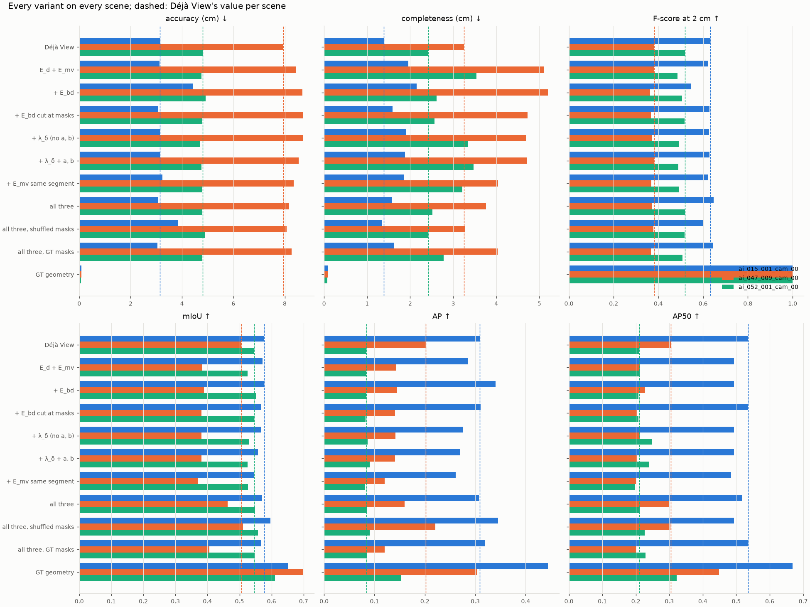

*Every score of every variant; dashed: Déjà View per scene.*

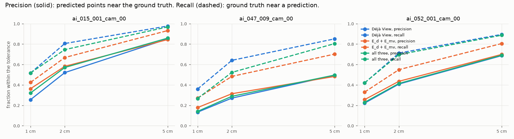

*Precision (solid) and recall (dashed) against the tolerance.*

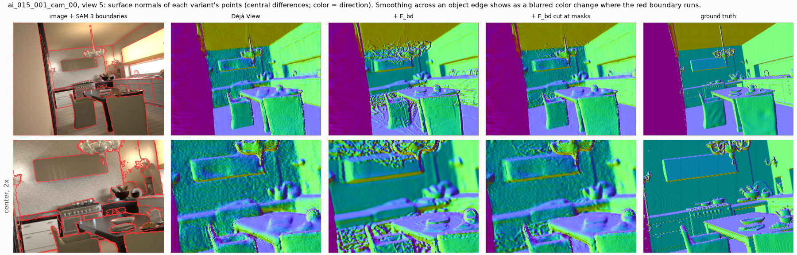

*Kitchen, view 5: surface normals. Uncut bending (+ E_bd) melts the cupboards, chandelier and
table into each other. Cut at the SAM 3 boundaries (red), it keeps Déjà View's edges.*

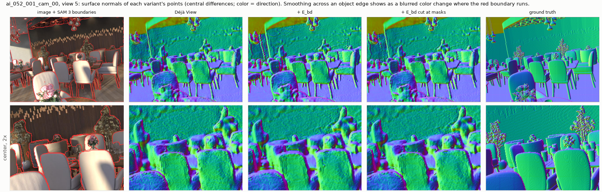 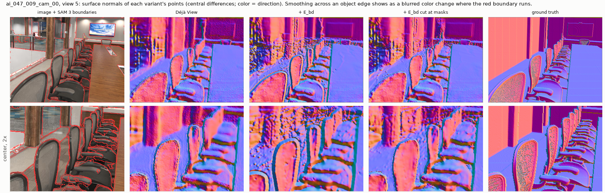

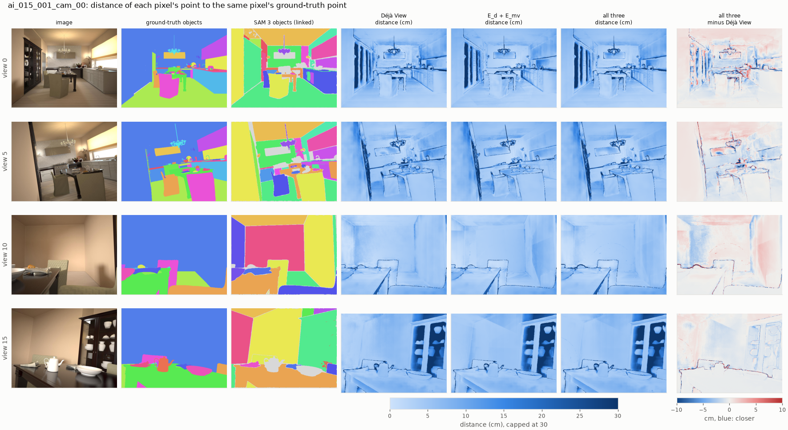

*Kitchen, 4 of 20 views, as a picture only (not a score: it pairs pixels, which a black box
does not expose).*
- Columns 4–6: each pixel's distance to its ground-truth point after the variant's registration, in cm.
- Last column: "all three" minus Déjà View; blue means closer.

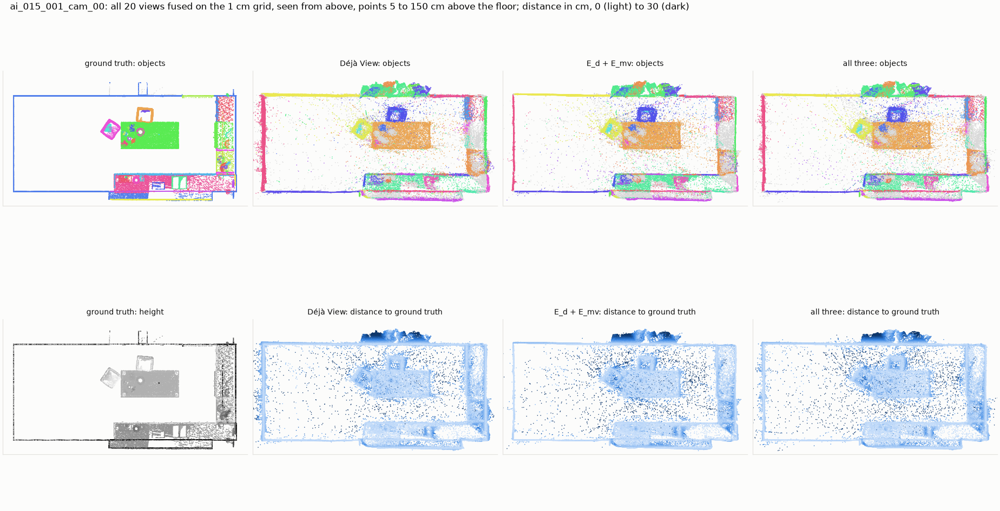

*Kitchen from above: furniture between 5 cm and 1.5 m above the floor.*

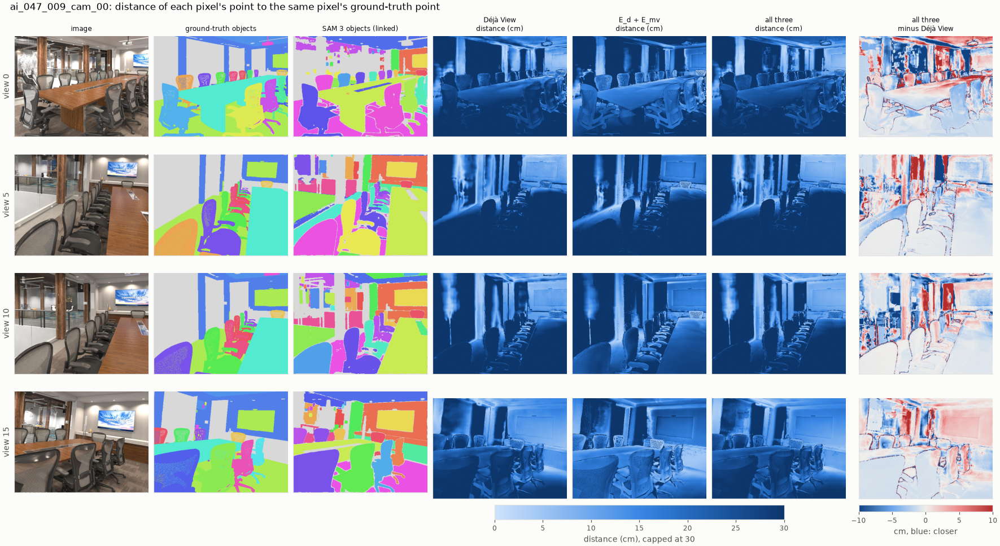

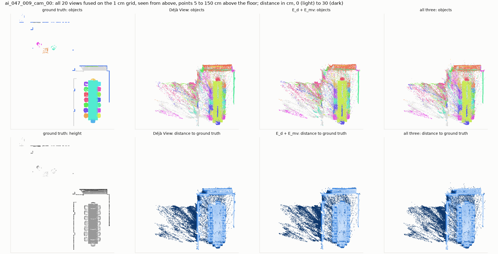

*Conference room: the streaks on the left are Déjà View's depth through the glass wall, where
the ground truth has no surface. They make up most of the accuracy error.*

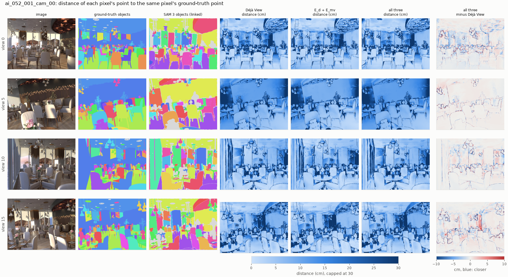

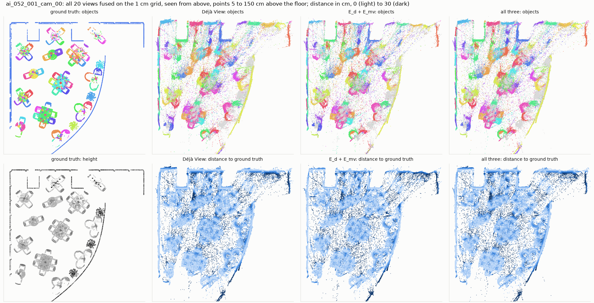

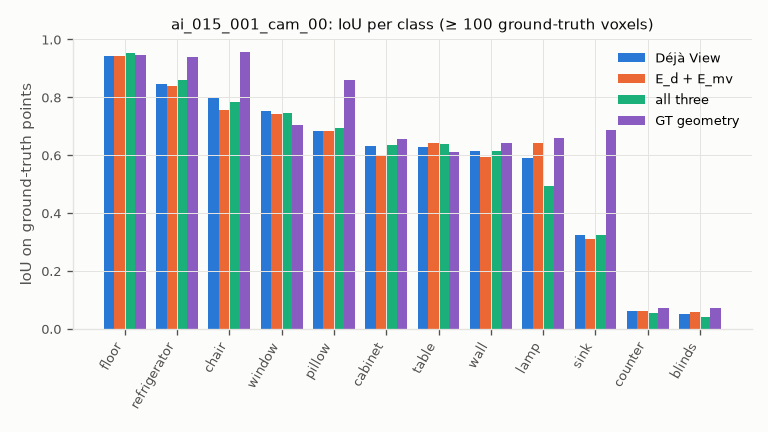
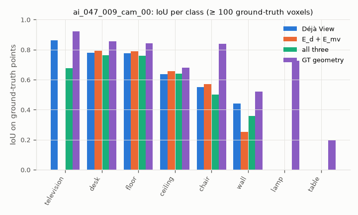
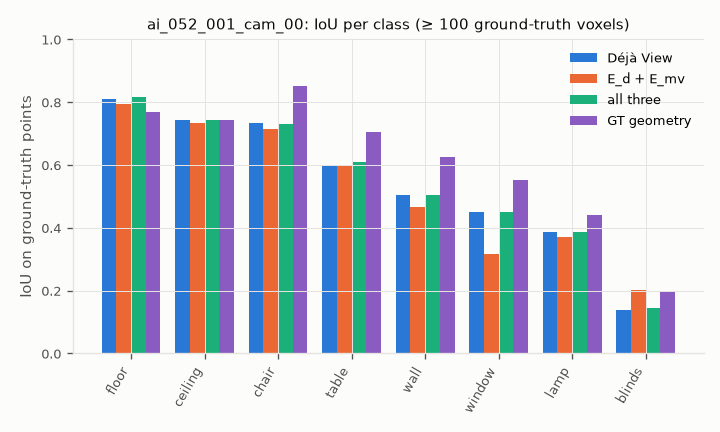

## Results

Kitchen `ai_015_001`:

| variant | accuracy (cm) | completeness (cm) | precision 2 cm | recall 2 cm | F-score 2 cm | mIoU | AP50 | AP | scale | disagreement (%) | time (s) |
|---|---|---|---|---|---|---|---|---|---|---|---|
| Déjà View | 3.13 | 1.39 | 0.521 | 0.806 | 0.633 | 0.577 | 0.535 | 0.309 | 2.732 | 0.50 | 0.0 |
| E_d + E_mv | 3.13 | 1.96 | 0.582 | 0.668 | 0.622 | 0.572 | 0.493 | 0.286 | 2.728 | 0.04 | 2.5 |
| + E_bd | 4.43 | 2.15 | 0.467 | 0.657 | 0.546 | 0.575 | 0.493 | 0.340 | 2.753 | 0.04 | 3.0 |
| + E_bd cut at masks | 3.06 | 1.59 | 0.544 | 0.747 | 0.629 | 0.568 | 0.535 | 0.311 | 2.728 | 0.33 | 1.7 |
| + λ_δ (no a, b) | 3.14 | 1.90 | 0.582 | 0.678 | 0.626 | 0.569 | 0.493 | 0.275 | 2.728 | 0.05 | 2.4 |
| + λ_δ + a, b | 3.16 | 1.88 | 0.583 | 0.683 | 0.629 | 0.557 | 0.493 | 0.269 | 2.728 | 0.04 | 3.8 |
| + E_mv same segment | 3.24 | 1.85 | 0.567 | 0.686 | 0.621 | 0.545 | 0.485 | 0.261 | 2.728 | 0.03 | 2.4 |
| all three | 3.05 | 1.57 | 0.571 | 0.746 | 0.647 | 0.570 | 0.518 | 0.307 | 2.728 | 0.28 | 1.8 |
| all three, shuffled masks | 3.83 | 1.34 | 0.473 | 0.826 | 0.601 | 0.596 | 0.493 | 0.345 | 2.752 | 0.56 | 3.2 |
| all three, GT masks | 3.05 | 1.62 | 0.573 | 0.731 | 0.643 | 0.568 | 0.535 | 0.320 | 2.729 | 0.24 | 2.3 |
| GT geometry | 0.09 | 0.09 | 1.000 | 1.000 | 1.000 | 0.651 | 0.668 | 0.444 | 1.000 | – | 0.0 |

Conference room `ai_047_009`:

| variant | accuracy (cm) | completeness (cm) | precision 2 cm | recall 2 cm | F-score 2 cm | mIoU | AP50 | AP | scale | disagreement (%) | time (s) |
|---|---|---|---|---|---|---|---|---|---|---|---|
| Déjà View | 7.94 | 3.25 | 0.271 | 0.641 | 0.381 | 0.505 | 0.304 | 0.202 | 3.839 | 0.96 | 0.0 |
| E_d + E_mv | 8.43 | 5.12 | 0.314 | 0.484 | 0.381 | 0.382 | 0.213 | 0.142 | 3.854 | 0.05 | 2.5 |
| + E_bd | 8.68 | 5.20 | 0.289 | 0.488 | 0.363 | 0.389 | 0.228 | 0.145 | 3.856 | 0.06 | 3.1 |
| + E_bd cut at masks | 8.71 | 4.73 | 0.290 | 0.498 | 0.366 | 0.381 | 0.204 | 0.141 | 3.853 | 0.18 | 2.0 |
| + λ_δ (no a, b) | 8.70 | 4.69 | 0.295 | 0.505 | 0.372 | 0.381 | 0.212 | 0.142 | 3.852 | 0.13 | 2.8 |
| + λ_δ + a, b | 8.53 | 4.71 | 0.303 | 0.507 | 0.379 | 0.381 | 0.204 | 0.141 | 3.856 | 0.10 | 3.6 |
| + E_mv same segment | 8.35 | 4.04 | 0.291 | 0.504 | 0.369 | 0.370 | 0.200 | 0.120 | 3.846 | 0.10 | 2.7 |
| all three | 8.17 | 3.76 | 0.288 | 0.523 | 0.372 | 0.463 | 0.300 | 0.160 | 3.836 | 0.19 | 4.6 |
| all three, shuffled masks | 8.07 | 3.28 | 0.269 | 0.631 | 0.377 | 0.511 | 0.304 | 0.221 | 3.841 | 0.76 | 3.1 |
| all three, GT masks | 8.26 | 4.03 | 0.287 | 0.509 | 0.367 | 0.406 | 0.202 | 0.120 | 3.846 | 0.13 | 4.9 |
| GT geometry | 0.09 | 0.09 | 1.000 | 1.000 | 1.000 | 0.698 | 0.448 | 0.304 | 1.000 | – | 0.0 |

Restaurant `ai_052_001`:

| variant | accuracy (cm) | completeness (cm) | precision 2 cm | recall 2 cm | F-score 2 cm | mIoU | AP50 | AP | scale | disagreement (%) | time (s) |
|---|---|---|---|---|---|---|---|---|---|---|---|
| Déjà View | 4.80 | 2.43 | 0.408 | 0.712 | 0.519 | 0.547 | 0.210 | 0.084 | 4.323 | 0.64 | 0.0 |
| E_d + E_mv | 4.76 | 3.54 | 0.436 | 0.550 | 0.486 | 0.525 | 0.211 | 0.084 | 4.323 | 0.05 | 2.4 |
| + E_bd | 4.92 | 2.62 | 0.404 | 0.678 | 0.506 | 0.553 | 0.207 | 0.084 | 4.327 | 0.49 | 1.4 |
| + E_bd cut at masks | 4.77 | 2.57 | 0.414 | 0.688 | 0.517 | 0.545 | 0.208 | 0.082 | 4.329 | 0.51 | 2.4 |
| + λ_δ (no a, b) | 4.70 | 3.35 | 0.431 | 0.576 | 0.493 | 0.530 | 0.248 | 0.087 | 4.325 | 0.08 | 2.6 |
| + λ_δ + a, b | 4.76 | 3.47 | 0.433 | 0.563 | 0.489 | 0.526 | 0.239 | 0.090 | 4.326 | 0.07 | 4.1 |
| + E_mv same segment | 4.78 | 3.21 | 0.431 | 0.574 | 0.492 | 0.527 | 0.198 | 0.081 | 4.319 | 0.06 | 2.3 |
| all three | 4.77 | 2.52 | 0.414 | 0.697 | 0.520 | 0.549 | 0.212 | 0.085 | 4.322 | 0.54 | 2.2 |
| all three, shuffled masks | 4.90 | 2.42 | 0.406 | 0.711 | 0.517 | 0.557 | 0.226 | 0.091 | 4.325 | 0.61 | 1.2 |
| all three, GT masks | 4.79 | 2.78 | 0.419 | 0.647 | 0.509 | 0.547 | 0.228 | 0.085 | 4.324 | 0.33 | 3.0 |
| GT geometry | 0.07 | 0.07 | 1.000 | 1.000 | 1.000 | 0.610 | 0.322 | 0.153 | 1.000 | – | 0.0 |

## Findings

Three scenes; only patterns that hold on all three are claimed.

1. **The pipeline runs end to end on Hypersim** and is scored on its output alone.
   - Déjà View's cloud is 3.1–7.9 cm from the ground truth on average (F-score at 2 cm 0.38–0.63).
   - With true geometry, the SAM 3 labels reach mIoU 0.61–0.70 and AP50 0.32–0.67; with Déjà
     View's, mIoU 0.51–0.58 and AP50 0.21–0.54. Geometry costs 0.06–0.19 mIoU.
2. **Agreement (E_d + E_mv) trades recall for precision; F-score does not improve.**
   - Precision rises on every scene (+0.061, +0.043, +0.028), recall falls (−0.14, −0.16, −0.16).
   - F-score at 2 cm: 0.633 → 0.622, 0.381 → 0.381, 0.519 → 0.486.
   - The views agree to 0.04–0.05 % instead of 0.5–1 %: one surface instead of 20 layers. The
     layers had covered more of the truth (recall); the single surface is not closer to it.
   - The previous report found agreement lowering the F-score on all three scenes by 0.04–0.05.
     Under per-variant registration the loss is 0.00–0.03: part of it came from aligning every
     variant with a fit made on Déjà View's own points.
   - On the conference room, mIoU and AP fall with every E_mv variant (0.505 → 0.38), with
     completeness (3.2 → 5.1 cm): labels are transferred within 5 cm, so a surface that moves
     away from the truth loses its labels too.
3. **Smoothing must stop at object boundaries.** At λ_bd = 1, cut at SAM 3's boundaries, E_bd
   scores higher than uncut on the kitchen and the restaurant and the same on the conference
   room: F-score 0.629 vs 0.546, 0.517 vs 0.506, 0.366 vs 0.363. Uncut, it raises the kitchen's
   accuracy error from 3.13 to 4.43 cm, and the normal maps show it melting the kitchen's
   objects together.
4. **Per-segment a, b do nothing measurable.** Against the same λ_δ without them: F-score
   +0.003, +0.007, −0.004, within the noise floor.
5. **Same-segment agreement does nothing measurable** against plain agreement: F-score −0.001,
   −0.012, +0.006.
6. **All three together score like Déjà View**, and the masks are not what makes it so:
   - F-score, all three vs Déjà View: 0.647 vs 0.633, 0.372 vs 0.381, 0.520 vs 0.519.
   - With shuffled masks: 0.601, 0.377, 0.517. With GT masks: 0.643, 0.367, 0.509.
   - The shuffle control separates from the real masks on the kitchen only (−0.046). GT masks
     score no higher than SAM 3's anywhere. So the semantic terms mostly hold the refinement
     back (disagreement stays at 0.2–0.5 %), and what they hold back is agreement, which did
     not help.
7. **Next:** the refinement redistributes error between views, and nothing in it knows the
   error the views share. Candidates: a shape prior (planarity for walls, floors and tables,
   E_pr in the method), and better cameras or depth from another backbone (MoGe-2).
