# Week 3 protocol: pipeline variants on three Hypersim validation scenes

Run `runs/eval_hypersim-20261103-111445` (`configs/eval_hypersim.yaml`; git `35a1e9d` plus the
uncommitted simplification of the commit that adds this report). Reproduce:

```bash
uv run python -m src.analysis.scene_eval --cfg configs/eval_hypersim.yaml       # 2.4 min
uv run python -m src.analysis.scene_figures --run runs/eval_hypersim-<time>     # 1.9 min
```

The method is a **black box**: unposed images in, one labeled point cloud out. Only that cloud
is scored. This report replaces `eval_hypersim-20261103-093957`: same protocol, but five scores
instead of eleven and eight variants instead of eleven. The three dropped variants (λ_δ alone,
λ_δ + a, b, same-segment E_mv alone) each changed the F-score by less than 0.013 there; they now
run only together, in "all three".

## Setup

- **Scenes:** Hypersim validation split, 20 views each, uniform over the trajectory, 504 × 378:
  `ai_015_001` (kitchen), `ai_047_009` (conference room), `ai_052_001` (restaurant). No weight
  was tuned on any of them, and the test split is never used.
- **Pipeline** (`run-pipeline` stages):
  1. Déjà View, K = 16.
  2. SAM 3 in image mode with one prompt per concrete NYU40 class (`configs/prompts/nyu40.txt`),
     threshold 0.3, linked across views with the working association.
  3. The joint refiner on Déjà View's cameras: 1–5 s per variant.
- **Weights:** every energy term that is on has weight 1: λ_d = λ_mv = 1 (`configs/refine.yaml`),
  λ_bd = 1 where E_bd is on, λ_δ = 1 in "all three".
- **Ground truth:** Hypersim's per-pixel depth, NYU40 classes and instances (Mircea's loader,
  E29), lifted through the true cameras and reduced to a 1 cm grid.
- **Registration** (`labeled.register`), per variant, from the two clouds alone:
  - The output is in the first view's camera frame, at its own scale (Déjà View's convention).
  - Start: the ground truth's first camera, and the ratio of the clouds' median distances from
    it as scale.
  - Then point-to-point ICP that also fits the scale, coarse to fine (5, 5, 2, 1 cm grids;
    radii 50, 20, 5, 2 cm), as point-map methods are evaluated (Umeyama then ICP: π³, VGGT).
  - Global registration without that start (FPFH features, RANSAC) failed on these rooms:
    the features are not scale invariant, and Déjà View's scale is off by a factor of 3 to 4.
  - Check: the ground truth's own points come back with scale 1.000 and 0.07–0.09 cm accuracy
    (the 1 cm grid's rounding).
- **Scores** (`src/evaluation/labeled.py`), on the registered, voxelized output:
  - **geometry:** accuracy and completeness (mean distances, capped at 20 cm) and F-score at
    2 cm, with its precision and recall (Tanks and Temples);
  - **labels:** mIoU and AP50 (ScanNet's protocol), on labels transferred to the ground-truth
    points from predictions within 5 cm.
- **Diagnostic, not a score:** disagreement between overlapping views (median depth gap), which
  shows how far the refinement moved the views towards one another. It needs no ground truth.
- **Labels:** always the linked SAM 3 masks, so label scores change only through geometry.
- **Noise floor**, from three runs of the same variants (the GPU's sums in the refinement are
  not deterministic; Déjà View and GT geometry repeat exactly):
  - F-score: up to 0.006. Exception: uncut E_bd on the kitchen, 0.546 / 0.518 / 0.541 at the
    same accuracy (4.43–4.44 cm), with registration scales 0.3 % apart. A distorted surface
    leaves the scaled ICP less well determined.
  - Label scores: up to 0.01 mIoU and about 0.03 AP50 on the kitchen and the restaurant. On
    the conference room up to 0.07 mIoU and 0.10 AP50, both from "all three" (mIoU 0.463 /
    0.469 / 0.401, AP50 0.300 / 0.300 / 0.200).
    Labels transfer only within 5 cm, and there the surface is near that limit (completeness
    3.7–3.9 cm), so small geometry changes decide whether a whole object keeps its label.
  - Differences below these are not findings.

## Variants

| variant | what changes against `configs/refine.yaml` (E_d + E_mv, 10 × 20 Gauss-Newton/CG) | question |
|---|---|---|
| Déjà View | no refinement | baseline |
| E_d + E_mv | the pipeline's current refiner | does agreement help? |
| + E_bd | thin-plate bending on inverse depth, everywhere | does smoothing help? |
| + E_bd cut at masks | the same, but no stencil across a change of instance id | only when cut at masks? |
| all three | cut E_bd + per-(view, instance) a, b with λ_δ + same-segment E_mv (`configs/refine_semantic.yaml`) | do the semantic terms help? |
| all three, shuffled masks | each view gets the next view's masks (same statistics, wrong places) | is it the masks? |
| all three, GT masks | Hypersim's instances instead of SAM 3's (oracle, issue #8) | would better masks help? |
| GT geometry | true depth with SAM 3 labels | ceiling of the label scores; registration check |

## Figures

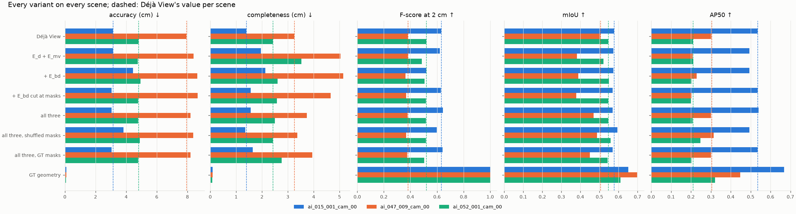

*Every score of every variant; dashed: Déjà View per scene.*

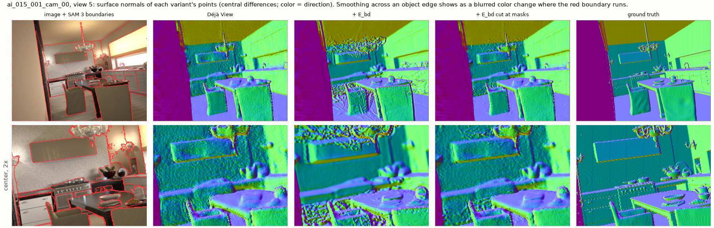

*Kitchen, view 5: surface normals. Uncut bending (+ E_bd) melts the cupboards, chandelier and
table into each other. Cut at the SAM 3 boundaries (red), it keeps Déjà View's edges.*

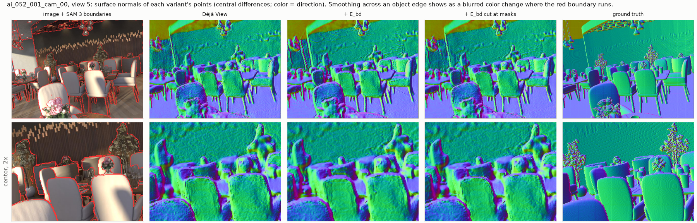 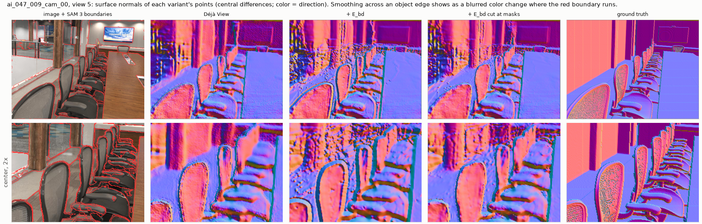

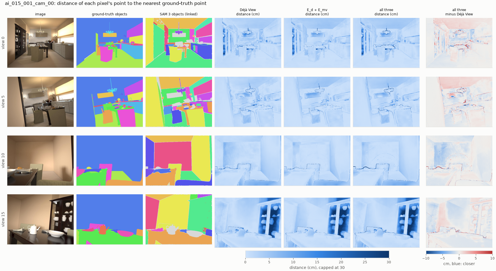

*Kitchen, 4 of 20 views. Columns 4–6: each pixel's registered point's distance to the nearest
ground-truth point, in cm (accuracy, per pixel). Last column: "all three" minus Déjà View; blue
means closer.*

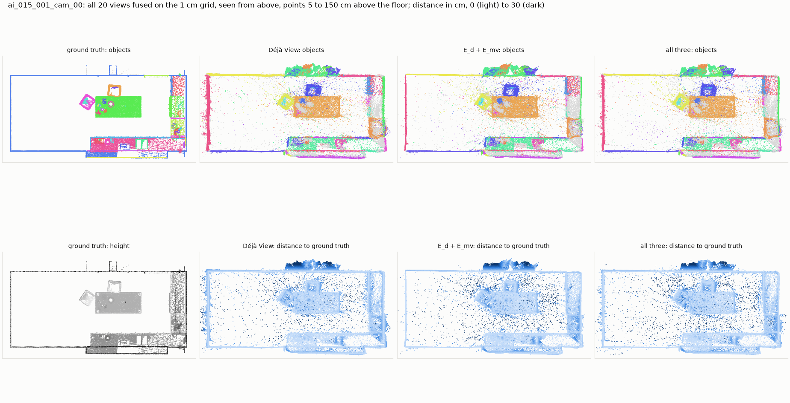

*Kitchen from above: furniture between 5 cm and 1.5 m above the floor.*

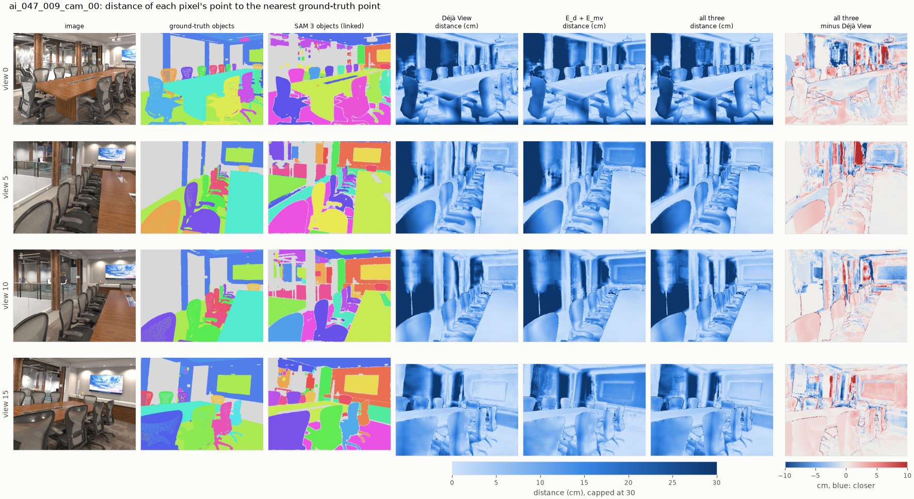

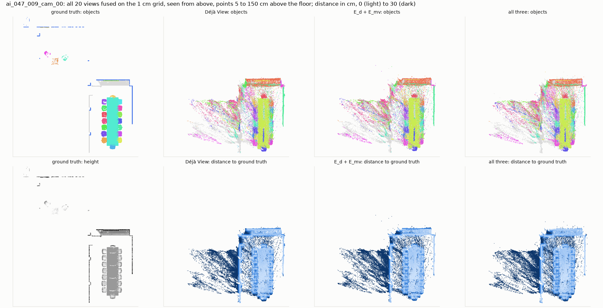

*Conference room: the streaks on the left are Déjà View's depth through the glass wall, where
the ground truth has no surface. They make up most of the accuracy error.*

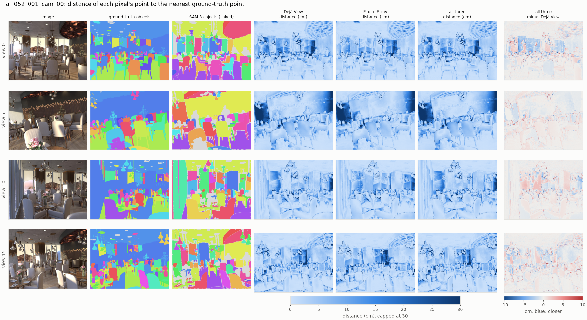

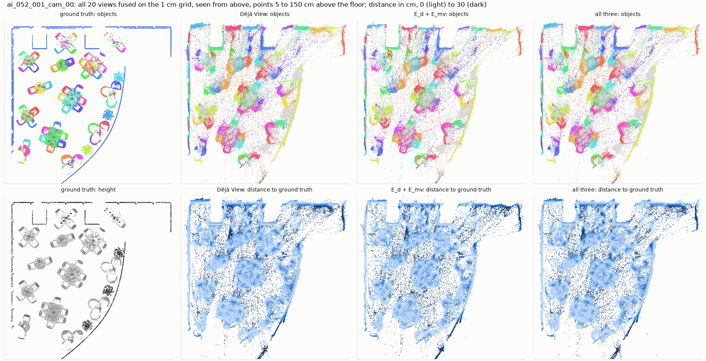

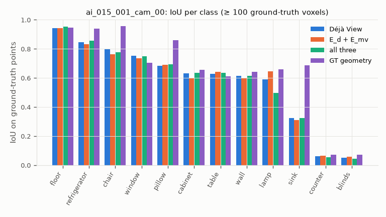
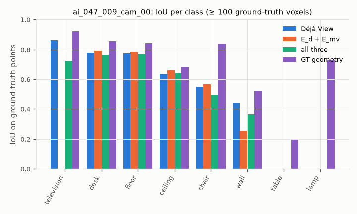
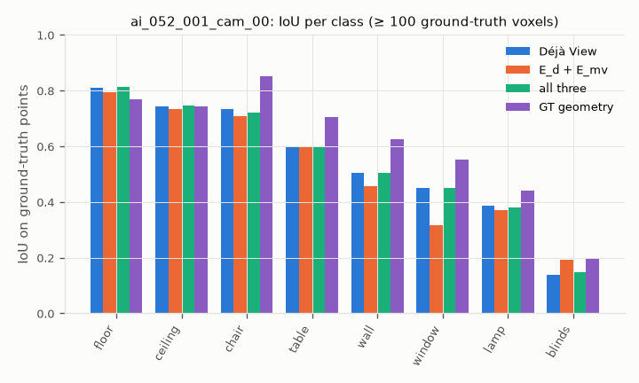

## Results

Precision, recall and F-score at 2 cm.

Kitchen `ai_015_001`:

| variant | accuracy (cm) | completeness (cm) | precision | recall | F-score | mIoU | AP50 | scale | disagreement (%) | time (s) |
|---|---|---|---|---|---|---|---|---|---|---|
| Déjà View | 3.13 | 1.39 | 0.521 | 0.806 | 0.633 | 0.577 | 0.535 | 2.732 | 0.50 | 0.0 |
| E_d + E_mv | 3.13 | 1.97 | 0.581 | 0.667 | 0.621 | 0.573 | 0.493 | 2.727 | 0.04 | 2.5 |
| + E_bd | 4.44 | 2.13 | 0.441 | 0.629 | 0.518 | 0.573 | 0.493 | 2.745 | 0.04 | 3.0 |
| + E_bd cut at masks | 3.05 | 1.56 | 0.543 | 0.748 | 0.629 | 0.569 | 0.535 | 2.730 | 0.33 | 1.7 |
| all three | 3.05 | 1.57 | 0.569 | 0.742 | 0.644 | 0.569 | 0.541 | 2.729 | 0.28 | 1.4 |
| all three, shuffled masks | 3.82 | 1.35 | 0.471 | 0.826 | 0.600 | 0.595 | 0.493 | 2.752 | 0.56 | 3.2 |
| all three, GT masks | 3.05 | 1.64 | 0.572 | 0.730 | 0.641 | 0.569 | 0.535 | 2.727 | 0.24 | 2.4 |
| GT geometry | 0.09 | 0.09 | 1.000 | 1.000 | 1.000 | 0.651 | 0.668 | 1.000 | – | 0.0 |

Conference room `ai_047_009`:

| variant | accuracy (cm) | completeness (cm) | precision | recall | F-score | mIoU | AP50 | scale | disagreement (%) | time (s) |
|---|---|---|---|---|---|---|---|---|---|---|
| Déjà View | 7.94 | 3.25 | 0.271 | 0.641 | 0.381 | 0.505 | 0.304 | 3.839 | 0.96 | 0.0 |
| E_d + E_mv | 8.39 | 5.03 | 0.314 | 0.486 | 0.382 | 0.382 | 0.209 | 3.855 | 0.05 | 2.5 |
| + E_bd | 8.64 | 5.14 | 0.290 | 0.488 | 0.364 | 0.390 | 0.228 | 3.854 | 0.06 | 3.1 |
| + E_bd cut at masks | 8.68 | 4.66 | 0.290 | 0.501 | 0.367 | 0.378 | 0.204 | 3.856 | 0.18 | 2.0 |
| all three | 8.20 | 3.73 | 0.293 | 0.528 | 0.377 | 0.469 | 0.300 | 3.840 | 0.19 | 4.2 |
| all three, shuffled masks | 8.37 | 3.37 | 0.262 | 0.618 | 0.368 | 0.487 | 0.314 | 3.846 | 0.76 | 3.1 |
| all three, GT masks | 8.19 | 3.94 | 0.294 | 0.517 | 0.375 | 0.450 | 0.300 | 3.847 | 0.13 | 4.3 |
| GT geometry | 0.09 | 0.09 | 1.000 | 1.000 | 1.000 | 0.698 | 0.448 | 1.000 | – | 0.0 |

Restaurant `ai_052_001`:

| variant | accuracy (cm) | completeness (cm) | precision | recall | F-score | mIoU | AP50 | scale | disagreement (%) | time (s) |
|---|---|---|---|---|---|---|---|---|---|---|
| Déjà View | 4.80 | 2.43 | 0.408 | 0.712 | 0.519 | 0.547 | 0.210 | 4.323 | 0.64 | 0.0 |
| E_d + E_mv | 4.76 | 3.52 | 0.436 | 0.550 | 0.486 | 0.521 | 0.211 | 4.324 | 0.05 | 2.5 |
| + E_bd | 4.93 | 2.61 | 0.403 | 0.678 | 0.506 | 0.550 | 0.203 | 4.330 | 0.49 | 1.4 |
| + E_bd cut at masks | 4.78 | 2.58 | 0.415 | 0.687 | 0.517 | 0.546 | 0.202 | 4.324 | 0.51 | 2.3 |
| all three | 4.78 | 2.50 | 0.410 | 0.698 | 0.517 | 0.545 | 0.208 | 4.326 | 0.54 | 2.0 |
| all three, shuffled masks | 4.90 | 2.42 | 0.405 | 0.711 | 0.516 | 0.558 | 0.247 | 4.326 | 0.61 | 1.1 |
| all three, GT masks | 4.79 | 2.76 | 0.415 | 0.644 | 0.505 | 0.543 | 0.203 | 4.327 | 0.33 | 2.6 |
| GT geometry | 0.07 | 0.07 | 1.000 | 1.000 | 1.000 | 0.610 | 0.322 | 1.000 | – | 0.0 |
## Findings

Three scenes; only patterns that hold on all three are claimed.

1. **The pipeline runs end to end on Hypersim** and is scored on its output alone.
   - Déjà View's cloud is 3.1–7.9 cm from the ground truth on average (F-score 0.38–0.63).
   - With true geometry, the SAM 3 labels reach mIoU 0.61–0.70 and AP50 0.32–0.67; with Déjà
     View's, mIoU 0.51–0.58 and AP50 0.21–0.54. Geometry costs 0.06–0.19 mIoU.
2. **Agreement (E_d + E_mv) trades recall for precision; the F-score does not improve.**
   - Precision rises on every scene (+0.060, +0.043, +0.028), recall falls (−0.14, −0.16, −0.16).
   - F-score: 0.633 → 0.621, 0.381 → 0.382, 0.519 → 0.486.
   - The views agree to 0.04–0.05 % instead of 0.5–1 %: one surface instead of 20 layers. The
     layers had covered more of the truth (recall); the single surface is not closer to it.
   - On the conference room, plain agreement costs 0.12 mIoU and 0.10 AP50, with completeness
     3.2 → 5.0 cm, in all three runs: labels are transferred within 5 cm, so a surface that
     moves away from the truth loses its labels too. "All three" moves it less (3.7–3.9 cm);
     how much of the labels it keeps varies between runs (mIoU 0.40–0.47).
3. **Smoothing must stop at object boundaries.** Cut at SAM 3's boundaries, E_bd scores higher
   than uncut on the kitchen and the restaurant and the same on the conference room: F-score
   0.629 vs 0.518, 0.517 vs 0.506, 0.367 vs 0.364. Uncut, it raises the kitchen's accuracy error
   from 3.13 to 4.44 cm, and the normal maps show it melting the kitchen's objects together.
4. **All three semantic terms together score like Déjà View**, and the masks are not what makes
   it so:
   - F-score, all three vs Déjà View: 0.644 vs 0.633, 0.377 vs 0.381, 0.517 vs 0.519.
   - With shuffled masks: 0.600, 0.368, 0.516. With GT masks: 0.641, 0.375, 0.505.
   - The shuffle control separates from the real masks on the kitchen only (−0.044). GT masks
     score no higher than SAM 3's anywhere. So the semantic terms mostly hold the refinement
     back (disagreement stays at 0.2–0.5 %), and what they hold back is agreement, which did
     not help.
5. **Next:** the refinement redistributes error between views, and nothing in it knows the
   error the views share. Candidates: a shape prior (planarity for walls, floors and tables,
   E_pr in the method), and better cameras or depth from another backbone (MoGe-2).
