# Evaluation protocol: Déjà View against the refined cloud on three Hypersim scenes

Run `runs/eval_hypersim-20261103-124707` (`configs/eval_hypersim.yaml`, `configs/refine.yaml`;
git `d8d06b4` plus the uncommitted figure code of the commit that adds this report). Reproduce:

```bash
uv run dsine-predict data/processed/hypersim/*/views_n20_uniform_504.npz
uv run python -m src.analysis.scene_eval --cfg configs/eval_hypersim.yaml       # 1.5 min
uv run python -m src.analysis.scene_figures --run runs/eval_hypersim-<time>     # 2 min
```

## Setup

- **Scenes:** Hypersim validation split, 20 views each, uniform over the trajectory, 504 × 378:
  `ai_015_001` (kitchen), `ai_047_009` (conference room), `ai_052_001` (restaurant). The test
  split is never used.
- **Pipeline:** Déjà View (K = 16) → SAM 3 image mode, one prompt per NYU40 class, threshold
  0.3, linked across views → DSINE normals on Déjà View's intrinsics → joint refinement.
- **Energy** (`src/refinement/multiview.py`), Gauss-Newton, 10 steps of 20 CG iterations:
  E = E_d + E_mv + E_bd + E_n + ‖δ‖², **every weight 1, none tuned**. E_d is Huber,
  weighted by confidence × consistency u; E_bd and E_mv stay within one linked instance;
  a, b per (view, instance).
- **Black box:** only the output cloud is scored, registered onto the ground truth from the
  clouds alone (first-camera start, ICP with scale; `labeled.register`).
- **Scores** (`src/evaluation/labeled.py`), on a 1 cm grid: accuracy and completeness (mean,
  capped at 20 cm), precision, recall and F-score at 5 cm, for the scene and per class; mIoU
  and AP50 on labels transferred to the ground-truth points within 5 cm. Disagreement
  between overlapping views is a diagnostic, not a score.

## Results

| scene | variant | accuracy (cm) | completeness (cm) | precision | recall | F-score | mIoU | AP50 | disagreement (%) | GN steps | s |
|---|---|---|---|---|---|---|---|---|---|---|---|
| kitchen | Déjà View | 3.13 | 1.39 | 0.851 | 0.977 | 0.910 | 0.577 | 0.535 | 0.50 | – | – |
| kitchen | Refined | 3.70 | 2.11 | 0.758 | 0.881 | 0.815 | 0.457 | 0.375 | 0.74 | 10 | 5.2 |
| conference | Déjà View | 7.94 | 3.25 | 0.495 | 0.852 | 0.626 | 0.505 | 0.304 | 0.96 | – | – |
| conference | Refined | 8.25 | 4.00 | 0.450 | 0.785 | 0.572 | 0.479 | 0.322 | 1.33 | 10 | 5.1 |
| restaurant | Déjà View | 4.80 | 2.43 | 0.687 | 0.895 | 0.777 | 0.547 | 0.210 | 0.64 | – | – |
| restaurant | Refined | 8.07 | 4.68 | 0.461 | 0.703 | 0.556 | 0.430 | 0.065 | 1.63 | 10 | 5.1 |

F-score at 5 cm per class, Déjà View → Refined:

| class | kitchen | conference | restaurant |
|---|---|---|---|
| wall | 0.94 → 0.85 | 0.70 → 0.59 | 0.74 → 0.43 |
| floor | 0.99 → 0.95 | 0.88 → 0.82 | 0.95 → 0.88 |
| chair | 0.89 → 0.67 | 0.46 → 0.46 | 0.75 → 0.50 |
| table | 0.92 → 0.86 | 0.00 → 0.00 (finding 6) | 0.81 → 0.60 |

Energy at the start and after 10 steps (means over all pixels; λ = 1):

| scene | E_d | E_mv | E_bd | E_n | ‖δ‖² |
|---|---|---|---|---|---|
| kitchen | 0 → 0.0005 | 0.0003 → 0.0024 | 0.0010 → 0.000001 | **54.7** → 0.056 | 0 → 0.0047 |
| conference | 0 → 0.0005 | 0.0007 → 0.0043 | 0.0007 → 0.000001 | **43.0** → 0.130 | 0 → 0.0029 |
| restaurant | 0 → 0.0007 | 0.0005 → 0.0164 | 0.0037 → 0.000001 | **108** → 0.189 | 0 → 0.0138 |

## Figures

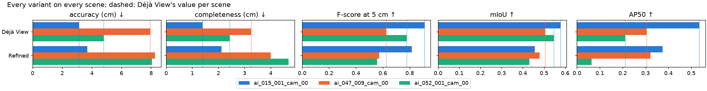

*Every score of every variant; dashed: Déjà View per scene.*

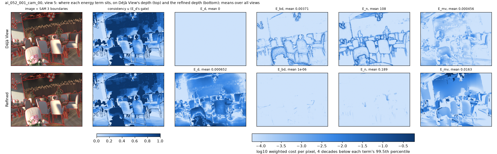

*Restaurant, view 5: each term's weighted cost per pixel on Déjà View's depth (top) and the
refined depth (bottom), log scale over four decades below each term's 99.5th percentile.
Second column: the consistency u that gates E_d (dark: all other views agree on the
instance).*

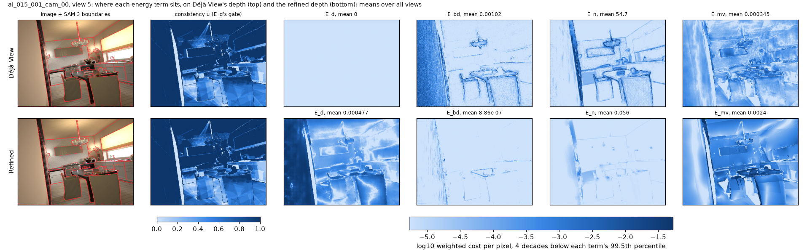
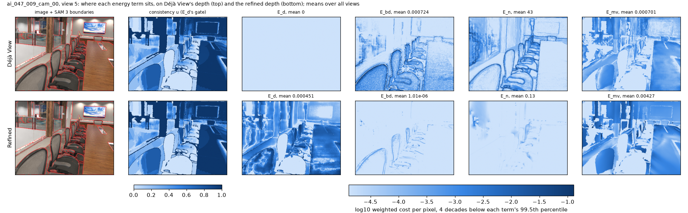

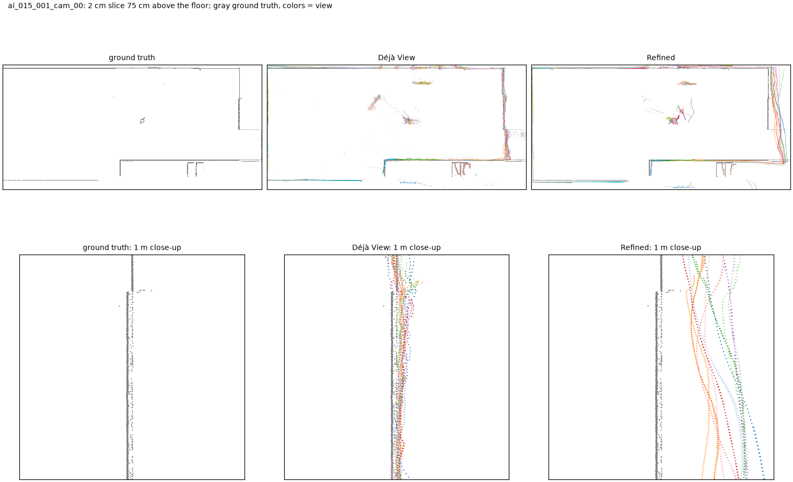

*Kitchen: a 2 cm slice 75 cm above the floor, gray ground truth, one color per view; bottom:
1 m of the right-hand wall. Déjà View's views lie within about 3 cm of each other around the
wall; refined, each view's wall is smooth but tilted on its own, and the views fan out over
several centimetres, farther from the truth.*

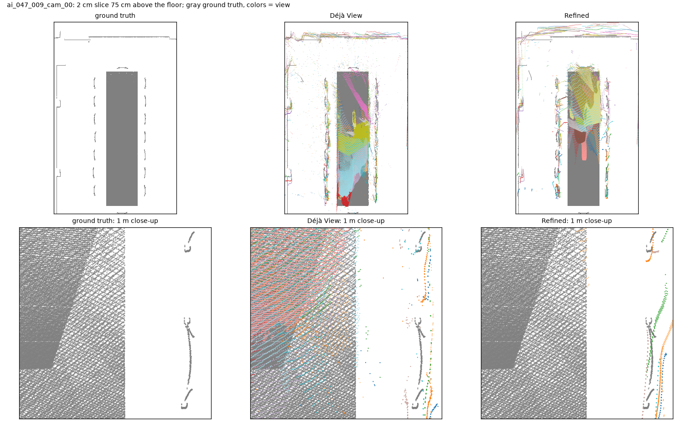
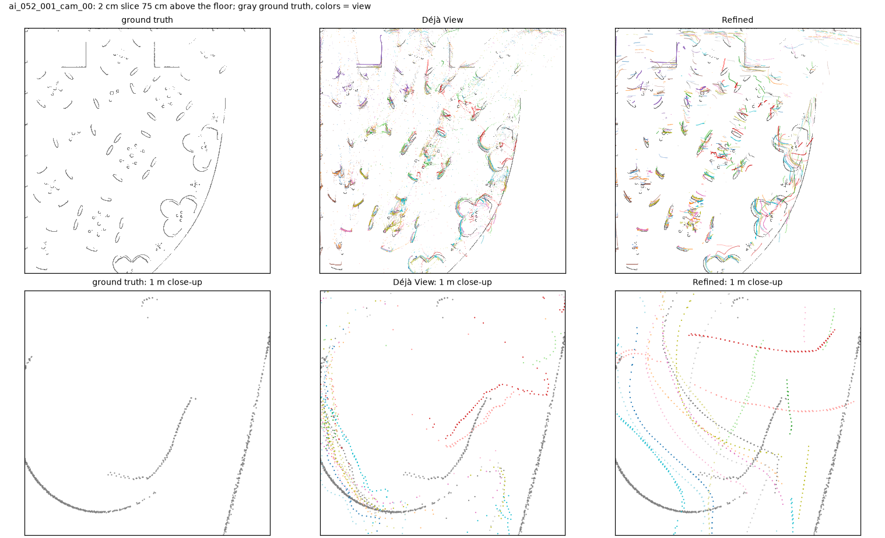

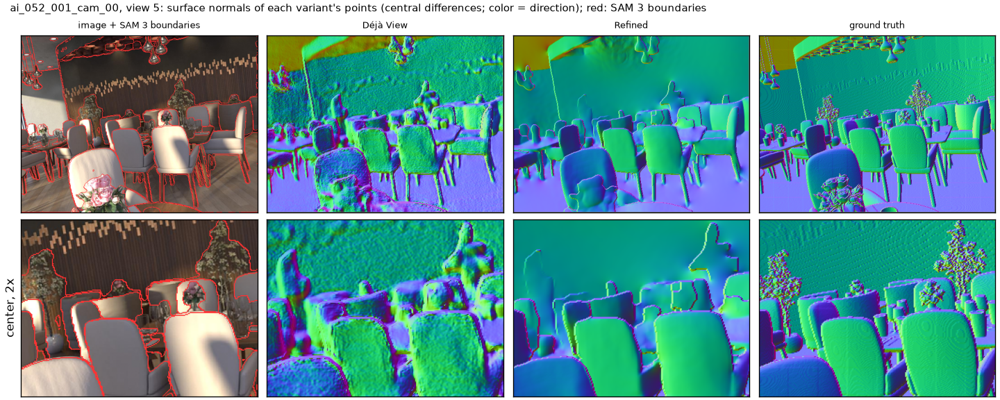

*Restaurant, view 5: surface normals of each variant (central differences, color =
direction). The refined chairs and wall are smooth where Déjà View's are bumpy, and look
like the ground truth's.*

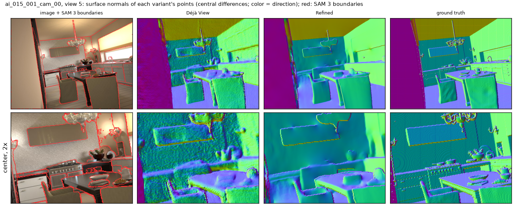
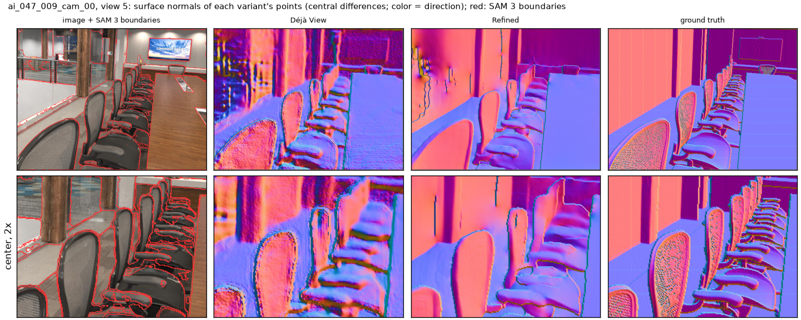

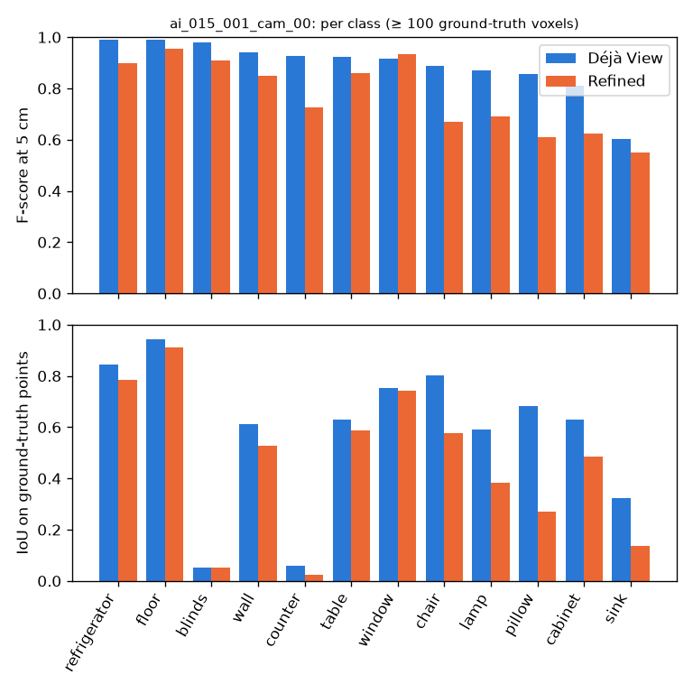
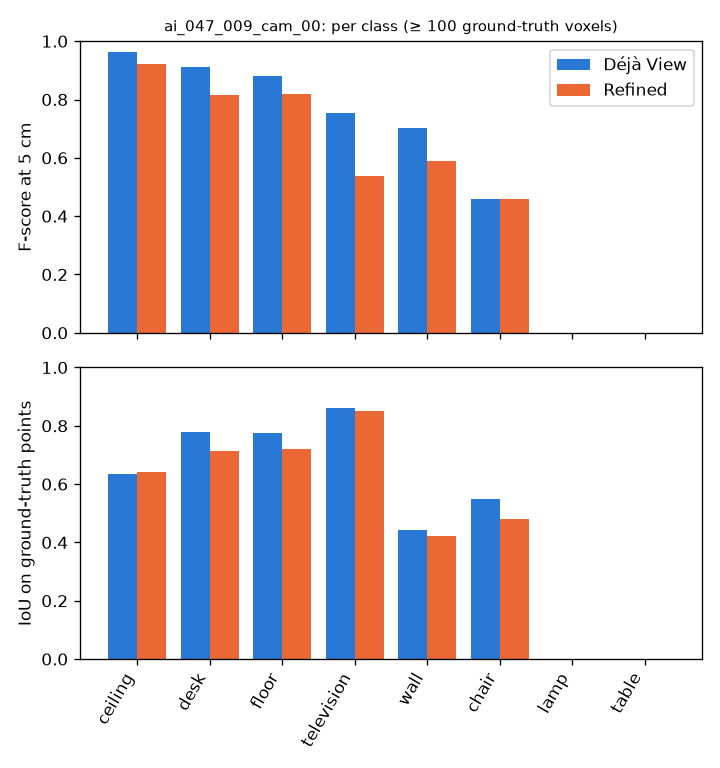
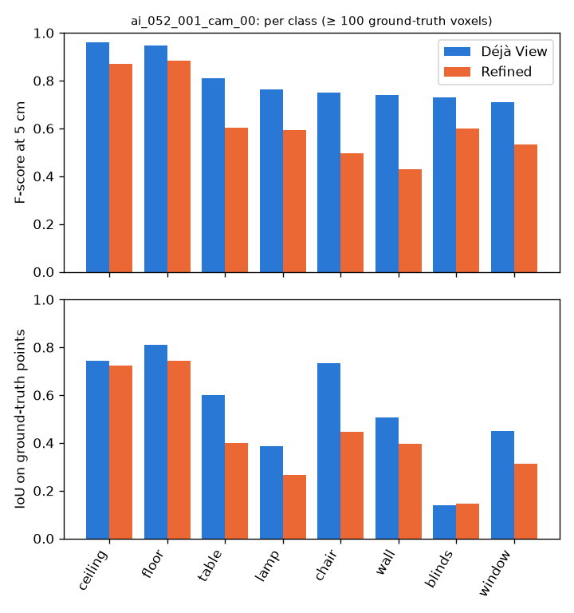

*F-score at 5 cm and IoU per class with at least 100 ground-truth voxels.*

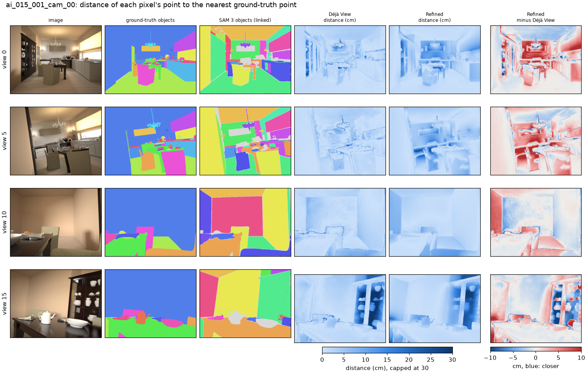

*Kitchen, 4 of 20 views: each pixel's distance to the nearest ground-truth point, in cm; last
column: Refined minus Déjà View, blue means closer.*

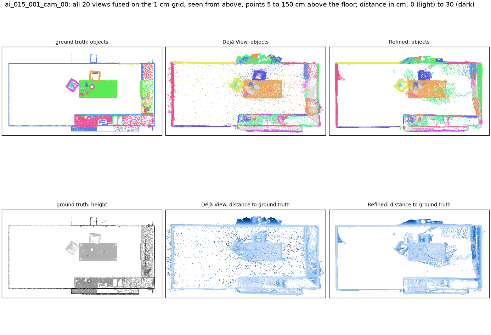
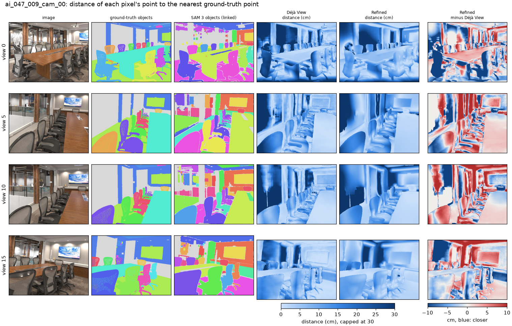
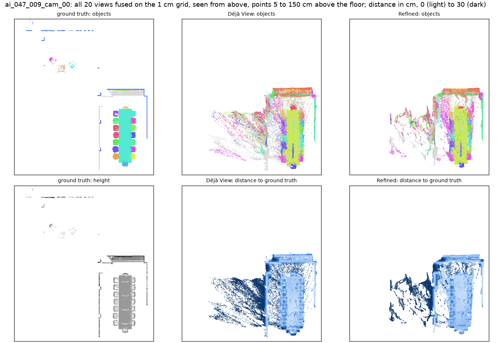
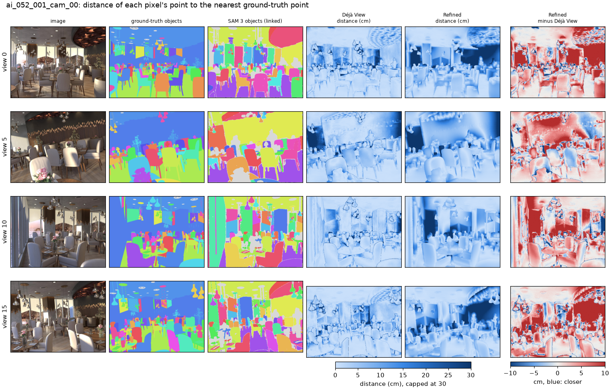
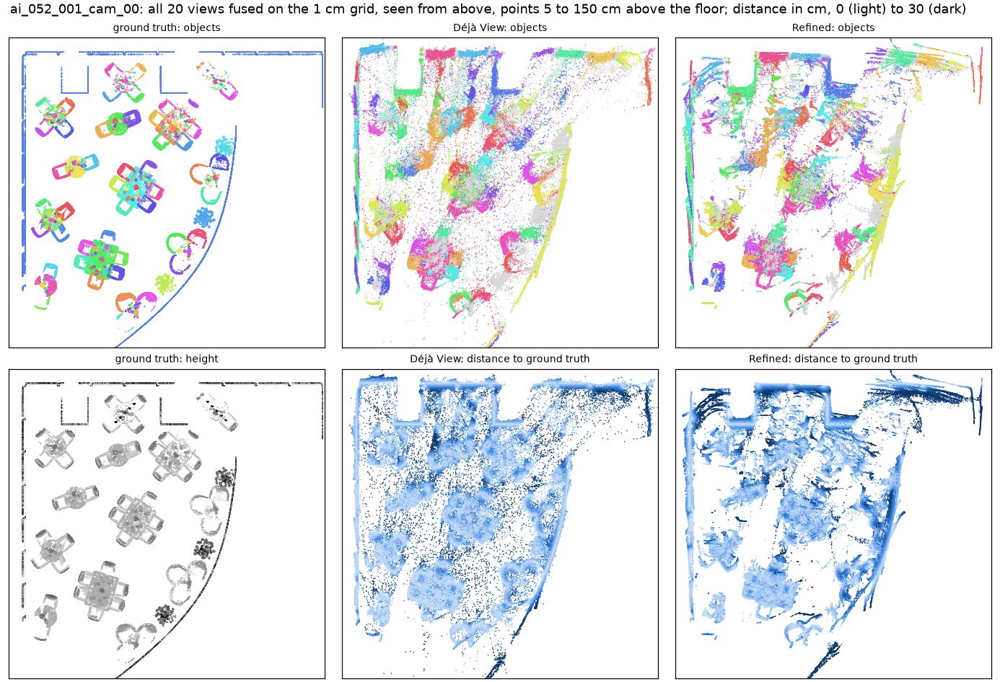

## Findings

Three scenes, one run; claims hold on all three unless a scene is named.

1. **The solve now runs to the end.** All 10 Gauss-Newton steps are accepted on every scene.
   Before E_bd was confined to segments, the unmasked pixels formed one segment across depth
   jumps between unrelated surfaces; the steps that would flatten them drove inverse depth
   negative, and the step halving stopped the solve after 5 of 10 steps.
2. **At weight 1, E_n decides the result.** It starts at 43–108, every other term at 0.004 or
   less, so the solve mostly fits each view to DSINE's normals. Its cost sits on object
   outlines (energy maps, top row). Weights equal in number are not equal in effect: the
   terms have different units.
3. **The views drift apart, and the cloud gets worse.** Disagreement between views rises
   (0.50 → 0.74 %, 0.96 → 1.33 %, 0.64 → 1.63 %), and E_mv grows 6–36× during the solve. The
   F-score at 5 cm falls on every scene (0.910 → 0.815, 0.626 → 0.572, 0.777 → 0.556) and in
   every class in the table except the conference chairs (0.46 both), walls most (restaurant
   0.74 → 0.43). The cross sections show why: each view's wall is smooth but tilted on its
   own.
4. **Shapes do follow the normals.** The normal maps of the refined views are smooth where
   Déjà View's are bumpy; whether that survives a weighting that keeps the views together is
   the open question for the weights.
5. **Labels follow geometry.** mIoU falls by 0.03–0.12, as labels transfer only within 5 cm
   of the ground truth; AP50 falls on the kitchen (0.535 → 0.375) and the restaurant
   (0.210 → 0.065) and rises slightly on the conference room (0.304 → 0.322).
6. **Conference room, table and lamp:** no predicted point lies within 20 cm of them in either
   variant (completeness at the cap), so their F-score is 0. They are probably the furniture
   behind the glass wall, where Déjà View puts the glass.
