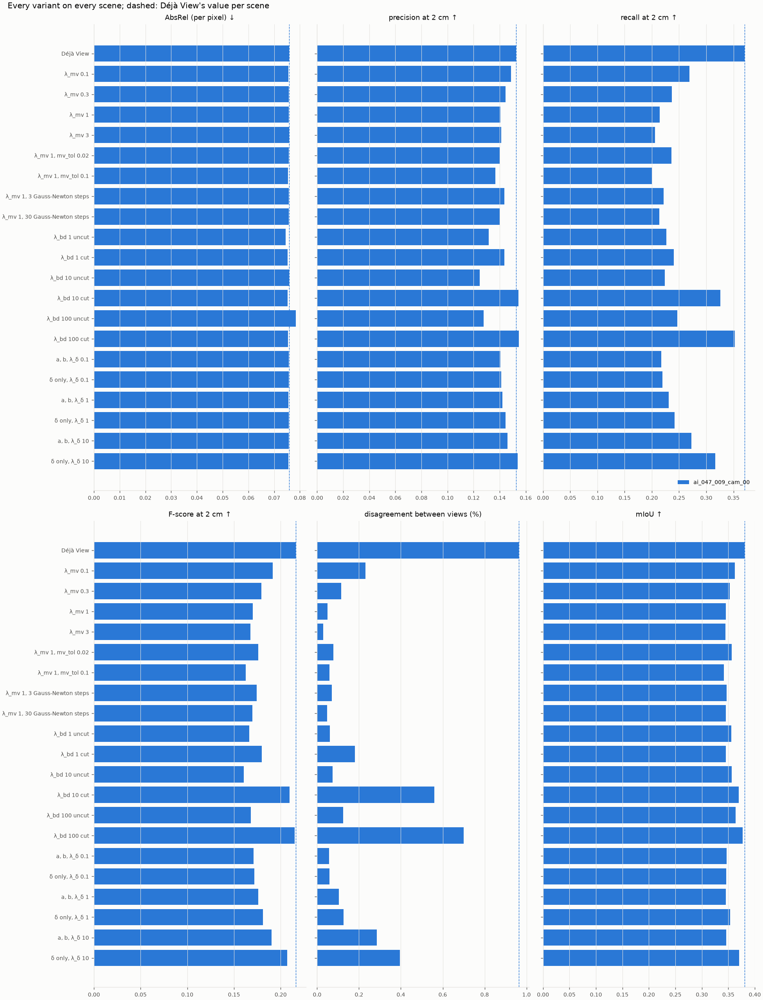

# Weight grid of the joint refinement on one Hypersim scene

Run `runs/eval_hypersim_tuning-20261102-230125` (`configs/eval_hypersim_tuning.yaml`, git `6ea3d3e`,
tree dirty: the uncommitted change was the same-segment option, which no variant here uses).
Draw it with `uv run python -m src.analysis.scene_figures --run runs/eval_hypersim_tuning-20261102-230125 --tuning`.

- **Scene:** Hypersim `ai_047_009` (conference room, validation split), 20 views at 504 × 378.
  This is the only scene the weights were chosen on; the kitchen and the restaurant are held out.
- **Inputs:** Déjà View K = 16, cameras its own. SAM 3 with one prompt per NYU40 class, linked
  across views.
- **Base:** `configs/refine.yaml` (E_d + E_mv, λ_mv = 1, 10 Gauss-Newton steps of 20 CG
  iterations). Each row changes one thing.
- **Scores:** all from `src/evaluation/labeled.py`, on a 1 cm voxel grid after one similarity
  fitted on the backbone's pixels. Precision is the share of predicted points within 2 cm of the
  ground truth, recall the share of ground truth within 2 cm of a prediction. AbsRel is the
  per-pixel depth error. Disagreement is the median depth gap between overlapping views.

*One bar per variant; dashed: Déjà View, the input.*

| variant | AbsRel | precision 2 cm | recall 2 cm | F-score 2 cm | disagreement (%) | mIoU | AP50 | time (s) |
|---|---|---|---|---|---|---|---|---|
| Déjà View | 0.0758 | 0.152 | 0.371 | 0.216 | 0.96 | 0.381 | 0.322 | 0.0 |
| λ_mv 0.1 | 0.0756 | 0.149 | 0.269 | 0.192 | 0.23 | 0.362 | 0.315 | 2.5 |
| λ_mv 0.3 | 0.0756 | 0.145 | 0.236 | 0.179 | 0.11 | 0.353 | 0.315 | 2.4 |
| λ_mv 1 | 0.0757 | 0.141 | 0.215 | 0.170 | 0.05 | 0.345 | 0.308 | 2.4 |
| λ_mv 3 | 0.0758 | 0.141 | 0.206 | 0.167 | 0.03 | 0.344 | 0.315 | 2.4 |
| λ_mv 1, mv_tol 0.02 | 0.0757 | 0.140 | 0.236 | 0.176 | 0.08 | 0.357 | 0.315 | 2.1 |
| λ_mv 1, mv_tol 0.1 | 0.0754 | 0.137 | 0.201 | 0.163 | 0.06 | 0.341 | 0.315 | 2.5 |
| λ_mv 1, 3 Gauss-Newton steps | 0.0757 | 0.144 | 0.221 | 0.174 | 0.07 | 0.347 | 0.315 | 0.9 |
| λ_mv 1, 30 Gauss-Newton steps | 0.0757 | 0.140 | 0.214 | 0.169 | 0.05 | 0.345 | 0.308 | 7.1 |
| λ_bd 1 uncut | 0.0745 | 0.132 | 0.226 | 0.166 | 0.06 | 0.356 | 0.336 | 3.0 |
| λ_bd 1 cut | 0.0752 | 0.144 | 0.240 | 0.180 | 0.18 | 0.345 | 0.308 | 2.0 |
| λ_bd 10 uncut | 0.0758 | 0.125 | 0.224 | 0.160 | 0.07 | 0.356 | 0.326 | 3.0 |
| λ_bd 10 cut | 0.0752 | 0.154 | 0.326 | 0.209 | 0.56 | 0.369 | 0.322 | 1.7 |
| λ_bd 100 uncut | 0.0784 | 0.128 | 0.247 | 0.168 | 0.13 | 0.364 | 0.326 | 3.0 |
| λ_bd 100 cut | 0.0754 | 0.155 | 0.353 | 0.215 | 0.70 | 0.377 | 0.322 | 0.8 |
| a, b, λ_δ 0.1 | 0.0756 | 0.141 | 0.218 | 0.171 | 0.06 | 0.347 | 0.315 | 3.2 |
| δ only, λ_δ 0.1 | 0.0757 | 0.141 | 0.220 | 0.172 | 0.06 | 0.346 | 0.315 | 2.4 |
| a, b, λ_δ 1 | 0.0755 | 0.142 | 0.231 | 0.176 | 0.10 | 0.345 | 0.315 | 3.3 |
| δ only, λ_δ 1 | 0.0756 | 0.144 | 0.242 | 0.181 | 0.13 | 0.353 | 0.315 | 2.6 |
| a, b, λ_δ 10 | 0.0756 | 0.146 | 0.273 | 0.190 | 0.28 | 0.346 | 0.315 | 3.3 |
| δ only, λ_δ 10 | 0.0756 | 0.154 | 0.317 | 0.207 | 0.39 | 0.371 | 0.315 | 1.9 |

## Findings

- **No setting beats the input on this scene.** Every refined variant has a lower F-score at
  2 cm than Déjà View's 0.216. The closest ones are those that move the depth least.
- **The loss is in recall, not precision.**
  - With λ_mv = 1, precision drops by 0.011 (0.152 → 0.141), while recall drops by 0.156
    (0.371 → 0.215).
  - Meanwhile the views' disagreement falls from 0.96 % to 0.05 %, and AbsRel does not move
    (0.0758 → 0.0757).
  - The agreement does what it is built for: the 20 views become one surface. That surface is
    no closer to the ground truth per pixel. The input's 20 slightly different layers, however,
    happened to straddle the true surface, and nearest-neighbor recall rewards that.
- **Cutting the bending energy at SAM 3 mask boundaries matters.** At every λ_bd, the cut
  variant has higher precision and recall than the uncut one: F-score 0.180 vs 0.166 at 1,
  0.209 vs 0.160 at 10, 0.215 vs 0.168 at 100.
  - Uncut smoothing bends surfaces across object edges.
  - Part of this gain comes from moving less: with cuts, the views still disagree by 0.56–0.70 %.
- **Per-segment a, b do not beat the same λ_δ without them.** At λ_δ = 10, δ alone scores
  F 0.207, with a, b 0.190. A whole segment can now move cheaply, and since agreement costs
  recall here, a cheaper move costs more.
- **The solver budget is not the issue.** 3, 10 and 30 Gauss-Newton steps score within 0.005
  F-score of one another.
- **Weights taken for the protocol run:** λ_bd = 100 with cuts and λ_δ = 10. Within each kind
  they are the settings closest to the input, chosen on this scene only.
