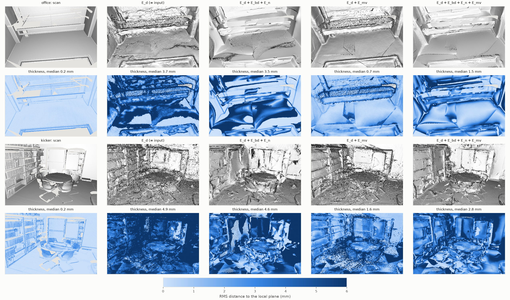
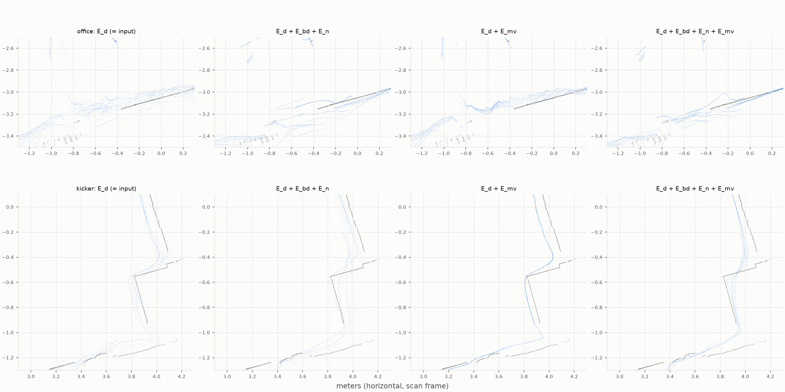

# eval_multiview-20261027-162823

git `6c913c2ee280f20b294317b47dd351dc288d54d9`

Joint refinement of all 20 views per scene (`multiview.py`) against ETH3D's laser scans, office and kicker. Weights
from ScanNet++ (as in `eval_eth3d`); λ_mv = 1, the 5 % match tolerance and the solver budget were set before this run
and on the input or the energy, never on these metrics. Images and laser scans: ETH3D (Schöps et al., CVPR 2017),
CC BY-NC-SA 4.0; the figures that show them are adapted from it under the same licence. The data itself is not in
this repository.

Fused cloud: Déjà View's points of all views, mapped by one similarity fitted to the camera centers (the same for
every variant), scored on 200k fixed pixels the scan saw. Thickness: RMS distance to the local plane on a 5 mm voxel
grid (layering and noise, no ground truth needed). Disagreement: median |log depth ratio| over the input's matches.

## fused cloud of all 20 views

| scene | variant | median (cm) | mean (cm) | ≤ 1 cm | ≤ 2 cm | ≤ 5 cm | thickness (mm) | angle to scan (°) | disagreement (%) | seconds |
|---|---|---|---|---|---|---|---|---|---|---|
| office | E_d (= input) | 1.52 | 3.61 | 33.8% | 62.3% | 84.2% | 3.77 | 10.2 | 0.436 | 1 |
| office | E_d + E_bd + E_n | 1.65 | 3.68 | 31.2% | 59.3% | 83.2% | 3.62 | 8.9 | 0.508 | 2 |
| office | E_d + E_mv | 1.40 | 3.52 | 35.1% | 65.0% | 85.5% | 0.74 | 4.8 | 0.028 | 3 |
| office | E_d + E_bd + E_mv | 1.41 | 3.47 | 35.2% | 65.1% | 85.9% | 0.63 | 4.4 | 0.029 | 3 |
| office | E_d + E_bd + E_n + E_mv | 1.58 | 3.53 | 31.2% | 60.4% | 85.9% | 1.65 | 5.1 | 0.083 | 4 |
| office | scan | | | | | | 0.22 | | | |
| kicker | E_d (= input) | 1.60 | 2.58 | 34.7% | 58.3% | 88.1% | 4.90 | 13.7 | 0.808 | 2 |
| kicker | E_d + E_bd + E_n | 1.74 | 2.89 | 33.0% | 55.1% | 84.5% | 4.74 | 11.6 | 1.052 | 4 |
| kicker | E_d + E_mv | 1.43 | 2.38 | 38.5% | 62.0% | 90.0% | 1.45 | 7.9 | 0.052 | 4 |
| kicker | E_d + E_bd + E_mv | 1.45 | 2.33 | 38.5% | 61.6% | 90.0% | 1.23 | 7.5 | 0.044 | 5 |
| kicker | E_d + E_bd + E_n + E_mv | 1.54 | 2.60 | 36.8% | 58.9% | 86.9% | 2.75 | 7.6 | 0.160 | 5 |
| kicker | scan | | | | | | 0.21 | | | |

## per-view protocol: views [5, 10, 14] of each scene, mean over all

| variant | median (cm) | mean (cm) | ≤ 1 cm | ≤ 2 cm | median per view (cm) |
|---|---|---|---|---|---|
| E_d (= input) | 1.68 | 2.79 | 38.3% | 62.7% | 1.64 3.17 0.68 1.91 1.17 1.53 |
| E_d + E_bd + E_n | 1.62 | 3.03 | 34.4% | 61.7% | 1.63 2.35 0.84 1.92 1.52 1.48 |
| E_d + E_mv | 1.59 | 2.78 | 38.7% | 61.4% | 1.51 2.86 0.56 1.79 1.36 1.46 |
| E_d + E_bd + E_mv | 1.60 | 2.72 | 38.7% | 61.3% | 1.51 2.87 0.56 1.76 1.38 1.50 |
| E_d + E_bd + E_n + E_mv | 1.65 | 3.02 | 37.1% | 59.9% | 1.58 2.89 0.61 1.96 1.42 1.45 |

Camera similarity (Déjà View to ETH3D centers), median residual: office 1.29 cm, kicker 1.43 cm.

## mv_renders

All 20 views fused, from a viewpoint 0.8 m behind and 0.5 m above view 10, on a 5 mm voxel grid. Top: headlight shading of each grid point's local plane (24 neighbors). Bottom: that plane's RMS thickness. Layers of views that disagree show as mottled shading and a thick surface; the scan is the reference. Medians here are over every point in view, the table's over the pixels the scan saw.

## mv_slices

A 2 cm horizontal slab at camera height, from above, zoomed on the wall where the input is most layered (chosen on the input). Gray: scan; blue: all 20 views fused. One wall should be one line.

## findings

- **Cross-view agreement removes the layering.** Déjà View's 20 views disagree by 0.4 % (office) and 0.8 % (kicker)
  of depth, about 1-2 cm, so every wall of the fused cloud is several parallel copies (`mv_slices`, input). With
  E_mv, the views agree to 0.03-0.05 %, the surface gets 4-5x thinner (3.8 -> 0.7 mm office, 4.9 -> 1.4 mm kicker;
  the scan's own is 0.2 mm) and its normals 2x closer to the scan's (10.2 -> 4.8°, 13.7 -> 7.9°). In the kicker
  slice, about six copies of the wall become one line.
- **Accuracy improves too, but less.** The fused median drops 8-10 % (1.52 -> 1.40 cm, 1.60 -> 1.43 cm) and the
  fraction within 2 cm rises 3-4 points. Under the per-view protocol (each view alone, its own median scale, ETH3D's
  cameras) the gain shrinks to 1.68 -> 1.59 cm: a view's own error barely changes, since most of it is shared by
  all views. Agreement averages away what the views disagree on, not what they agree on.
- **What remains is shared error.** The kicker wall is one clean line after E_mv but still up to ~10 cm off the scan
  at the top of the slice, and the corner at (4.0, -0.4) is rounded: every view puts it there. Part of this is
  the camera similarity (median center residual 1.3-1.4 cm), the rest is Déjà View's. Fixing it needs information
  the views do not share, which is what the semantic and planar terms are meant to bring.
- **Office's far wall stays a band.** About 3 m from every camera, it narrows from ~15 cm to ~5-8 cm but does not
  collapse: few neighboring views see it at a useful angle, so it has few matches.
- **Seams.** Straight steps on the office floor (`mv_renders`) mark where the set of views covering it changes: each
  region settles on its own consensus. A wider neighborhood, or E_bd across views, would be the place to look.
- **The normal term works against agreement.** Adding E_n (DSINE) to E_mv brings layers back (0.7 -> 1.6 mm,
  1.2 -> 2.8 mm) and loses the accuracy gain: each view follows its own DSINE biases, which differ between views.
  Bending is harmless and slightly helpful (0.74 -> 0.63 mm office).
- **Speed.** 2.5-3.2 s per scene for E_d + E_mv (+ E_bd) on an RTX 3080, 3.7-5.2 s with all terms, of which 1-2 s
  is setup (matches, occlusion cuts): Gauss-Newton with CG; L-BFGS took a minute.
- Limits: two scenes, one weight per term, 20 views each; Déjà View's cameras are kept fixed, so their errors are
  absorbed into depth.
