# mono_kitchen-20261027-101125

git `6652e10397d897d31ba45d821d3debfa0a9bf345`

| metric | value |
|---|---|
| refine_seconds | 4.416 |
| E_initial | 0.01107 |
| E_final | 0.0001809 |
| drift_pct_input | 0 |
| drift_pct_refined | 0.1893 |
| angle_to_normals_deg_input | 9.003 |
| angle_to_normals_deg_refined | 5.089 |

## ablation table

| variant | evaluations | seconds | drift_pct | angle_to_normals_deg |
|---|---|---|---|---|
| E_d (= input) | 2 | 0.07 | 0 | 9.003 |
| E_bd | 1254 | 4.30 | 0.03695 | 9.523 |
| E_n | 3520 | 13.10 | 2.25 | 2.196 |
| E_d + E_bd | 547 | 2.05 | 0.001865 | 7.413 |
| E_d + E_n | 563 | 2.13 | 0.1874 | 5.07 |
| E_bd + E_n | 3005 | 11.08 | 2.136 | 2.268 |
| E_d + E_bd + E_n | 584 | 2.14 | 0.1893 | 5.089 |
| BiNI CG, λ_depth = 100 | 3 | 0.21 | 0.1925 | 5.105 |

## Findings (looked at every figure)

Kitchen 5ee7c22ba0 view 13, same setup as office view 6 (pinhole rays, DSINE, cuts at edge_tol 0.02,
λ_n = 0.005 ≙ BiNI λ = 100, chosen on these two views). No GT depth.

- One energy alone. E_bd alone stalls after 1254 evaluations and ends further from DSINE than the input (9.5° vs
  9.0°): with cuts, each region bends toward its own plane, and the cabinet fronts become smooth bulges.
  E_n alone copies DSINE (2.2°) and drifts 2.3%.
- Pairs. E_d + E_bd: 7.4°, smoother, no detail. E_d + E_n: 5.07°, 0.19% drift. E_bd + E_n drifts like E_n.
- All three: 5.09°, the same as E_d + E_n.
- L-BFGS on E_d + E_n against BiNI's CG: median depth difference 0.11%, 5.07° vs 5.11°, 2.1 s vs 0.21 s.
  L-BFGS needs ~300 evaluations to match BiNI's angle (convergence.png).

## depth

Depth maps on one color scale: input, refined, and ground truth when known.

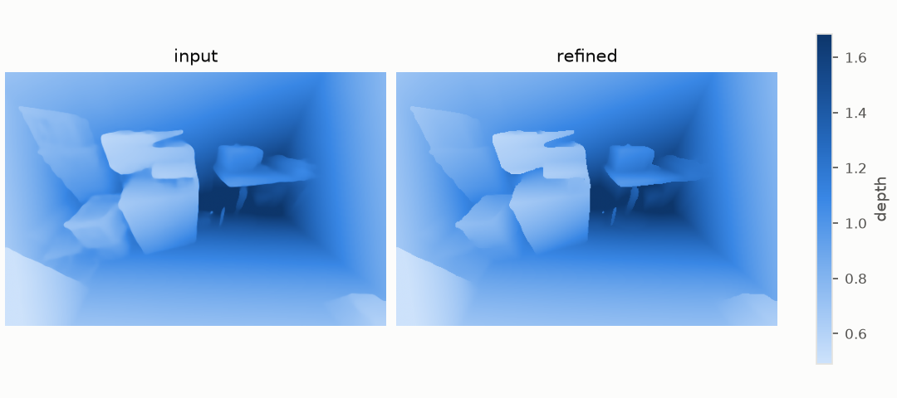

## delta

The dense residual δ that refinement adds to the normalized inverse depth.

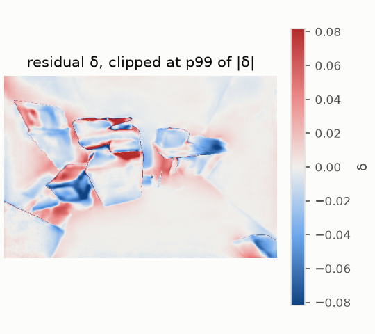

## profile

Depth along one image row through a crease.

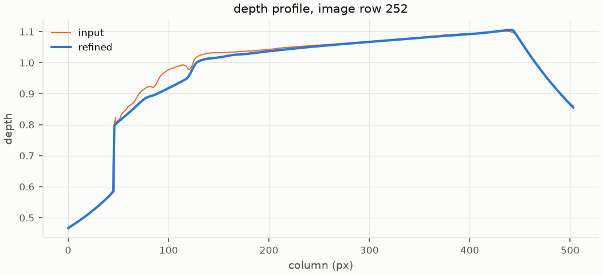

## points_topdown

Point clouds seen from above (x-z).

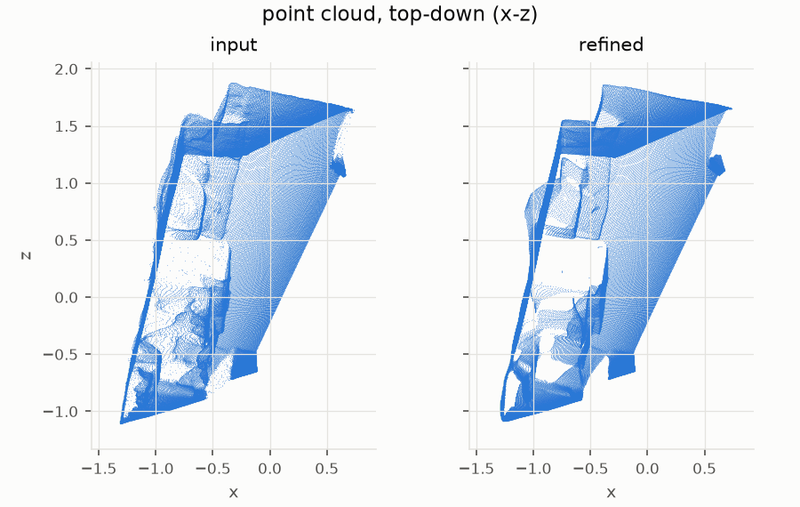

## ablation

Each energy alone, in pairs, and all together (columns), with BiNI's CG solution of E_d + E_n as reference. Top: normals of the result (central differences). Bottom: error against ground truth, or a zoom where the normals have the most detail. Iterations: up to 1000, 5000 where no data term anchors the result.

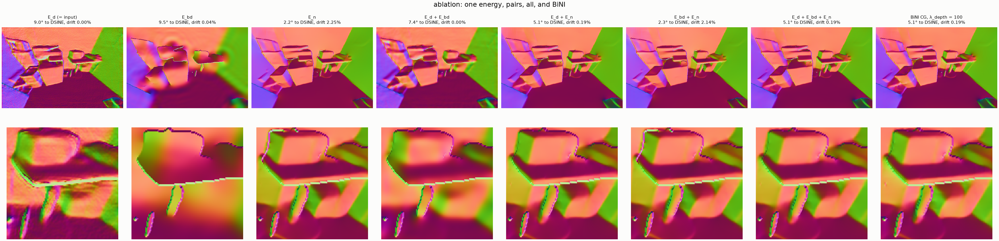

## ablation_profile

Depth along one image row for each variant, against the input and ground truth when known. For E_bd alone without contour cuts, dashed: the least-squares plane of the input's inverse depth, where it converges in the limit (L-BFGS steps never change the input's null-space part); with cuts, the limit is one plane per region.

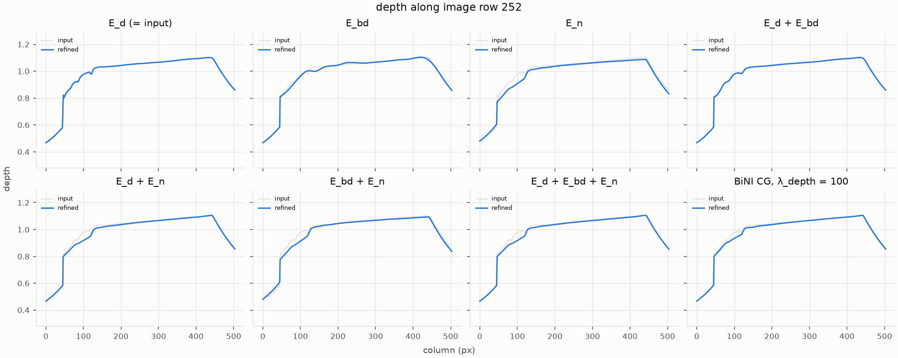

## ablation_topdown

Point clouds of each variant seen from above (x-z), on shared axes.

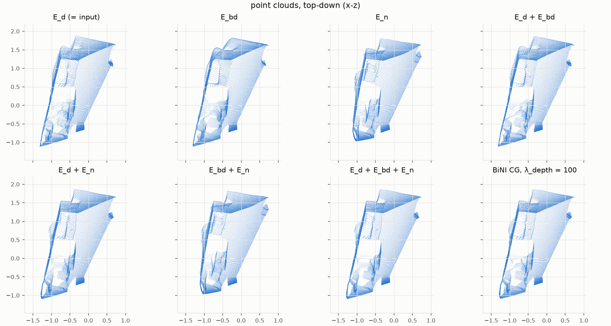

## convergence

E_d + E_n by L-BFGS under growing iteration budgets, against BiNI's CG solution of nearly the same energy (its data term is quadratic in log depth instead of Huber in inverse depth).

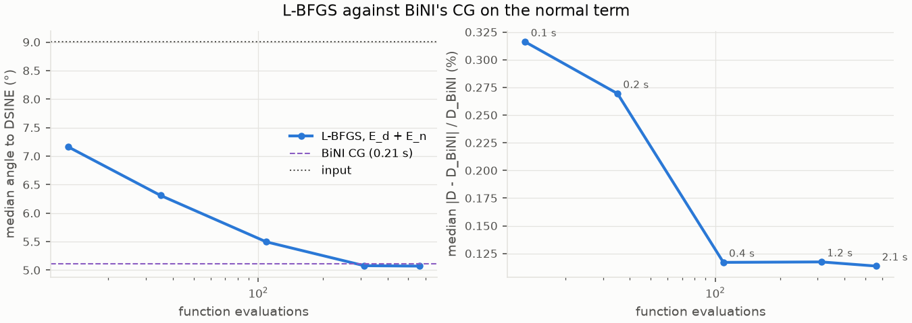

## energy_terms

Weighted contribution of each energy term during L-BFGS: smoothing cost is bought down by spending data cost.

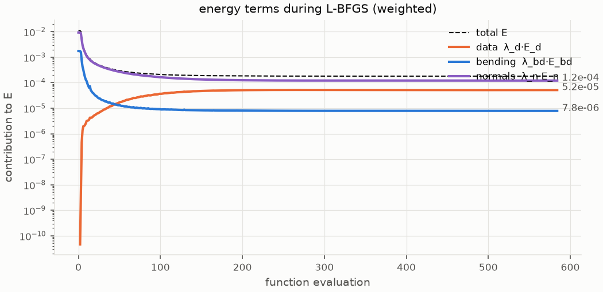

## cost_maps

Where each term pays, per pixel (log scale).

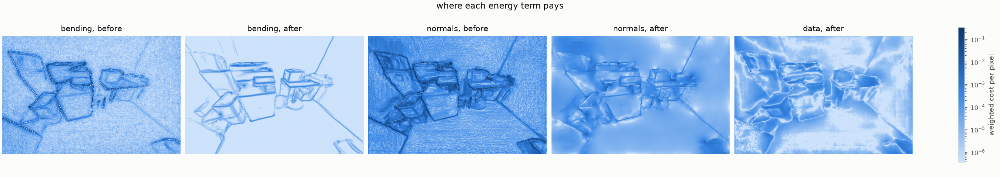

## forces

Tug of war at convergence: the force -∂E/∂δ each term exerts per pixel. Data pulls back toward the input, bending pushes toward planes, normals toward the predicted slopes; they cancel (net ≈ 0).

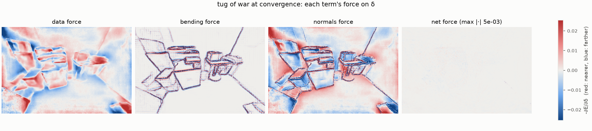
