# mono_office-20261027-101118

git `6652e10397d897d31ba45d821d3debfa0a9bf345`

| metric | value |
|---|---|
| refine_seconds | 5.131 |
| E_initial | 0.04748 |
| E_final | 0.0001743 |
| drift_pct_input | 0 |
| drift_pct_refined | 0.1701 |
| angle_to_normals_deg_input | 7.948 |
| angle_to_normals_deg_refined | 2.738 |

## ablation table

| variant | evaluations | seconds | drift_pct | angle_to_normals_deg |
|---|---|---|---|---|
| E_d (= input) | 2 | 0.05 | 0 | 7.948 |
| E_bd | 885 | 2.98 | 0.01759 | 6.469 |
| E_n | 4065 | 14.66 | 2.194 | 1.049 |
| E_d + E_bd | 691 | 2.57 | 0.003158 | 4.918 |
| E_d + E_n | 743 | 2.76 | 0.1686 | 2.73 |
| E_bd + E_n | 2798 | 10.07 | 2.023 | 1.122 |
| E_d + E_bd + E_n | 781 | 2.76 | 0.1701 | 2.738 |
| BiNI CG, λ_depth = 100 | 3 | 0.19 | 0.1582 | 2.951 |

## Findings (looked at every figure)

Office 7b6477cb95 view 6, Déjà View depth on pinhole rays, DSINE normals, cuts on the prior's occlusion contours
(edge_tol 0.02). No GT depth: the angle to DSINE says how much detail came from the normals, drift (median
|log D/D0| after a 16 px blur) how far the coarse shape moved. λ_n = 0.005 matches BiNI's λ = 100, chosen on
this view and kitchen view 13.

- One energy alone. E_bd alone stalls after 885 evaluations; with cuts its limit is a plane per region, and it
  only flattens regions a little (6.5° to DSINE). E_n alone copies DSINE (1.0°), but the whole room drifts by
  2.2%: nothing ties the per-region log-depth offsets to the prior.
- Pairs. E_d + E_bd smooths the noise and the patch texture (4.9°, 0.003% drift) but adds no detail.
  E_d + E_n: 2.73° and 0.17% drift, the same picture as BiNI. E_bd + E_n drifts like E_n alone.
- All three: 2.74°, the same as E_d + E_n. At λ_bd = 10, bending neither helps nor hurts here.
- L-BFGS on E_d + E_n against BiNI's CG: median depth difference 0.15%, angle 2.73° vs 2.95°, but
  2.8 s vs 0.19 s (convergence.png). L-BFGS passes BiNI's angle after ~300 evaluations; its difference to BiNI
  dips to 0.12% at 100 evaluations and settles at 0.15%, plausibly because the two energies differ slightly (Huber in inverse depth, and
  conf weights, vs quadratic in log depth), so L-BFGS passes near BiNI's minimum on the way to its own.
- Edges stay sharp in every E_n variant: the cuts carry over from BiNI unchanged.

## depth

Depth maps on one color scale: input, refined, and ground truth when known.

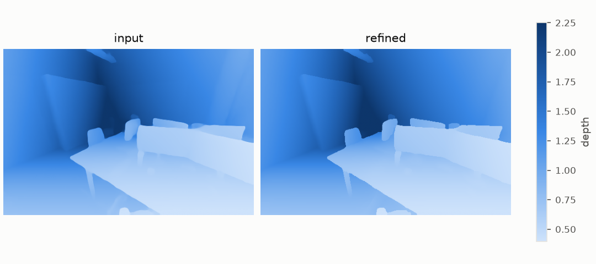

## delta

The dense residual δ that refinement adds to the normalized inverse depth.

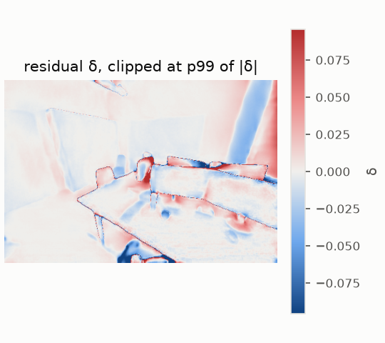

## profile

Depth along one image row through a crease.

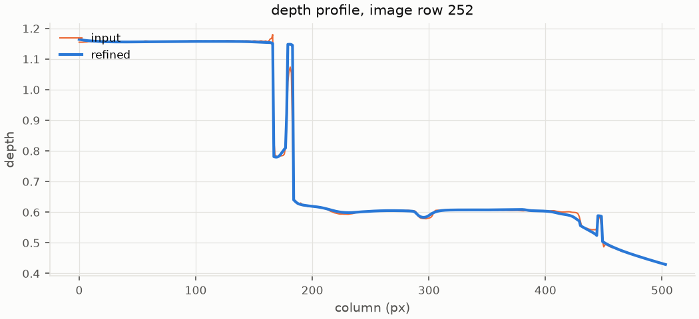

## points_topdown

Point clouds seen from above (x-z).

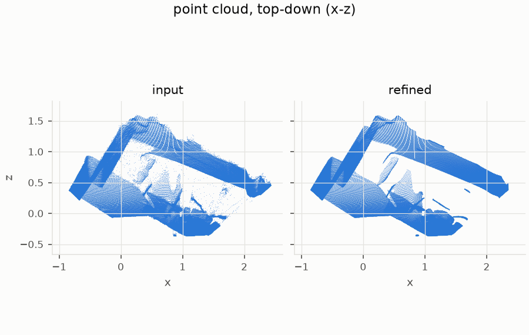

## ablation

Each energy alone, in pairs, and all together (columns), with BiNI's CG solution of E_d + E_n as reference. Top: normals of the result (central differences). Bottom: error against ground truth, or a zoom where the normals have the most detail. Iterations: up to 1000, 5000 where no data term anchors the result.

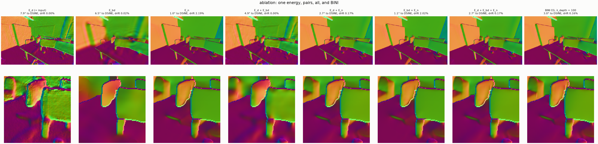

## ablation_profile

Depth along one image row for each variant, against the input and ground truth when known. For E_bd alone without contour cuts, dashed: the least-squares plane of the input's inverse depth, where it converges in the limit (L-BFGS steps never change the input's null-space part); with cuts, the limit is one plane per region.

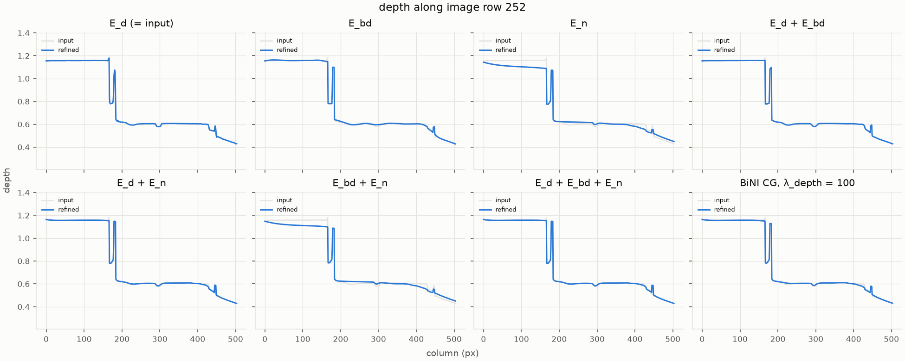

## ablation_topdown

Point clouds of each variant seen from above (x-z), on shared axes.

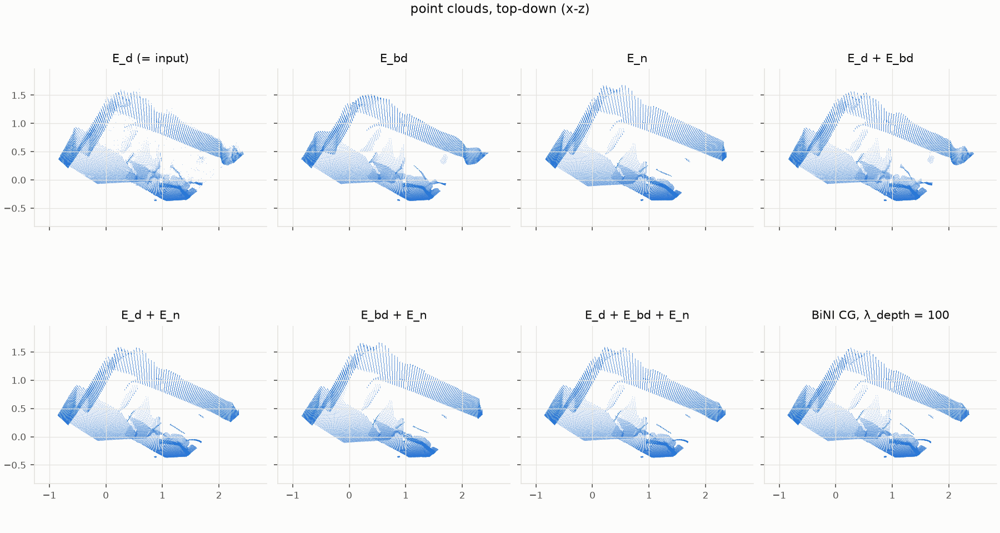

## convergence

E_d + E_n by L-BFGS under growing iteration budgets, against BiNI's CG solution of nearly the same energy (its data term is quadratic in log depth instead of Huber in inverse depth).

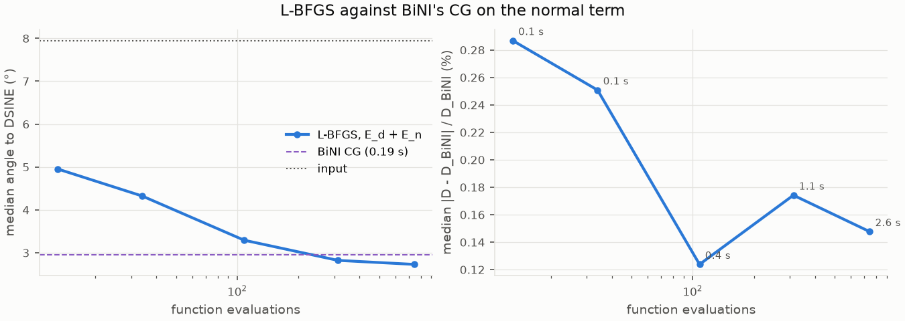

## energy_terms

Weighted contribution of each energy term during L-BFGS: smoothing cost is bought down by spending data cost.

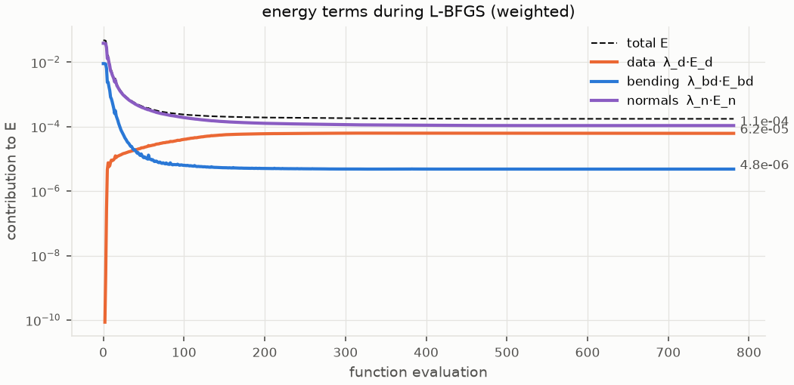

## cost_maps

Where each term pays, per pixel (log scale).

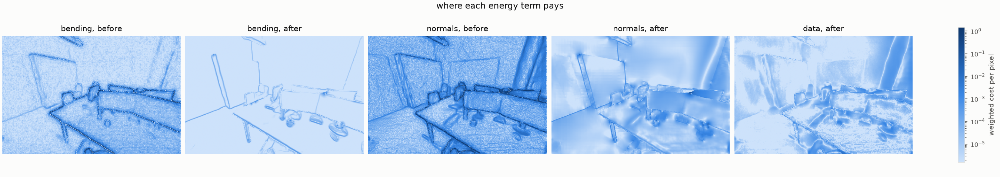

## forces

Tug of war at convergence: the force -∂E/∂δ each term exerts per pixel. Data pulls back toward the input, bending pushes toward planes, normals toward the predicted slopes; they cancel (net ≈ 0).

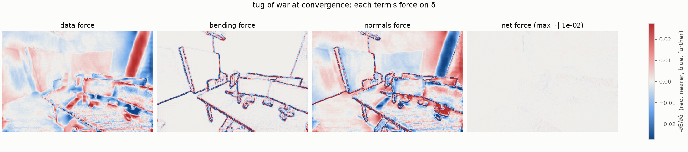
