# mono_scannetpp_kitchen-20261026-131532

git `5b358ab88ce8a423733f915cde48aa79856fd1d2`

| metric | value |
|---|---|
| views | 20 |
| refine_seconds | 14.21 |
| E_initial (view 0) | 0.009943 |
| E_final (view 0) | 5.426e-05 |
| scale_to_m | 1.048 |
| camera_ate_m | 0.007364 |
| mean_point_shift_mm | 6.897 |
| mv_median_input | 0.01046 |
| mv_median_refined | 0.01063 |
| mv_inlier_1pct_input | 0.4685 |
| mv_inlier_1pct_refined | 0.459 |

## Findings (looked at every figure)

- No GT depth on real scenes, so the metric is a proxy: cross-view disagreement of points under Déjà View's own
  (frozen) cameras. Occlusions put a floor under it; input and refined are scored identically.
- Cameras are good: after a Sim(3) fit to the GT centers, camera ATE is 7.4 mm.
- The input normals show a 14 px block grid, matching the ViT patch size; it's the most visible defect in the
  prediction. Refinement with second-difference smoothing does not remove it at λ_bd = 10.
- Segment-free smoothing never helps here: the median cross-view disagreement rises monotonically with λ_bd
  (1.05% → 1.06% at λ_bd = 10). Large weights round object edges and ring next to them (λ_bd ≥ 100).
- Which means smoothing has to stop at segment boundaries (E_bd within segments), and a term for the
  patch seams is needed before the dense-δ prior can help on real data.

## inputs

What the frozen Déjà View forward pass gives us, for a few of the views: image, depth, confidence.

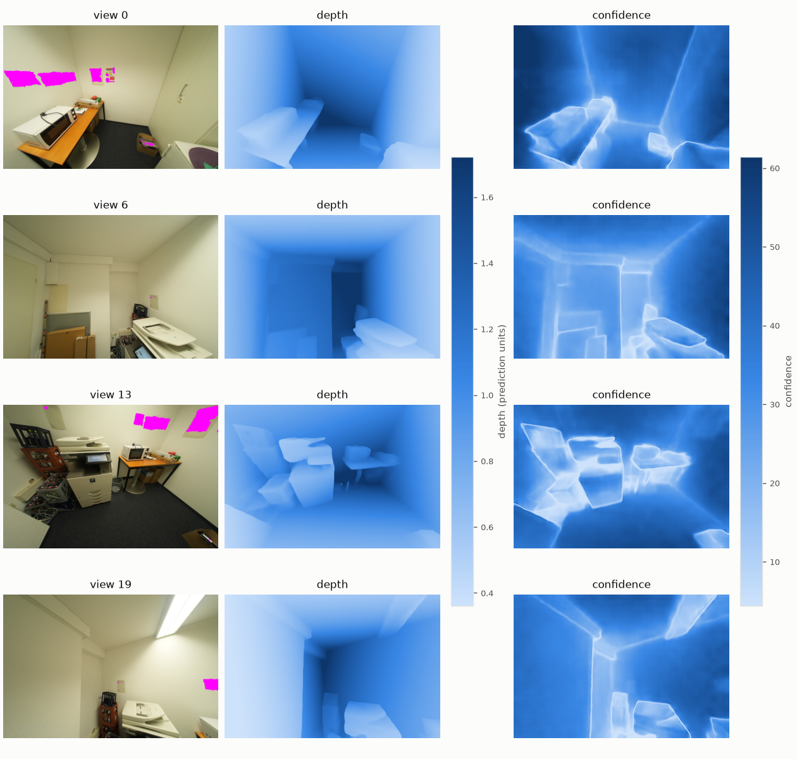

## depth

Depth maps of the first view on one color scale: input, refined, and ground truth when known.

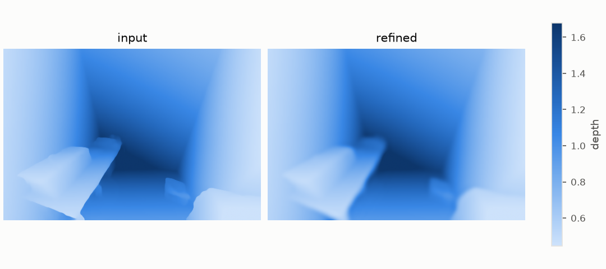

## delta

The dense residual δ that refinement adds to the normalized inverse depth.

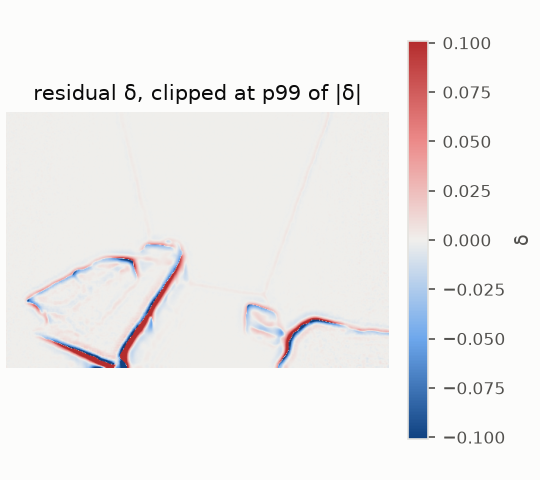

## profile

Depth along one image row through a crease.

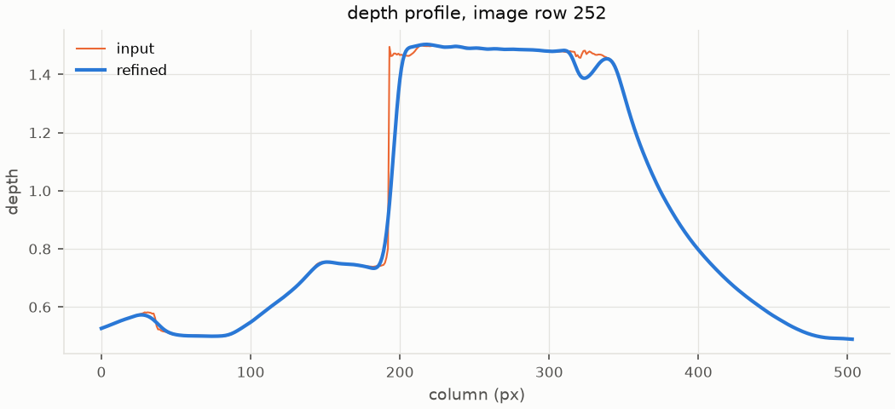

## points_topdown

Point clouds of the first view seen from above (x-z).

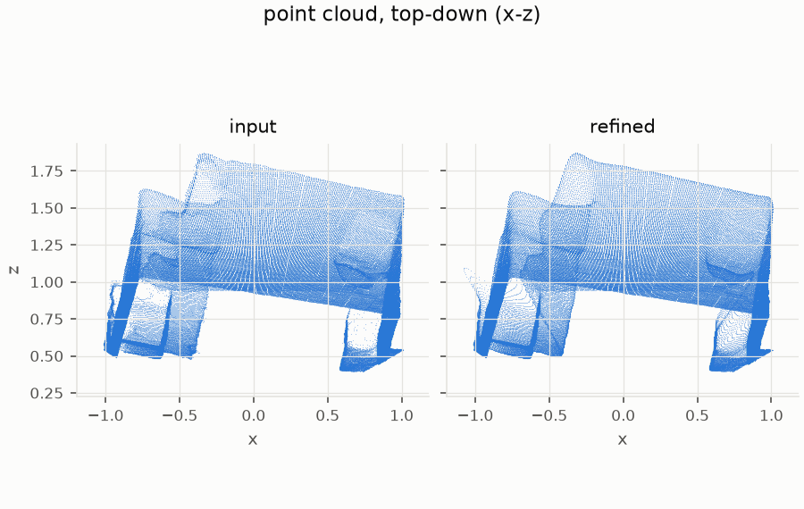

## normals

Surface normals from the point maps (world frame as RGB): noise and edges show here first.

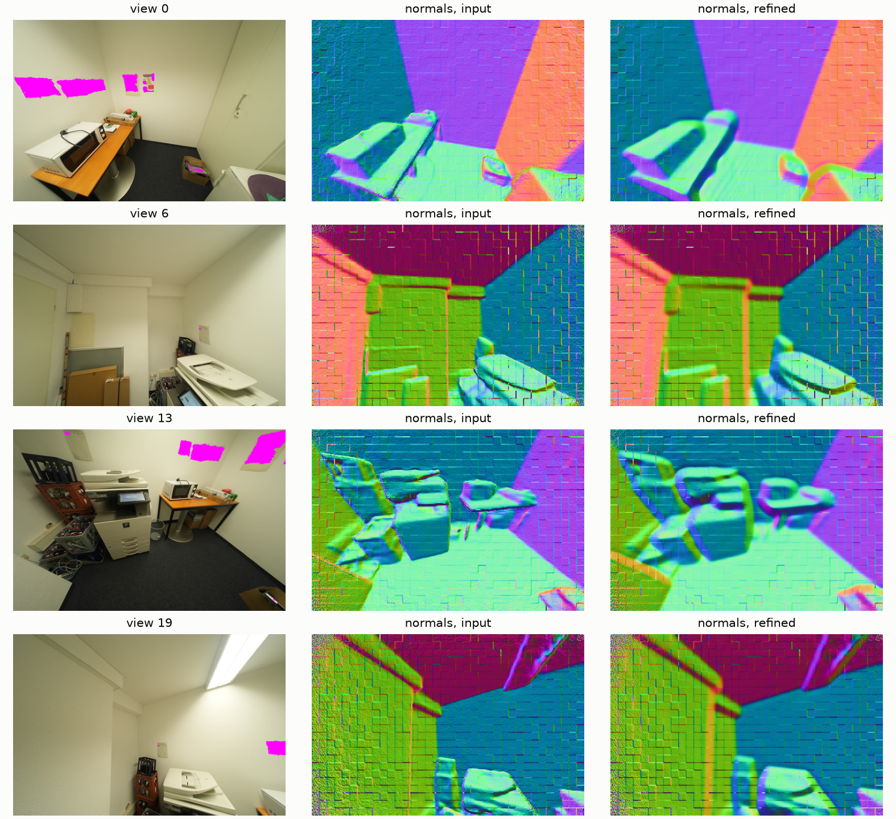

## multiview_maps

Cross-view disagreement per pixel: median over the other views of |x - x_j| / D_j under the frozen predicted cameras. A GT-free proxy; occlusions put a floor under it.

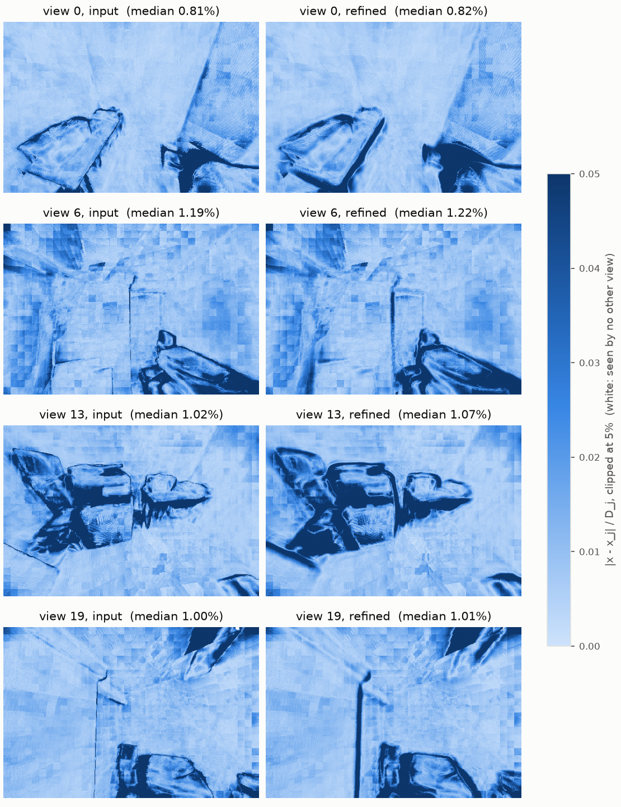

## multiview_per_view

Median cross-view disagreement per view, before and after.

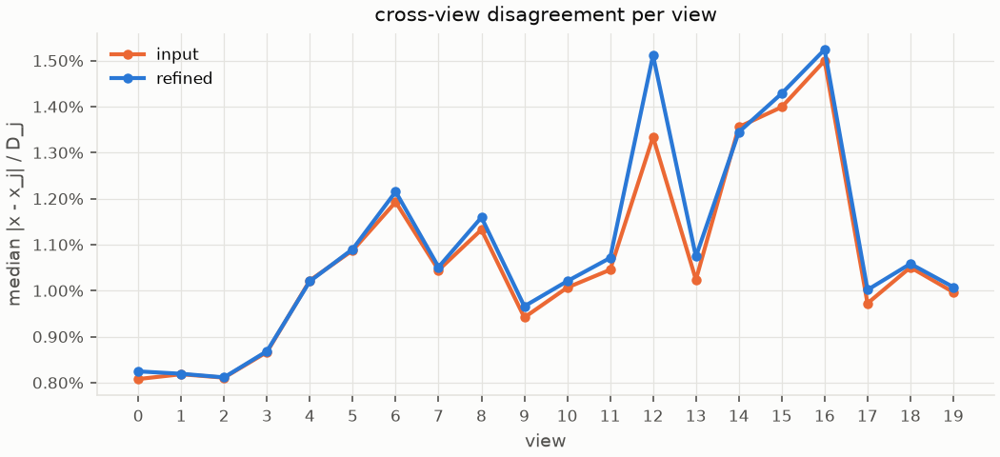

## sweep_real

Smoothness weight λ_bd on real data: normals of the first view and cross-view disagreement over all views.

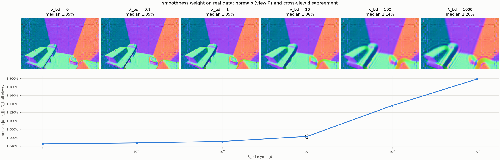

## energy_terms

Weighted contribution of each energy term during L-BFGS: smoothness cost is bought down by spending data cost.

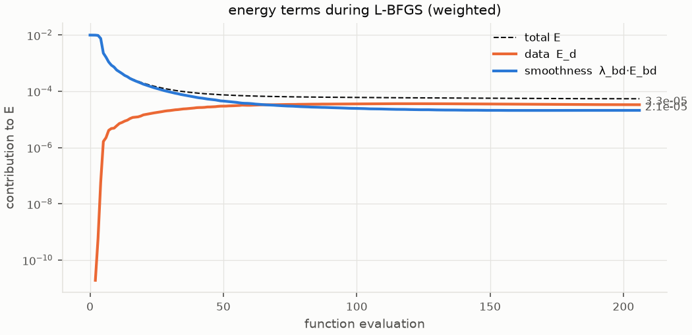

## cost_maps

Where each term pays, per pixel (log scale), for the first view.

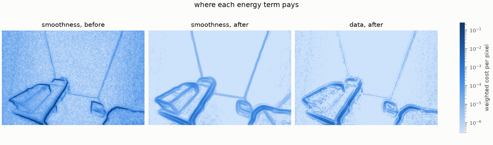

## forces

Tug of war at convergence: the force -∂E/∂δ each term exerts per pixel. Data pulls back toward the input, smoothness pushes toward planes, and at convergence they cancel (net ≈ 0).

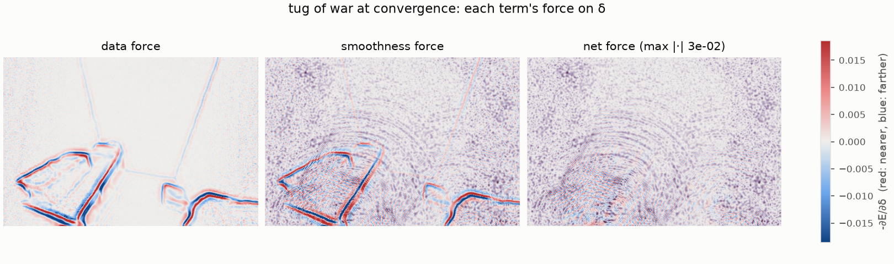
