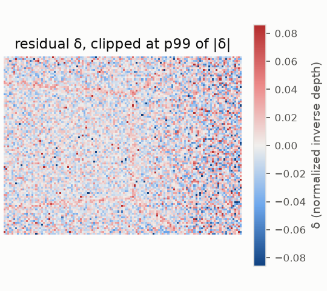
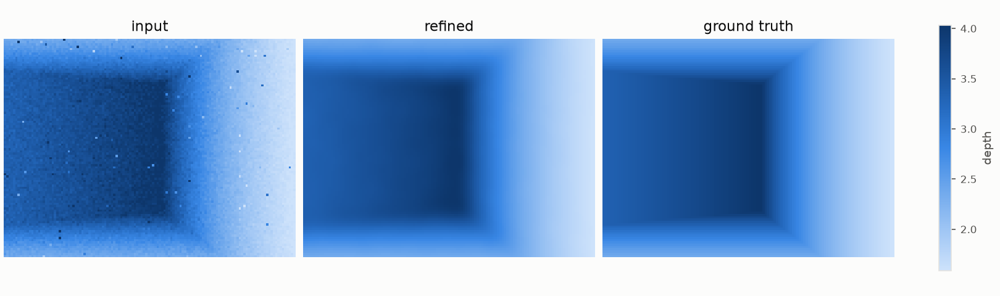
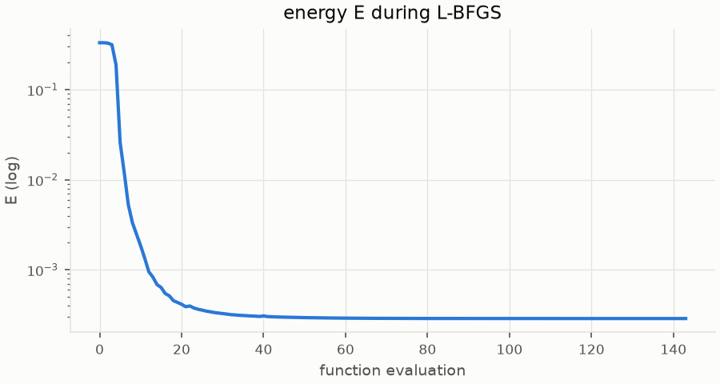
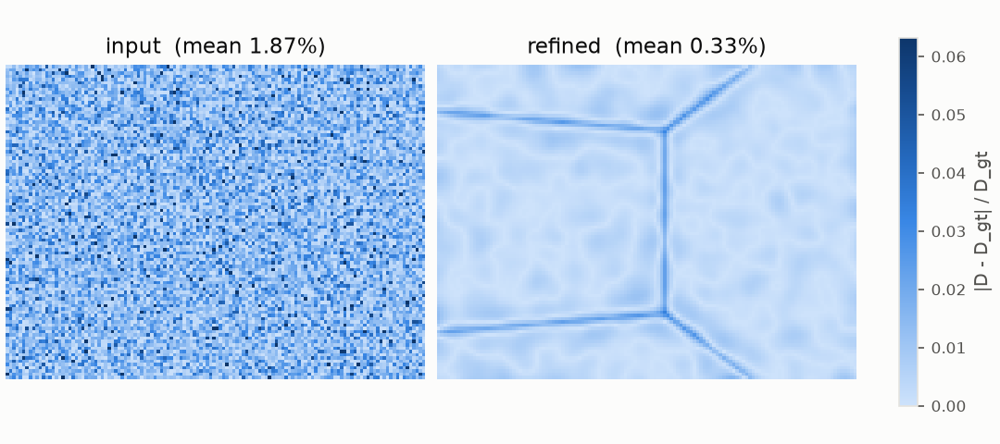
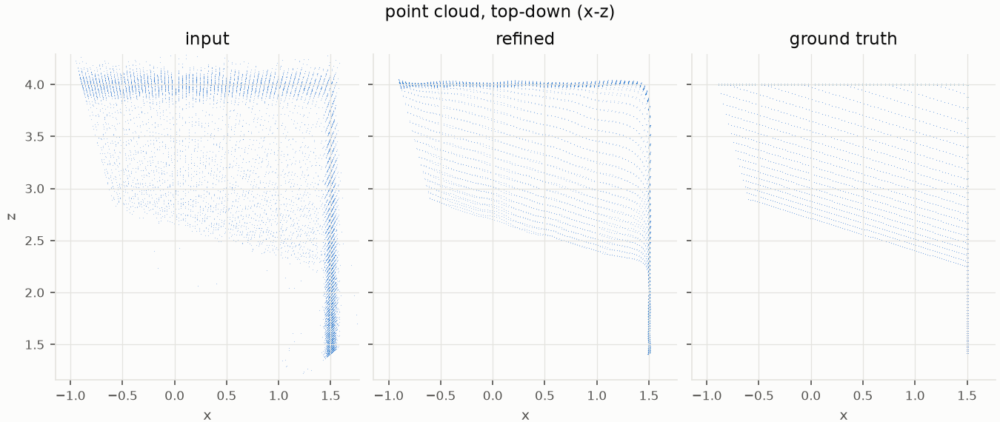
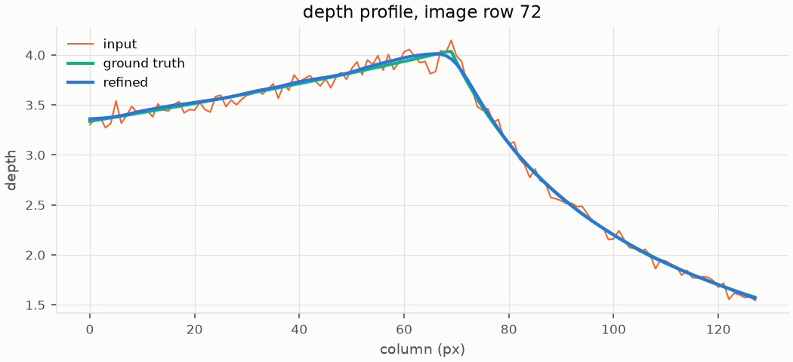

# mono_synthetic-20261026-110333

git `79319d745f7709b674c90008d55b48416de7204f`

| metric | value |
|---|---|
| refine_seconds | 2.623 |
| E_initial | 0.3329 |
| E_final | 0.0002875 |
| abs_rel_input | 0.01874 |
| abs_rel_refined | 0.003272 |
| point_rmse_input | 0.1441 |
| point_rmse_refined | 0.01783 |

