# mono_synthetic-20261026-113155

git `d6196ef5fcbde49bf8d2b5fb40139964663c7a8b`

| metric | value |
|---|---|
| refine_seconds | 2.617 |
| E_initial | 0.3269 |
| E_final | 0.000287 |
| abs_rel_input | 0.01874 |
| abs_rel_refined | 0.003266 |
| point_rmse_input | 0.1441 |
| point_rmse_refined | 0.01775 |

## depth

Depth maps on one color scale: noisy input with outliers, refined, and ground truth.

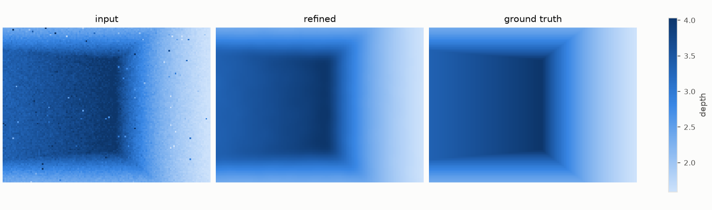

## error

Relative depth error per pixel before and after refinement. What remains sits on the creases.

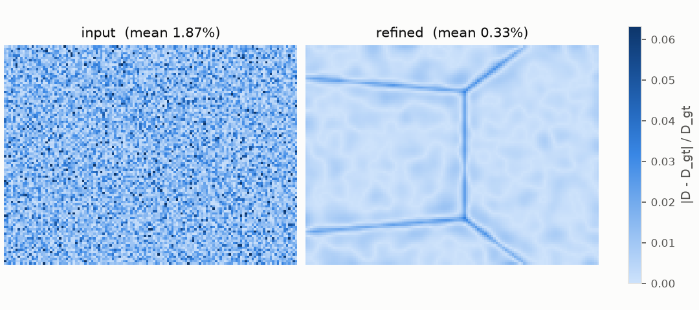

## delta

The dense residual δ that refinement adds to the normalized inverse depth.

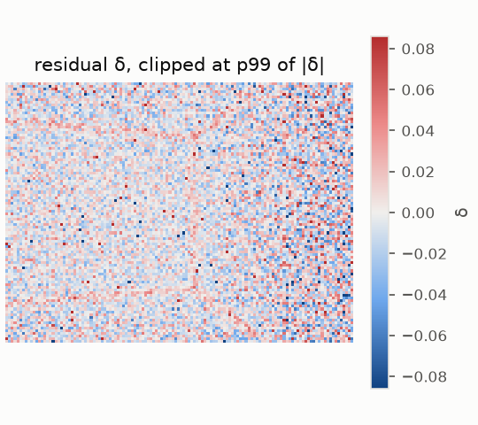

## profile

Depth along one image row through a crease.

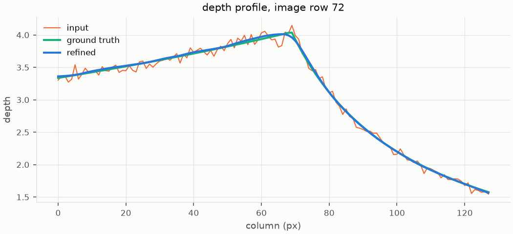

## points_topdown

Point clouds seen from above (x-z).

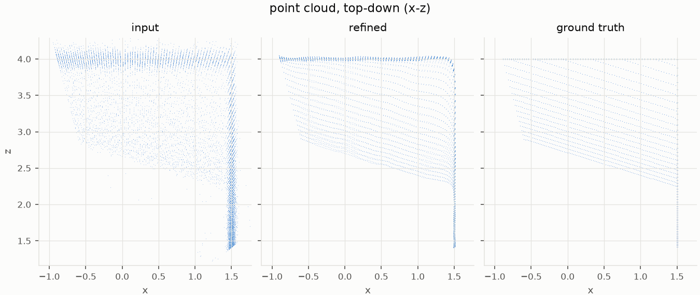

## energy_terms

Weighted contribution of each energy term during L-BFGS: smoothness cost is bought down by spending data cost.

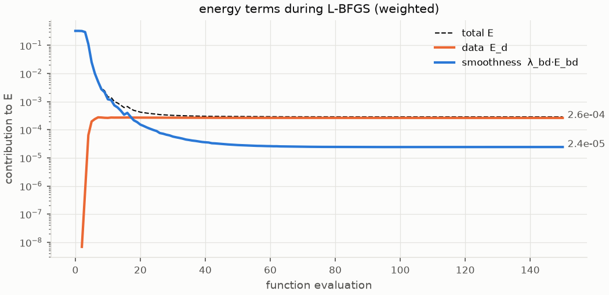

## cost_maps

Where each term pays, per pixel (log scale). Smoothness cost collapses everywhere except on creases; data cost is spread evenly where δ removed noise, and outliers stay cheap because their low confidence downweights them.

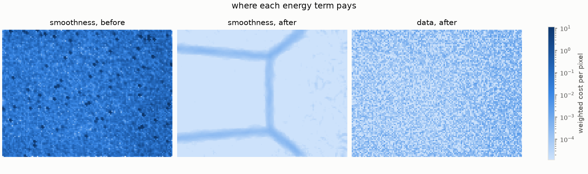

## forces

Tug of war at convergence: the force -∂E/∂δ each term exerts per pixel. Data pulls back toward the input, smoothness pushes toward planes, and they cancel (net ≈ 0).

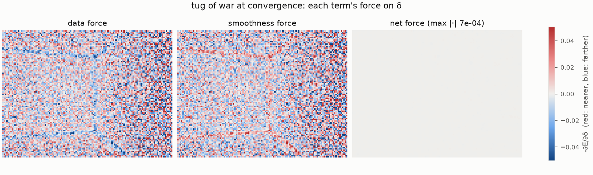

## sweep_lambda_bd

Effect of the smoothness weight λ_bd: too low keeps the noise, too high rounds off the creases.

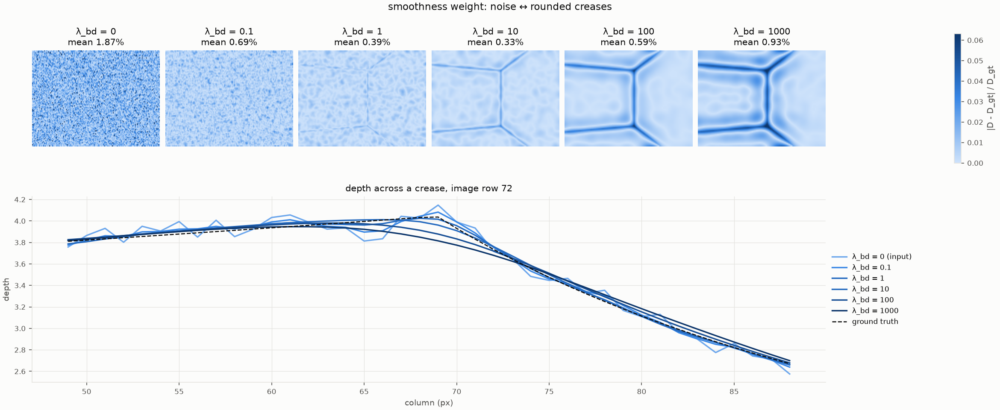

## data_term_ablation

Effect of the data term's form on the 1% outliers: an unweighted quadratic lets them drag their neighbors into blobs. Confidence weighting alone removes them here; Huber only matters without it.

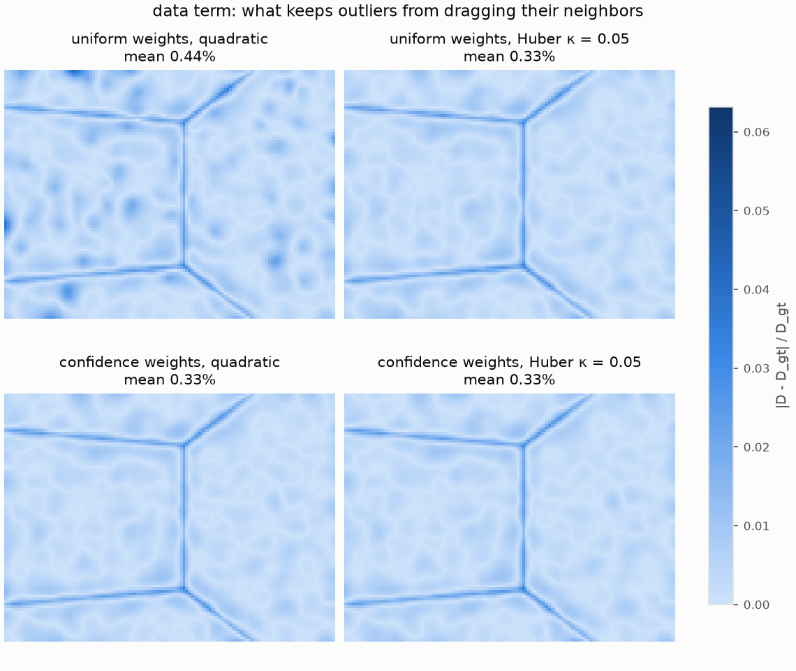

## sensitivity

Error versus each weight, all else fixed at the run's config (circle). Dashed: input error.

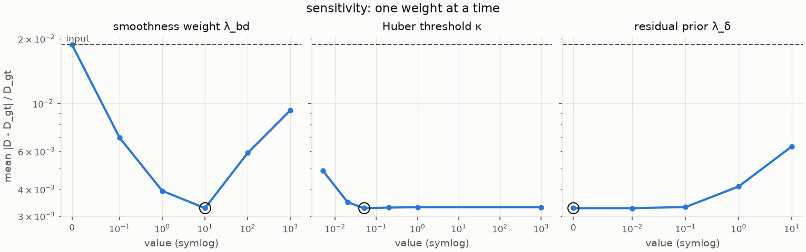
