# mono_synthetic-20261027-101111

git `6652e10397d897d31ba45d821d3debfa0a9bf345`

| metric | value |
|---|---|
| refine_seconds | 2.966 |
| E_initial | 0.3833 |
| E_final | 0.0004207 |
| drift_pct_input | 0 |
| drift_pct_refined | 0.06344 |
| angle_to_normals_deg_input | 45.94 |
| angle_to_normals_deg_refined | 1.984 |
| abs_rel_input | 0.01874 |
| abs_rel_refined | 0.002 |
| point_rmse_input | 0.1441 |
| point_rmse_refined | 0.01026 |
| angle_to_gt_normals_deg_input | 45.88 |
| angle_to_gt_normals_deg_refined | 0.9405 |

## ablation table

| variant | evaluations | seconds | drift_pct | angle_to_normals_deg | abs_rel | point_rmse | angle_to_gt_normals_deg |
|---|---|---|---|---|---|---|---|
| E_d (= input) | 2 | 0.01 | 0 | 45.94 | 0.01874 | 0.1441 | 45.88 |
| E_bd | 1881 | 6.17 | 0.7351 | 26.66 | 0.04549 | 0.2181 | 26.8 |
| E_n | 526 | 1.82 | 0.2236 | 1.858 | 0.005158 | 0.02114 | 0.7788 |
| E_d + E_bd | 150 | 0.51 | 0.05427 | 4.257 | 0.003266 | 0.01775 | 3.494 |
| E_d + E_n | 191 | 0.65 | 0.06573 | 1.962 | 0.001863 | 0.00964 | 0.977 |
| E_bd + E_n | 402 | 1.35 | 0.194 | 1.874 | 0.00546 | 0.02304 | 0.7405 |
| E_d + E_bd + E_n | 189 | 0.64 | 0.06344 | 1.984 | 0.002 | 0.01026 | 0.9405 |
| BiNI CG, λ_depth = 50 | 3 | 0.07 | 0.02558 | 2.014 | 0.00177 | 0.01051 | 1.032 |

## Findings (looked at every figure)

Synthetic room (96×128, pinhole), inverse-depth noise 2%, 1% low-confidence outliers; normals are the planes'
own, tilted by 0.03 rad per axis (median 2°). Error against GT; no contour cuts (the room has no occlusions,
and its noise exceeds any useful edge_tol). Weights chosen on this scene.

- One energy alone. E_d alone returns the input (δ = 0 is its minimum). E_bd alone has every plane as a
  minimizer; in the limit, L-BFGS from d0 lands on the least-squares plane of d0 in inverse depth, since its steps
  never change d0's null-space part (tested on 8×9). Here it stalls long before that, after 1881 of 5000
  evaluations on the tolerance: a biharmonic energy's condition number grows like N⁴, so after 6 s the depth is a
  smooth bulge, neither the room nor the plane (ablation_profile.png). E_n alone integrates the normals:
  the shape is right (0.8° to GT normals), but with nothing anchoring it the normals' noise integrates into
  a 0.5% error, 2.6× that of E_d + E_n.
- Pairs. E_d + E_bd: 0.33%, with creases rounded off and residual noise as blobs. E_d + E_n: 0.19% abs rel,
  10× below the input, sharp creases. E_bd + E_n: like E_n alone (0.55%): bending doesn't anchor anything.
- All three: 0.20%, slightly worse than E_d + E_n. The forces show why: at every crease the bending force pushes
  against the normal force (forces.png), and the λ_bd sweep with λ_n fixed is best at λ_bd = 0
  (sensitivity.png). Once there are normals, bending only rounds the creases they hold.
- λ_n has a minimum near 0.003-0.01: below, the depth noise remains; above, the normals' noise integrates
  into a random walk.
- BiNI's CG (λ_depth = 50 = 1 / (2 λ_n)) on the same normals: 0.18%, 0.07 s, against 0.65 s for L-BFGS on
  E_d + E_n. The same minimizer up to the data term (Huber in inverse depth vs quadratic in log depth).
- Left: thin dashed error streaks along the ceiling and floor creases in every E_n variant and in BiNI. Likely
  cause, not checked: edges that straddle a crease ask one side's normal to hold a point on the other plane.

## depth

Depth maps on one color scale: input, refined, and ground truth when known.

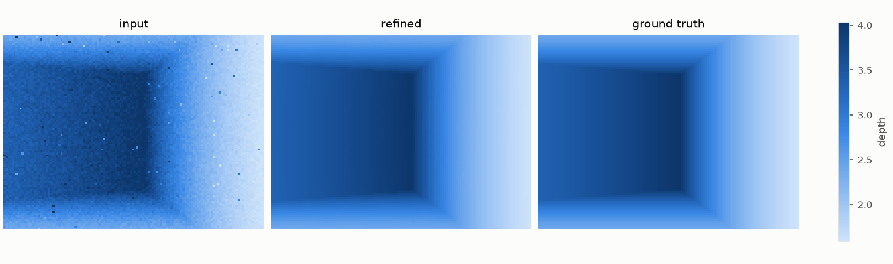

## error

Relative depth error per pixel before and after refinement. What remains sits on the creases.

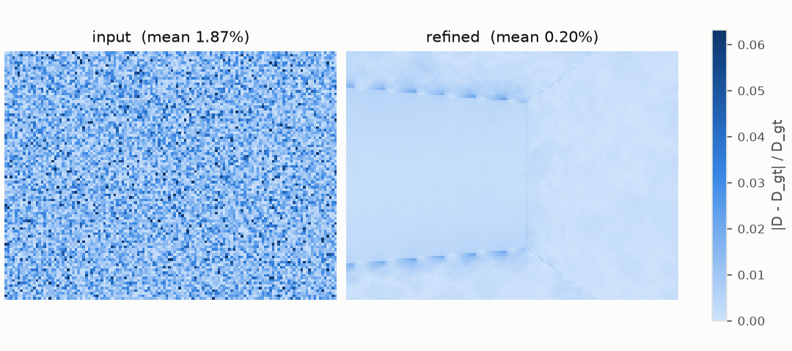

## delta

The dense residual δ that refinement adds to the normalized inverse depth.

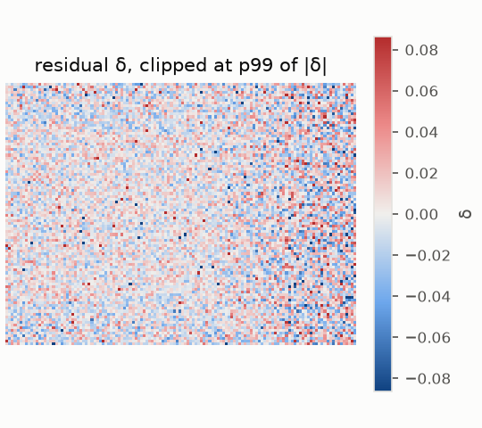

## profile

Depth along one image row through a crease.

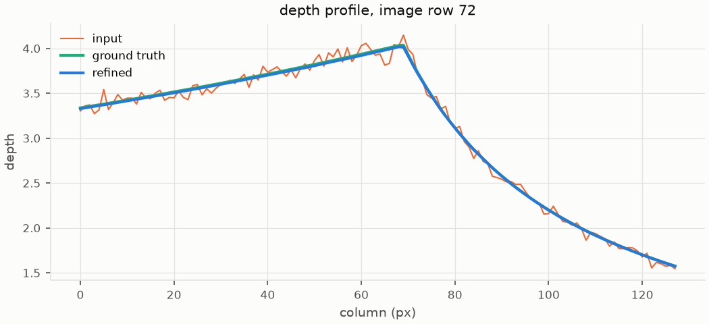

## points_topdown

Point clouds seen from above (x-z).

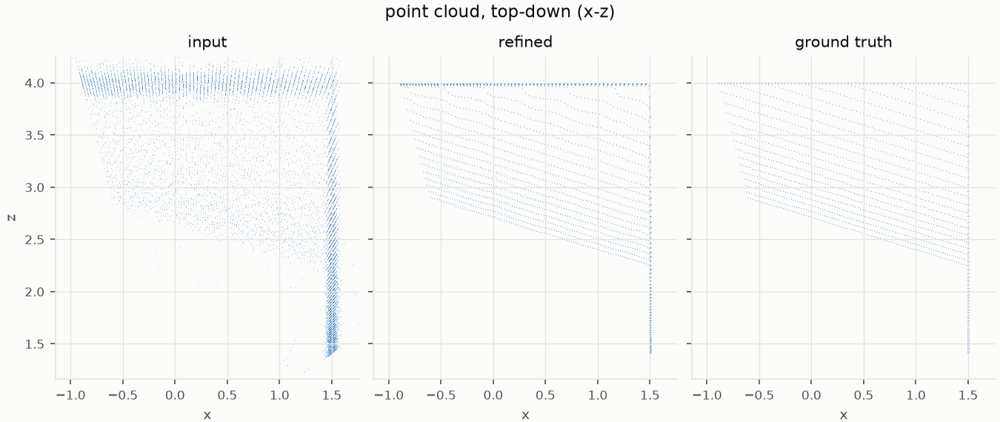

## ablation

Each energy alone, in pairs, and all together (columns), with BiNI's CG solution of E_d + E_n as reference. Top: normals of the result (central differences). Bottom: error against ground truth, or a zoom where the normals have the most detail. Iterations: up to 1000, 5000 where no data term anchors the result.

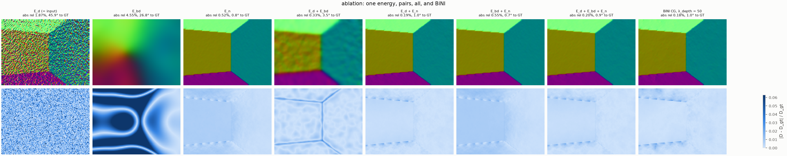

## ablation_profile

Depth along one image row for each variant, against the input and ground truth when known. For E_bd alone without contour cuts, dashed: the least-squares plane of the input's inverse depth, where it converges in the limit (L-BFGS steps never change the input's null-space part); with cuts, the limit is one plane per region.

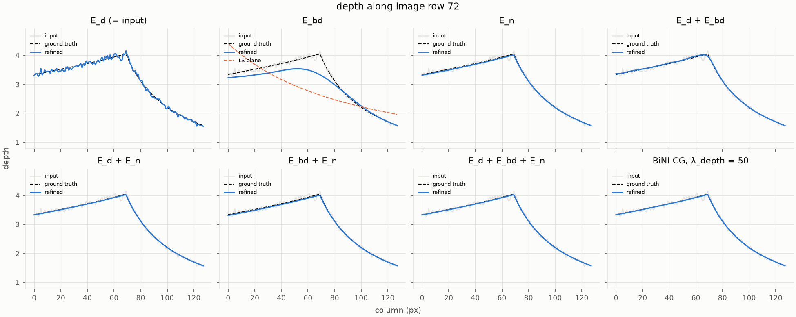

## ablation_topdown

Point clouds of each variant seen from above (x-z), on shared axes.

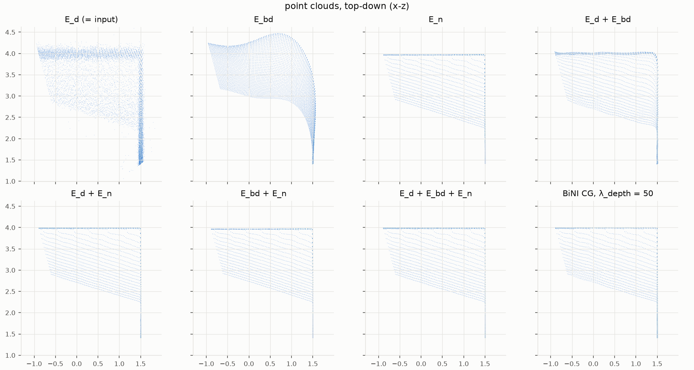

## energy_terms

Weighted contribution of each energy term during L-BFGS: smoothing cost is bought down by spending data cost.

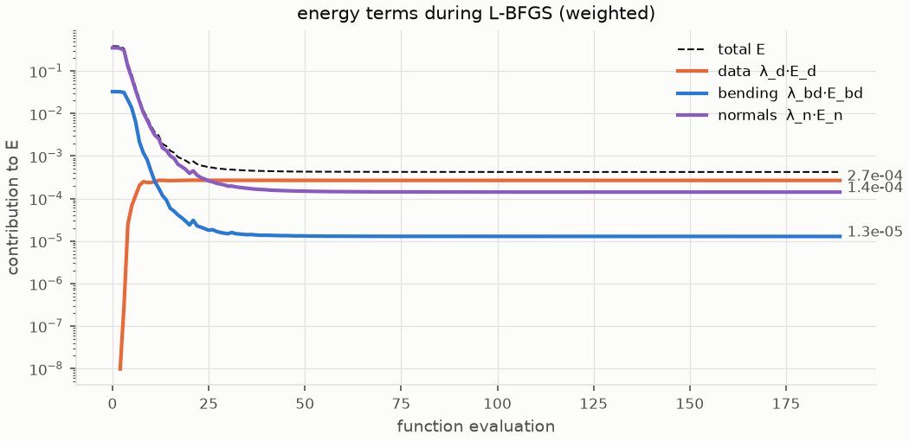

## cost_maps

Where each term pays, per pixel (log scale).

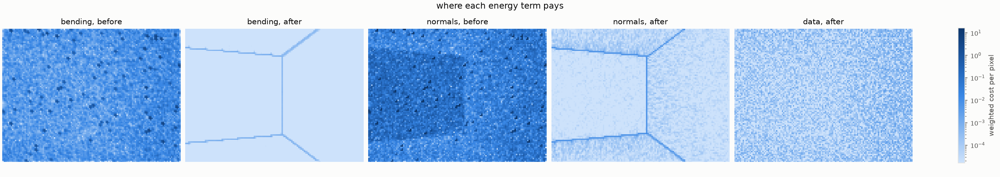

## forces

Tug of war at convergence: the force -∂E/∂δ each term exerts per pixel. Data pulls back toward the input, bending pushes toward planes, normals toward the predicted slopes; they cancel (net ≈ 0).

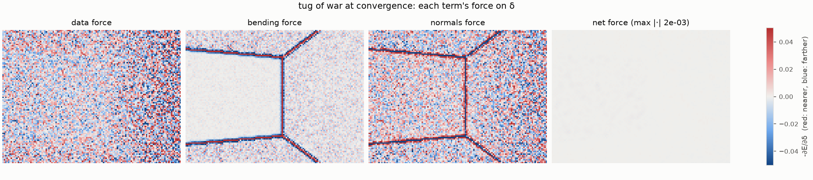

## sweep_lambda_bd

Effect of the bending weight λ_bd: too low keeps the noise, too high rounds off the creases.

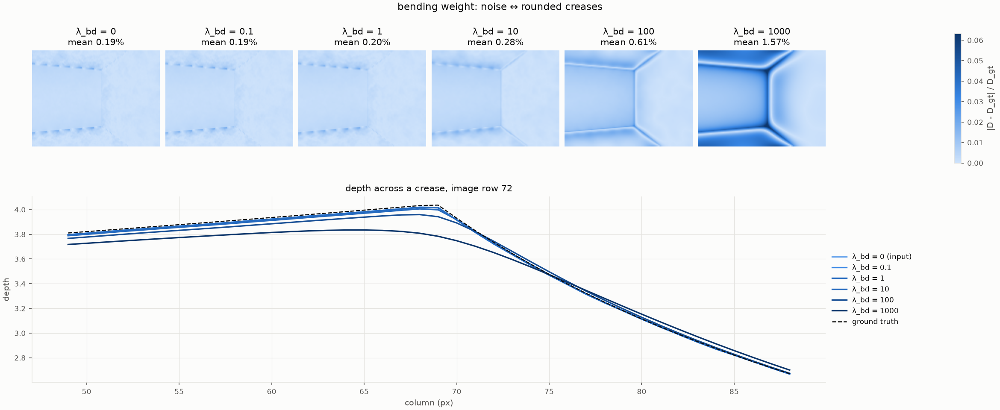

## data_term_ablation

Effect of the data term's form on the 1% outliers: an unweighted quadratic lets them drag their neighbors into blobs. Confidence weighting alone removes them here; Huber only matters without it.

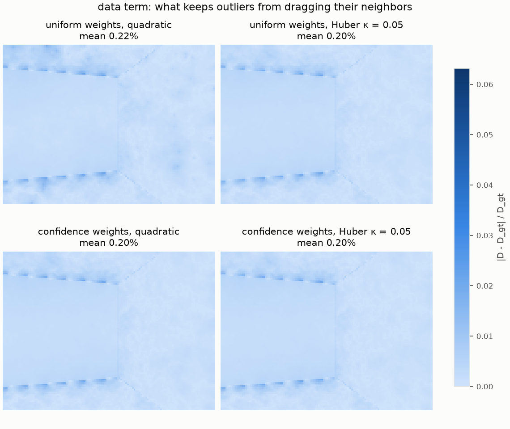

## sensitivity

Error versus each weight, all else fixed at the run's config (circle). Dashed: input error.

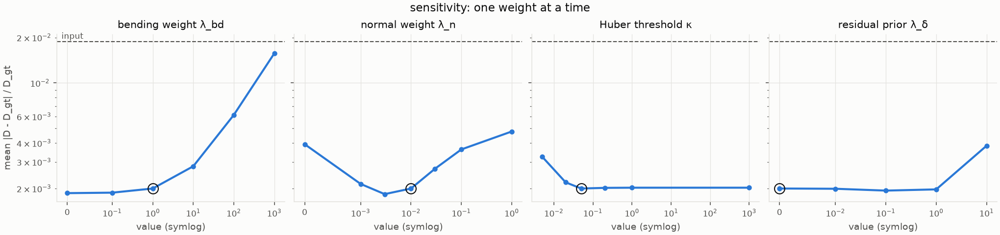
