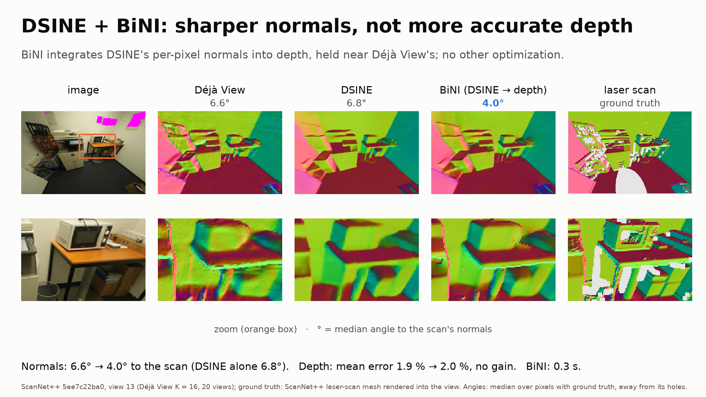
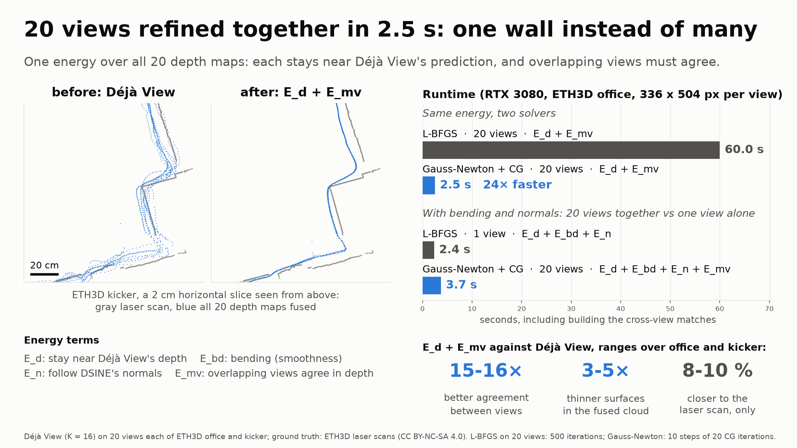

# talk-20261029-135006

git `08c703bd4f301034cf0b56c82b053b9b136d6696-dirty`; from `bini_kitchen-20261027-065550`, `eval_eth3d-20261027-133306`, `eval_multiview-20261027-162823`.

Images and ground truth: ScanNet++ (Yeshwanth et al., ICCV 2023), used under its terms of use, and ETH3D (Schöps et al., CVPR 2017), CC BY-NC-SA 4.0; the figures that show ETH3D are adapted from it under the same licence. The data itself is not in this repository.

## DSINE + BiNI

| | median angle to the scan's normals (°) | mean depth error (%) |
|---|---|---|
| Déjà View | 6.55 | 1.91 |
| DSINE | 6.77 | |
| BiNI | 3.98 | 1.96 |

Our energy has a normal term, so first: how much can a normal estimator add on its own? DSINE predicts
sharp per-pixel normals; BiNI integrates them into a depth map held near Déjà View's, and nothing else runs. On this
ScanNet++ kitchen the result is visibly crisper than Déjà View: flat faces, clean edges, no texture noise. Against
the laser scan its normals are clearly closer, even closer than DSINE's own. But the depth is no more accurate: the
normals fix orientation, not offsets. Normals buy visual fidelity; accuracy has to come from elsewhere.

## joint refinement

The views disagree by about half a percent, so the fused cloud has every wall several times. We
minimize one energy over all 20 views, where neighboring views have to agree in depth. With L-BFGS that took a
minute. The energy is a sum of squares, so Gauss-Newton with conjugate gradients fits it, as it does BiNI: now 2.5
seconds for all 20 views, faster than L-BFGS refines a single view. Six copies of the wall become one line and the
surface gets 3 to 5 times thinner. The distance to the scan improves less, 8 to 10 percent: agreement removes what
the views disagree on, not the error they share.

Correction (after `benchmark_solvers-20261029-143531`): the slide's "24× faster" compares Gauss-Newton with L-BFGS
stopped after 500 iterations, not at convergence. Measured to within 5 % of the lowest energy either solver
reaches, Gauss-Newton is 6-80× faster on ETH3D office and kicker and 18× on the ScanNet++ kitchen
(`benchmark_solvers_scannetpp-20261029-163353`).
